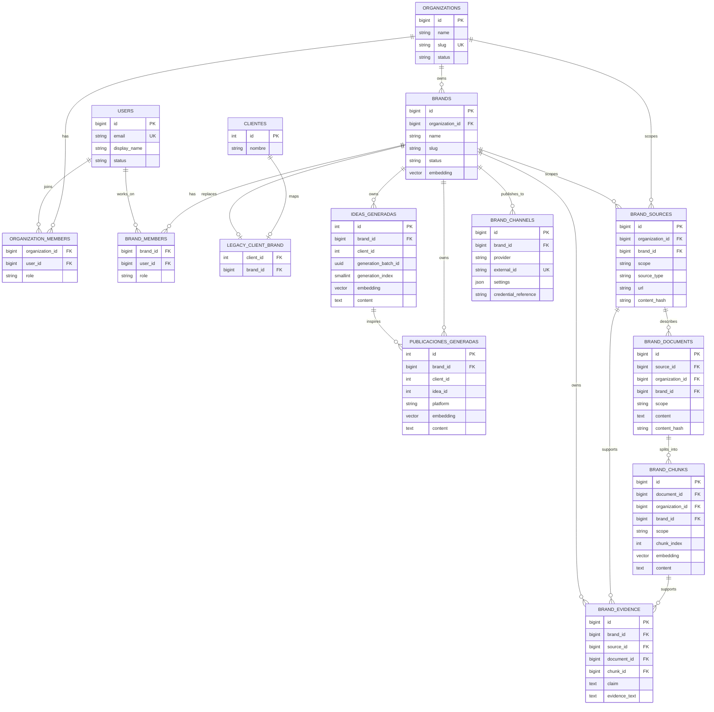
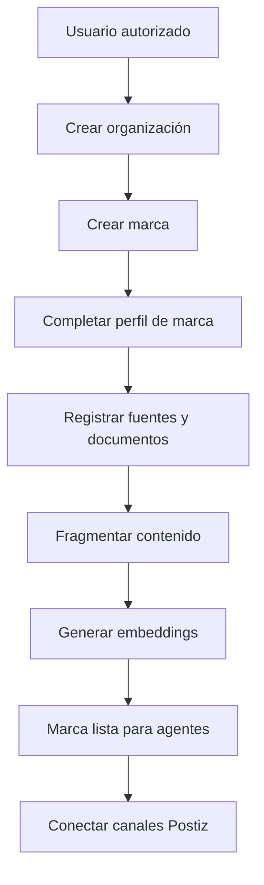
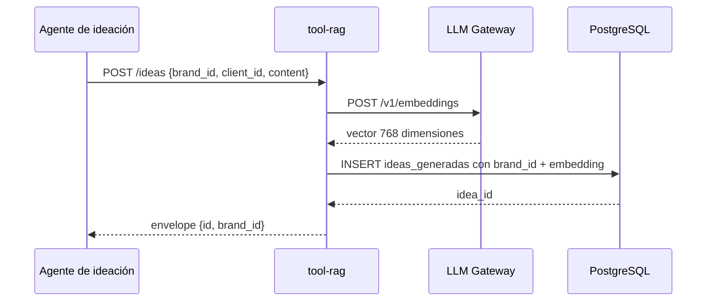
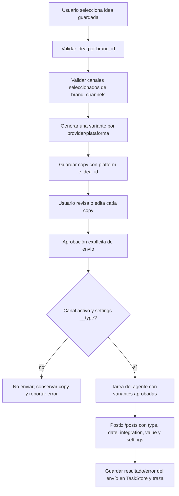

# Modelo de datos y comportamiento de la base

## 1. Capas de almacenamiento

El sistema usa tres capas distintas:

| Capa | Tecnología | Qué guarda |
|---|---|---|
| Datos de negocio | PostgreSQL + pgvector | organizaciones, marcas, documentos, memoria, publicaciones y fuentes |
| Estado de ejecución | Redis Stack | checkpoints LangGraph, tareas, caché LLM y pub/sub |
| Mensajería | RabbitMQ | eventos y RPC entre servicios |

Redis y RabbitMQ no sustituyen a PostgreSQL: Redis conserva estado operativo
reconstruible y RabbitMQ transporta mensajes. La memoria durable de la marca
vive en PostgreSQL.

## 2. Diagrama entidad-relación



## 3. Ownership y scopes

Cada registro de conocimiento tiene un alcance explícito:

```text
global         -> disponible para todas las organizaciones
organization   -> disponible para las marcas de una organización
brand          -> privado de una marca
```

La jerarquía de acceso es:

```text
usuario -> organization_members -> organización -> brand_members -> marca
```

Una búsqueda privada debe limitarse por `brand_id` antes de calcular o aplicar
la similitud vectorial. Nunca se debe recuperar todo pgvector y filtrar después
en memoria.

## 4. Flujo de onboarding



La marca no debería procesar briefs reales hasta tener estado `ready` y al
menos un perfil válido.

## 5. Flujo de persistencia de una idea



La idea queda vinculada al `brand_id` y no debe poder guardarse sin él.
Las ideas de un lote llevan `generation_batch_id` y posición estable. El índice
único parcial `(brand_id, generation_batch_id, generation_index)` hace idempotente
la reentrega de cada tarea sin mezclar marcas; las ideas legacy pueden mantener
ambos campos batch en `NULL`.

La biblioteca consulta y abre dossiers con `brand_id` en la propia condición SQL.
El estado operativo del lote (tareas pendientes, terminadas y fallidas) vive en
Redis; el dossier completo sigue siendo durable en `ideas_generadas.content`.

## 6. Flujo de recuperación RAG


Contrato de búsqueda:

```json
{
  "brand_id": 1,
  "query": "campaña de verano sostenible",
  "limit": 3,
  "min_similarity": 0.3
}
```

La garantía principal es:

```text
todos los resultados privados deben pertenecer al brand_id solicitado
```

## 7. Flujo de publicación



La generación de ideas no invoca este flujo. `POST /ideas/{id}/publish` solo
prepara y persiste las variantes; `POST /publications/{task_id}/deliver` ocurre
después de revisión/aprobación y despacha al publicador con los copies editados.

`brand_channels.external_id` identifica el canal externo de Postiz. La tool no
debe aceptar un `integration_id` que no pertenezca a la marca de la tarea. La
columna nullable `publicaciones_generadas.platform` identifica la plataforma de
cada variante; los registros históricos pueden mantenerla en `NULL`. La
migración `003_publication_platform.sql` añade la columna y su índice por marca,
plataforma y fecha.

## 8. Procedencia documental

Una fuente puede originar documentos, y cada documento se divide en chunks:

```text
brand_sources
  -> brand_documents
      -> brand_chunks
          -> brand_evidence
```

Cada chunk conserva:

```text
brand_id
scope
source_id
document_id
content_hash
embedding
created_at
```

Esto permite responder:

```text
qué se recuperó
qué fuente lo originó
cuándo se obtuvo
para qué marca aplica
qué evidencia respalda el claim
```

## 9. Compatibilidad legacy

Los clientes anteriores permanecen en `clientes` temporalmente. La tabla
`legacy_client_brand` traduce:

```text
clientes.id -> brands.id
```

Los registros históricos con `client_id` desconocido se conservan bajo la marca
`Legacy unassigned` con estado `quarantined`. No deben entrar en el contexto de
ninguna marca `ready`.

## 10. Consultas de control

```sql
-- Contenido privado sin marca: debe ser cero.
SELECT COUNT(*)
FROM ideas_generadas
WHERE brand_id IS NULL;

SELECT COUNT(*)
FROM publicaciones_generadas
WHERE brand_id IS NULL;

-- Verificación de una búsqueda por marca.
SELECT id, brand_id, client_id
FROM ideas_generadas
WHERE brand_id = 1
ORDER BY created_at DESC;

-- Canales vinculados a una marca.
SELECT provider, external_id, status
FROM brand_channels
WHERE brand_id = 1;
```

## 11. Estado actual

Implementado:

- Fundaciones de organización, usuario y marca.
- Migración desde clientes existentes.
- `brand_id` en ideas y publicaciones.
- Filtro RAG por marca.
- Prueba anti-mezcla.
- Onboarding inicial de marcas.
- Ingesta de documentos, chunks y procedencia.
- Canales Postiz por marca.

Pendiente para producción:

- Autenticación y autorización real.
- Políticas de acceso por usuario.
- FK obligatoria de `publicaciones_generadas.idea_id`.
- Rotación y almacenamiento seguro de credenciales.
- Conectores oficiales de plataformas.
- Auditoría completa de accesos y cambios.
