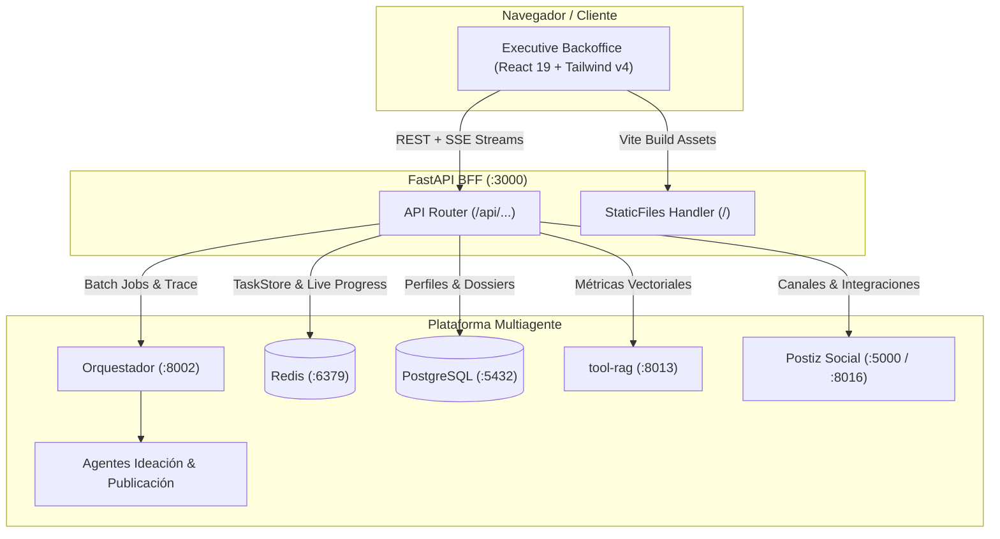

# Frontend Multi-Agent Executive Backoffice

## 1. Resumen

El frontend ha sido modernizado a una interfaz ejecutiva tipo **Backoffice**, construida con **React 19**, **Tailwind CSS v4**, **Lucide React** y empaquetada mediante **Vite**.

La aplicación se sirve de forma unificada y sin necesidad de proxies externos a través de `frontend/server.py` en el puerto `3000`:
- **Single-Port Delivery**: FastAPI sirve tanto la suite completa de endpoints BFF (`/api/...`) como la aplicación SPA compilada en `frontend/static/` mediante `StaticFiles`.
- **Arquitectura BFF**: Valida solicitudes, gestiona la generación batch multimarca, orquesta la publicación desacoplada en dos fases (preparación y entrega a Postiz), y agrega métricas de Redis, PostgreSQL, RabbitMQ, Ollama y los microservicios de herramientas (`tool-client`, `tool-rag`, `tool-postiz`, etc.).
- **Persistencia y Resiliencia**: Inicialización instantánea con fallback para marcas predeterminadas, conexión ultra rápida con timeouts cortos a bases de datos auxiliares para evitar bloqueos por servicios caídos, y sincronización en tiempo real vía Server-Sent Events (SSE).

---

## 2. Arquitectura del Backoffice



### Estructura del Código Frontend

```
frontend/
├── src/                          # Código fuente React 19
│   ├── components/
│   │   ├── dashboard/            # DashboardView: KPIs, batches activos, métricas ejecutivas
│   │   ├── studio/               # StudioView: Generador de lotes, plantillas, briefs
│   │   ├── library/              # LibraryView: Master-Detail explorer, dossiers, copys
│   │   ├── publications/         # PublicationsView: Monitor de entregas Postiz, copys aprobados
│   │   ├── traceability/         # TraceabilityView & PipelineVisualizer (LangGraph 5 etapas)
│   │   ├── results/              # ResultsView: Preproducción, desglose de escenas, mockup social
│   │   ├── history/              # HistoryView: Auditoría de tareas Redis con filtros
│   │   ├── system/               # SystemView: Salud de microservicios y catálogo de herramientas
│   │   └── layout/               # Sidebar (navegación y status pills), Header, ToastContainer
│   ├── context/
│   │   └── AppContext.jsx        # Estado global: marca activa, lotes, tareas, SSE, toasts
│   ├── api/
│   │   └── client.js             # Capa cliente HTTP (fetch) y Server-Sent Events
│   ├── App.jsx                   # Orquestador de vistas y layout principal
│   ├── main.jsx                  # Punto de entrada React
│   └── index.css                 # Configuración Tailwind CSS v4
├── static/                       # Salida compilada de producción (servida por FastAPI)
│   ├── index.html                # Entrypoint HTML generado por Vite
│   └── assets/                   # Bundles optimizados JS y CSS
├── static_legacy_backup/         # Respaldo histórico del frontend Vanilla JS original
├── server.py                     # BFF FastAPI: endpoints REST/SSE y servidor estático
├── vite.config.js                # Configuración de compilación Vite apuntando a static/
├── package.json                  # Dependencias JS (React 19, Lucide, Tailwind, Vite)
├── test-backoffice.mjs           # Suite de verificación automatizada Playwright E2E
├── run.ps1 / run.sh              # Scripts de inicio de producción
└── requirements.txt              # Dependencias Python del BFF
```

---

## 3. Módulos y Funcionalidades del Backoffice

El Backoffice agrupa toda la funcionalidad preexistente en 8 módulos navegables de forma fluida:

### 1. Panel de Control (Dashboard)
- **KPIs Principales**: Contador dinámico de tareas ejecutadas, vectores en RAG pgvector, canales de Postiz vinculados e indicador de salud general de microservicios.
- **Acciones Rápidas**: Accesos directos a generación de campañas, exploración de biblioteca, revisión de copys y prueba rápida de 1-click.
- **Lote Activo**: Monitor visual del progreso porcentual del lote actual de generación.
- **Últimas Tareas**: Tabla resumen de las últimas 5 tareas con badge de estado y acceso directo a su trazabilidad.

### 2. Generador Creativo (Studio)
- **Generación Batch Multiagente**: Generación de 1 a 5 ideas simultáneas por lote.
- **Plantillas Preconfiguradas (1-Click)**: Configuración rápida para marcas de ejemplo (*EcoBrand*, *TechStart*, *FitLife*).
- **Briefing Compartido e Individual**: Entrada de brief maestro o especificaciones por línea para cada idea del lote.
- **Selectores de Formato**: Opciones `Automático`, `Reel / Video Vertical` o `Post Estático`.
- **Enlace de Canales Postiz**: Activación o desactivación de integraciones de publicación social por marca.

### 3. Biblioteca de Dossiers (Library)
- **Explorador Master-Detail**: Búsqueda en tiempo real y filtrado de ideas por marca seleccionada.
- **Ficha Técnica Completa**: Visualización estructurada de hipótesis de engagement, pilares de contenido, formato y estado de publicación con badges de ciclo de vida (`approved`, `draft`, `archived`).
- **Edición de Ideas con Re-indexación Vectorial**: Modal para actualizar título y concepto creativo; al guardar, se invoca automáticamente el gateway para recalcular y actualizar el vector de 768 dimensiones en pgvector (`updated_at = NOW()`).
- **Eliminación con Protección de Inmutabilidad**: Modal de confirmación que advierte sobre la restricción de inmutabilidad: si la idea posee copias ya despachadas a Postiz, el BFF y `tool-rag` rechazan la operación con `HTTP 409 Conflict`.
- **Preparación de Publicación**: Botón directo para orquestar la preparación de copys específicos para cada canal sin enviar a producción.
- **Visor JSON Estructurado**: Inspección técnica del payload del dossier generado.

### 4. Monitor de Publicaciones (Publications)
- **Rastreo de Entregas Postiz**: Listado completo de tareas de publicación con badges de estado (`pending`, `completed`, `failed`).
- **Insignias de Inmutabilidad**: Las publicaciones enviadas (`sent`, `scheduled`, `created`) exhiben la insignia visual `Lock Inmutable`, indicando que el copy ha sido despachado a redes y no admite mutación ni borrado.
- **Vista Previa de Copys**: Visualización de las variantes de copy generadas por plataforma (Instagram, LinkedIn, X/Twitter, etc.).
- **Aprobación y Entrega a Postiz**: Modal de confirmación para ejecutar el despacho definitivo (`POST /api/publications/{id}/deliver`).

### 5. Configuración de Marca y Parámetros RAG (Sidebar)
- **Modal de Marca y Tenant**: Edición directa de perfil corporativo, restricciones de tono, producto o servicio y audiencia.
- **Calibración RAG & pgvector Dinámica**: Control deslizante de umbral de similitud coseno (`similarity_threshold` entre 0.30 y 0.95), ajuste del `top_k` de recuerdos semánticos (1 a 20) y activación de contraste semántico frente al histórico de la marca.
- **Archivado de Marca**: Capacidad de realizar *soft-delete* de la marca, excluyéndola de listados activos.

### 6. Trazabilidad & Pipeline Visual (Traceability)
- **Pipeline Interactivo LangGraph de 5 Etapas**:
  1. `Ingreso & Supervisor`
  2. `Agente Ideación`
  3. `Reanudación Orquestador`
  4. `Agente Publicación`
  5. `Memoria & Persistencia`
- Cada nodo muestra su estado (`completed`, `active`, `pending`), roles, herramientas consumidas y metadata al hacer clic.
- **Timeline de Ejecución**: Registro temporal detallado con duración en segundos y llamadas a herramientas (`tool_client`, `tool_rag`, `tool_trends`).
- **Historial de Chat Persistente (PostgreSQL)**: Transcripción durable de interacciones del agente.
- **Contexto RAG**: Inspección de vectores y documentos relevantes recuperados de la base de datos.

### 7. Preproducción & Mockup Social (Results)
- **Desglose de Escenas y Guion**: Tabla técnica con número de escena, tiempo (segundos), descripción visual y diálogo/voz en off.
- **Dirección de Cámara y Audio**: Planos de cámara, iluminación, locación y notas técnicas de audio.
- **Variantes de Copy Editables**: Selector interactivo de copys por canal con editor de texto integrado para aprobación final.
- **Simulador de Red Social**: Mockup visual de publicación en feed con cálculo de longitud y advertencia de límite de caracteres.
- **Badge de Inmutabilidad**: Bloqueo visual ante copias ya entregadas a Postiz.
- **Exportación**: Descarga en formatos Markdown estructurado o JSON crudo.

### 8. Auditoría de Tareas (History)
- **Registro TaskStore de Redis**: Lista completa de tareas del sistema con filtrado por estado (`completed`, `failed`, `running`, etc.) y búsqueda por ID o tema.
- **Acceso Rápido a Trazas**: Botón directo para inspeccionar el flujo de cualquier tarea histórica.

### 9. Estado del Sistema & Catálogo de Herramientas (System)
- **Monitor de Microservicios**: Tarjetas en vivo para Orquestador, Redis, PostgreSQL, Agente Ideación, Agente Publicación y Gateway LLM con latencia y estado.
- **Métricas de RAG**: Conteo de vectores, embeddings indexados y estado de la base de conocimiento.
- **Tool Discovery Catalog**: Directorio interactivo de herramientas descubiertas dinámicamente con endpoint, versión y descripción técnica.

---

## 4. API Endpoints del BFF

| Método | Ruta | Descripción |
| --- | --- | --- |
| `GET` | `/api/health` | Estado de salud de orquestador, agentes, Redis y PostgreSQL |
| `GET` | `/api/overview` | Métricas generales para el Dashboard ejecutivo |
| `GET` | `/api/clients` | Listado de marcas disponibles (con fallback predeterminado) |
| `GET` | `/api/clients/{id}` | Perfil y configuración de una marca |
| `GET` | `/api/brands/{id}` | Detalle de marca y su objeto `rag_config` (JSONB) |
| `PUT` | `/api/brands/{id}` | Actualización de perfil y parámetros RAG dinámicos de la marca |
| `DELETE` | `/api/brands/{id}` | Soft-delete (archivado) de una marca |
| `POST` | `/api/ideas/generate` | Generación de lote (1-5 ideas) sin publicación automática |
| `GET` | `/api/idea-batches/{id}` | Estado y resultados de un lote en progreso |
| `GET` | `/api/ideas` | Biblioteca de dossiers filtrados por `brand_id` y búsqueda |
| `GET` | `/api/ideas/{id}` | Detalle completo del dossier de una idea |
| `PUT` | `/api/ideas/{id}` | Edición de idea y re-indexación automática de embedding en pgvector |
| `DELETE` | `/api/ideas/{id}` | Soft-delete de idea (rechazo 409 Conflict si tiene publicaciones enviadas) |
| `POST` | `/api/ideas/{id}/publish` | Fase 1: Preparación de copys sin enviar a Postiz |
| `GET` | `/api/publications` | Listado de entregas y preparaciones desde Redis TaskStore |
| `GET` | `/api/publications/saved` | Listado de publicaciones persistidas en PostgreSQL vía tool-rag |
| `GET` | `/api/publications/saved/{id}` | Detalle de una publicación persistida |
| `PUT` | `/api/publications/saved/{id}` | Edición de copy borrador (bloqueo 409 Conflict si ya fue enviada a Postiz) |
| `DELETE` | `/api/publications/saved/{id}` | Soft-delete de publicación (bloqueo 409 Conflict si ya fue enviada a Postiz) |
| `POST` | `/api/publications/{id}/deliver` | Fase 2: Despacho final de variantes revisadas a Postiz |
| `POST` | `/api/tasks` | Endpoint legacy para generación individual |
| `POST` | `/api/demo` | Disparo de lote demo rápido (EcoBrand) |
| `GET` | `/api/tasks` | Historial de tareas almacenadas en Redis |
| `GET` | `/api/tasks/{id}` | Registro individual de tarea |
| `GET` | `/api/tasks/{id}/history` | Historial de chat persistente de PostgreSQL |
| `GET` | `/api/tasks/{id}/trace` | Trazabilidad agregada de agentes, timeline y contexto |
| `GET` | `/api/tasks/{id}/stream` | Flujo Server-Sent Events (SSE) para progreso en vivo |
| `GET` | `/api/tools` | Catálogo de herramientas dinámico del orquestador |
| `GET` | `/api/rag/stats` | Estadísticas del almacén vectorial pgvector |

---

## 5. Instrucciones de Ejecución

### Opción A: Modo Producción (Recomendado)
El servidor FastAPI entrega la aplicación lista para producción en el puerto `3000`.

**En Windows (PowerShell):**
```powershell
# 1. Compilar el frontend (si se realizaron cambios en src/)
cd frontend
npm run build
cd ..

# 2. Iniciar el BFF
.\frontend\run.ps1
```

**En Linux / macOS:**
```bash
# 1. Compilar el frontend (si se realizaron cambios en src/)
cd frontend
npm run build
cd ..

# 2. Iniciar el BFF
./frontend/run.sh
```

Abrir en el navegador: [http://localhost:3000](http://localhost:3000)

### Opción B: Modo Desarrollo (Hot Reloading)
Para iterar rápidamente en los componentes React:

1. Iniciar el BFF en una terminal (puerto 3000):
   ```powershell
   python -m uvicorn frontend.server:app --host 127.0.0.1 --port 3000
   ```
2. Iniciar el servidor de desarrollo Vite en otra terminal (puerto 5173):
   ```powershell
   cd frontend
   npm run dev
   ```
   *Vite reenviará automáticamente todas las peticiones `/api` al BFF en el puerto 3000.*

---

## 6. Pruebas y Verificación Automatizada

El proyecto incluye un script de prueba End-to-End (`frontend/test-backoffice.mjs`) que utiliza Playwright para verificar:
1. Conexión y respuesta HTTP 200 de todos los endpoints BFF.
2. Renderizado de las 8 vistas del Backoffice sin errores de consola.
3. Navegación por el Sidebar y selector de marcas.
4. Inspección interactiva de los nodos del pipeline LangGraph.
5. Capturas de pantalla de verificación visual guardadas en `docs/screenshots/`.

Para ejecutar la verificación:
```powershell
node frontend/test-backoffice.mjs
```
