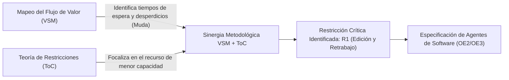
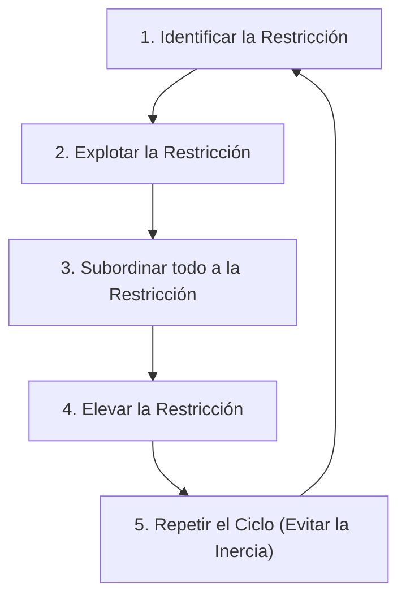

# Anexo 1. Marco Teórico y Justificación de la Integración VSM-ToC

<b>Capítulo:</b> 2 (Diagnóstico Operativo) &nbsp;|&nbsp; 
<b>Objetivo Específico:</b> OE1 &nbsp;|&nbsp; 
<b>Investigador:</b> Alvaro Felipe Lopez Russi &nbsp;|&nbsp; 
<b>Entidad:</b> ITY SAS / Universidad Católica de Colombia

## 1. Introducción y Justificación Metodológica

El diagnóstico de la cadena de valor en entornos de servicios intensivos en conocimiento (*Knowledge-Intensive Business Services* - KIBS), como las agencias de marketing digital, presenta desafíos metodológicos singulares derivados de la intangibilidad de los entregables, la alta variabilidad del flujo creativo y la dispersión de los canales de comunicación. En la agencia ITY SAS, el proceso de producción de contenidos operaba históricamente bajo flujos informales, donde la coordinación dependía de notas de voz, mensajería instantánea y asignaciones manuales sin trazabilidad.

Para caracterizar rigurosamente este ecosistema y establecer la línea base cuantitativa y cualitativa de la investigación (OE1), se integraron dos marcos metodológicos ampliamente reconocidos en la ingeniería industrial y la gestión de operaciones: el **Mapeo de la Cadena de Valor** (*Value Stream Mapping* - VSM) y la **Teoría de las Restricciones** (*Theory of Constraints* - ToC). 

Lejos de ser una yuxtaposición arbitraria, la integración sinérgica de VSM y ToC responde a una complementariedad operativa estricta: mientras el VSM despliega una radiografía holística del flujo continuo visibilizando los desperdicios y los tiempos muertos, la ToC provee el algoritmo de focalización analítica necesario para concentrar los esfuerzos de automatización exclusivamente en el recurso que limita la capacidad del sistema global.

*Figura 1. Sinergia metodológica entre VSM y ToC en el diagnóstico operativo.*

---

## 2. Fundamentos del Value Stream Mapping (VSM) en Servicios Creativos

### 2.1. Adaptación de Lean Services al Flujo de Contenidos Digitales
El Mapeo de la Cadena de Valor, derivado del Sistema de Producción Toyota (*Toyota Production System* - TPS) y formalizado por Rother y Shook (1999), tiene como meta trazar el recorrido integral de un bien o servicio a lo largo de las distintas estaciones de trabajo, midiendo de forma estricta dos dimensiones temporales:

1. **Tiempo de Ciclo Activo ($T_p$ o $C/T$):** Lapso durante el cual un profesional creativo o técnico ejecuta trabajo directo sobre la pieza (redacción, diseño gráfico, ensamblaje audiovisual).
2. **Tiempo de Espera o Cola ($T_w$ o $W/T$):** Lapso durante el cual la pieza permanece en reposo en bandejas de entrada, repositorios en la nube o chats esperando validación, corrección o asignación de turno.

La suma de ambas dimensiones define el **Tiempo de Entrega Total** (*Lead Time* - $LT$):
$$LT = \sum_{i=1}^{k} T_{p,i} + \sum_{i=1}^{k} T_{w,i}$$

### 2.2. Valor Agregado (VA) frente a No Valor Agregado (NVA)
En concordancia con los principios de *Lean*, una actividad se clasifica como de **Valor Agregado (VA)** únicamente si satisface de manera simultánea tres condiciones:
* Modifica la forma, función o sustancia del contenido en beneficio del cliente.
* El cliente final está dispuesto a pagar por su realización.
* Se ejecuta correctamente en la primera iteración (*Right First Time*).

Toda tarea que no cumpla estos criterios se considera **No Valor Agregado (NVA)** o desperdicio (*Muda*). En marketing digital, las actividades típicas de NVA identificadas en ITY SAS comprenden: la búsqueda manual de assets gráficos en bancos de imágenes, las esperas prolongadas por aprobación de copys, los formateos manuales para distintas redes sociales y los ciclos iterativos de reprocesamiento originados por briefs ambiguos.

La **Eficiencia de Ciclo del Proceso** (*Process Cycle Efficiency* - PCE) sintetiza esta relación:
$$PCE = rac{\sum T_{va}}{LT} 	imes 100$$

En flujos manuales de agencias digitales sin automatización, la literatura reporta valores típicos de PCE entre el 5% y el 15%, lo cual evidencia que más del 85% del tiempo de permanencia de una pieza en la agencia corresponde a demoras pasivas y retrabajos no productivos.

---

## 3. Fundamentos de la Teoría de las Restricciones (ToC)

### 3.1. Postulados de Goldratt y los Cinco Pasos de Focalización
La Teoría de las Restricciones, formulada por Eliyahu M. Goldratt (1990), sostiene que cualquier sistema productivo complejo se encuentra gobernado por un número muy reducido de restricciones (usualmente una sola), la cual determina el rendimiento máximo o tasa de transferencia (*throughput*) del sistema total. Mejorar estaciones no restrictivas produce un efecto nulo sobre la capacidad global y satura las colas intermedias de trabajo en proceso (*Work In Progress* - WIP).

Para estructurar la intervención en ITY SAS, se adoptó el ciclo clásico de cinco pasos de la ToC:

*Figura 2. Ciclo de mejora continua de los cinco pasos de la ToC.*

1. **Identificar la restricción:** Analizar la línea base empírica para aislar la estación con mayor tiempo de procesamiento y mayor acumulación de colas de reproceso.
2. **Explotar la restricción:** Asegurar que el recurso limitante opere sin tiempos ociosos ni interrupciones operativas evitables.
3. **Subordinar el sistema:** Alinear los ritmos de briefing, investigación y publicación a la capacidad real de procesamiento del cuello de botella.
4. **Elevar la restricción:** Incorporar tecnología asistida por agentes inteligentes para aumentar la capacidad efectiva del nodo crítico.
5. **Prevenir la inercia:** Evaluar periódicamente el sistema tras la optimización para atacar el nuevo cuello de botella emergente.

---

## 4. Ley de Little y Dinámica de Colas en la Producción de Contenidos

El comportamiento de los tiempos de entrega en ITY SAS se rige matemáticamente por la **Ley de Little** (Little, 1961), que vincula el inventario de piezas en proceso ($L$ o $WIP$), la tasa promedio de arribo de briefs ($\lambda$) y el tiempo de permanencia en el sistema ($W$ o $LT$):
$$L = \lambda 	imes W$$

Al incrementarse las revisiones internas y los reprocesos, la tasa de salida efectiva disminuye y el volumen de briefs represados en cola ($WIP$) se dispara exponencialmente. Esto genera saturación operativa, sobrecarga cognitiva en el equipo creativo y retrasos en las publicaciones comprometidas con las marcas.

---

## 5. Justificación de la Integración Metodológica VSM + ToC

La tabla resume la convergencia metodológica aplicada en el proyecto:

| Criterio de Comparación | Mapeo de Cadena de Valor (VSM) | Teoría de Restricciones (ToC) | Integración VSM + ToC (Enfoque Tesis) |
|---|---|---|---|
| **Objetivo Primario** | Mapear el flujo integral y clasificar VA vs. NVA. | Identificar y maximizar el throughput del cuello de botella. | Cuantificar el flujo holístico y concentrar la solución en el nodo crítico. |
| **Enfoque de Análisis** | Macro-operativo y visualización continua. | Micro-analítico sobre recursos y capacidades. | Diagnóstico macro con microanálisis estocástico de reproceso. |
| **Riesgo Típico** | Intentar optimizar todas las fases sin jerarquía. | Olvidar las interconexiones sistémicas previas y posteriores. | Priorización cuantitativa basada en impacto global comprobado. |
| **Aporte al Sistema MAS** | Define las fronteras de los estados y actividades del pipeline. | Justifica la especialización de los dos agentes (Ideación y Publicación). | Garantiza que el sistema multiagente impacte directamente el throughput de la agencia. |

---

## 6. Conclusiones del Marco Teórico

1. La combinación de VSM y ToC proporciona la rigurosidad científica necesaria para evitar optimizaciones locales aisladas, asegurando que el diseño de software aborde las causas estructurales del bajo rendimiento operativo.
2. Las métricas de $LT$, $T_p$, $T_w$ y $PCE$ constituyen los indicadores cuantitativos contra los cuales se comparará el desempeño de la prueba de concepto (OE4).
3. La investigación respeta los lineamientos éticos y organizacionales de ITY SAS, validando las directrices estratégicas exclusivamente con la Gerencia de Mercadeo (Leidy López) y la Dirección Creativa (Roger Martínez).
