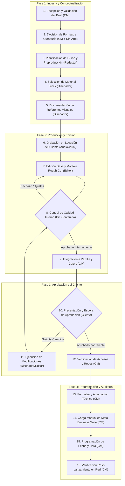

# Anexo 2. Diagrama de Flujo Detallado del Proceso Operativo con Tabla Descriptiva

<b>Capítulo:</b> 2 (Diagnóstico Operativo) &nbsp;|&nbsp; 
<b>Objetivo Específico:</b> OE1 &nbsp;|&nbsp; 
<b>Investigador:</b> Alvaro Felipe Lopez Russi &nbsp;|&nbsp; 
<b>Entidad:</b> ITY SAS / Universidad Católica de Colombia

## 1. Introducción y Alcance del Mapeo

El presente anexo desglosa la arquitectura del flujo de trabajo manual (*As-Is*) ejecutado por la agencia ITY SAS para la producción de contenidos digitales en redes sociales (Instagram Reels, Posts estáticos y Carruseles). A través de la observación directa (*Gemba Walk*) durante 12 sesiones de campo y la reconstrucción cronológica retrospectiva de 315 piezas históricas, se identificó un macrociclo estructurado en **16 pasos secuenciales**, intervenidos por diversos roles creativos, operacionales y externos.

El propósito de este mapeo es fijar la granularidad analítica del proceso actual, permitiendo clasificar cada actividad según su valor agregado e identificar con precisión matemática las estaciones donde se originan las mayores demoras y bucles de reprocesamiento.

---

## 2. Diagrama de Flujo Operativo As-Is (16 Pasos)

El siguiente diagrama detalla la interacción entre los actores operacionales, las aprobaciones intermedias y el bucle crítico de retroalimentación:

*Figura 1. Diagrama de flujo del proceso de trabajo en 16 pasos en ITY SAS.*

---

## 3. Tabla Descriptiva Detallada del Proceso de Trabajo

La siguiente matriz documenta el comportamiento de cada uno de los 16 pasos operativos, detallando el rol responsable, la descripción operativa, los insumos requeridos y los entregables generados:

| Paso | Nombre de la Actividad | Rol Responsable | Descripción de la Actividad | Insumos Requeridos | Entregable / Salida |
|:---:|---|---|---|---|---|
| **1** | Recepción y Validación del Brief | Community Manager | El CM recibe la solicitud del cliente vía WhatsApp o correo. Interpreta requerimientos, revisa disponibilidad de insumos y redacta una ficha de brief en Google Sheets. | Mensaje informal del cliente, notas de voz, lineamientos comerciales. | Brief inicial de contenido registrado en parrilla editorial. |
| **2** | Decisión de Formato y Curaduría | CM + Dir. Arte | Se define si la idea corresponde a Reel, Post, Historia o Carrusel. El CM revisa feeds de Instagram y TikTok para identificar audios virales y formatos vigentes. | Brief inicial, tendencias observadas manualmente en redes sociales. | Formato seleccionado y enlace de referencia conceptual. |
| **3** | Planificación de Guion y Preproducción | Redactor / CM | Se redacta el guion técnico literario (gancho inicial, desarrollo del mensaje, llamado a la acción) o la estructura de láminas para carruseles. | Formato y concepto estratégico consolidado en el Paso 2. | Guion técnico en Google Docs con minutero estimado. |
| **4** | Selección y Extracción de Material Stock | Diseñador / Editor | Si la pieza no requiere grabación presencial, se buscan clips y fotografías en librerías de recursos (Freepik, Envato, Canva Stock). | Guion técnico y palabras clave temáticas del contenido. | Carpeta en Google Drive con assets multimedia brutos. |
| **5** | Documentación de Referentes Visuales | Diseñador Gráfico | Se capturan ejemplos visuales de la competencia y referentes estéticos, registrándolos en la hoja de preproducción. | Búsqueda manual en perfiles de competidores directos. | Enlaces de referencia estética añadidos al brief de producción. |
| **6** | Grabación en Locación del Cliente | Equipo Audiovisual | Para contenidos que requieren al talento humano del cliente, se planifica y ejecuta la sesión de rodaje con cámaras y micrófonos en sitio. | Guion aprobado, citación de talento y equipos técnicos de filmación. | Archivos de video crudo (.mp4 / .mov) respaldados en disco. |
| **7** | Edición Base y Montaje (*Rough Cut*) | Editor Audiovisual | Importación de material a Premiere/CapCut, ensamble de cortes de ritmo, sincronización de pista de audio y balance preliminar de color. | Video crudo, música seleccionada, guion técnico y assets de marca. | Primer corte de video sin postproducción avanzada. |
| **8** | Control de Calidad Interno y Revisión | Director Contenido | El director revisa el video o arte gráfico frente a criterios de calidad estética, ortografía, ritmo y cumplimiento de marca. | Primer corte de video o boceto gráfico exportado. | Veredicto: Aprobación interna o Devolución a corrección (Paso 7). |
| **9** | Integración a Parrilla y Redacción Copys | Community Manager | Una vez aprobado internamente, el contenido se enlaza en la parrilla final y el CM redacta el texto del copy, hashtags y menciones. | Pieza audiovisual aprobada y objetivo de la campaña. | Fila completa en la parrilla editorial lista para el cliente. |
| **10** | Presentación y Espera de Aprobación | Cliente Externo | Se comparte la parrilla editorial al cliente vía WhatsApp/correo. El flujo entra en suspensión pasiva hasta recibir feedback formal. | Enlace a parrilla editorial o previsualización de archivos. | Aprobación total, aprobación con cambios o rechazo del cliente. |
| **11** | Ejecución de Modificaciones Solicitadas | Diseñador / Editor | Si el cliente solicita ajustes de copy, colores, música o información, se reabre el proyecto para ejecutar los cambios pedidos. | Mensaje de feedback del cliente con observaciones detalladas. | Versión corregida (v2 o v3) reenviada para visto bueno. |
| **12** | Verificación de Accesos y Cuentas | Community Manager | Comprobación de vigencia de tokens de acceso a Meta Suite y plataformas sociales antes de programar la publicación. | Credenciales comerciales y roles de administración en páginas. | Estado de conectividad de cuenta validado. |
| **13** | Formateo y Adecuación Técnica | Community Manager | Ajuste de relaciones de aspecto (9:16 para Reels, 1:1 o 4:5 para feed), verificación de compresión y etiquetado de colaboradores. | Archivo multimedia definitivo aprobado y lineamientos de red. | Archivos finales listos para ingesta en plataforma. |
| **14** | Carga Manual en Meta Business Suite | Community Manager | Subida individual del archivo de video o imagen, copiado y pegado de copys y hashtags desde la hoja de cálculo a la plataforma nativa. | Archivos de video/imagen y textos de la parrilla editorial. | Borrador cargado en el administrador de publicaciones. |
| **15** | Publicación y Programación en Redes | Community Manager | Selección manual de fecha y hora óptima según calendario editorial y confirmación de la orden de programación en el sistema. | Borrador configurado y fecha/hora del calendario de contenidos. | Publicación en estado "Programada" en los servidores de la red. |
| **16** | Verificación Post-Lanzamiento y Registro | Community Manager | Una vez cumplida la hora programada, el CM ingresa a la red social para certificar que el contenido salió en vivo sin cortes ni fallos de audio. | Post publicado en la red social nativa. | Registro de confirmación de salida exitosa en bitácora de control. |

---

## 4. Hallazgos Derivados del Mapeo de Flujo

1. **Fragmentación Tecnológica y Fricción de Herramientas:** Para procesar un único contenido, el equipo debe interactuar con al menos siete herramientas inconexas (WhatsApp, Google Sheets, Google Docs, Drive, Premiere/Canva, Meta Business Suite y la red social nativa). Cada cambio de contexto representa una pérdida de tiempo de preparación y riesgo de desincronización de versiones.
2. **El Cuello de Botella del Bucle 8-10-11:** Las etapas 8 (revisión interna), 10 (espera de cliente) y 11 (retrabajo de edición) concentran la mayor incertidumbre temporal. Cuando el brief inicial llega viciado o incompleto (Paso 1), el error se propaga a lo largo de los Pasos 3 a 7 y solo se hace visible en el Paso 8 o 10, obligando a rehacer el 100% de la edición.
3. **Carga Operativa en Tareas de No Valor Agregado:** Los Pasos 12 a 16 (verificación de cuentas, formateo manual, copiado y pegado en Meta Suite y auditoría post-lanzamiento) son actividades 100% mecánicas y estandarizables que consumen entre 45 y 75 minutos por publicación del Community Manager, tiempo que podría destinarse a análisis estratégico.
