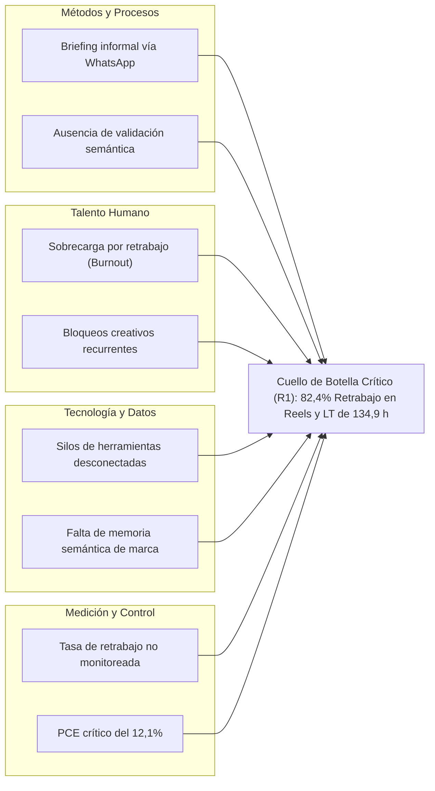

# Anexo 7. Análisis Causa-Raíz de los Cuellos de Botella (ToC)

<b>Capítulo:</b> 2 (Diagnóstico Operativo) &nbsp;|&nbsp; 
<b>Objetivo Específico:</b> OE1 &nbsp;|&nbsp; 
<b>Investigador:</b> Alvaro Felipe Lopez Russi &nbsp;|&nbsp; 
<b>Entidad:</b> ITY SAS / Universidad Católica de Colombia

## 1. Introducción y Marco de Análisis

En concordancia con el primer paso de la Teoría de Restricciones (ToC), **Identificar la Restricción del Sistema**, la mera observación de que los tiempos de entrega son elevados resulta insuficiente para diseñar una solución de software orientada a agentes. Se requiere descender a las causas estructurales y dinámicas que originan las fallas operativas mediante la técnica formal de los **Cinco Porqués** (*5 Whys*) y el despliegue del diagrama causa-raíz de Ishikawa.

Este anexo documenta la descomposición causal de las tres restricciones principales priorizadas en ITY SAS:
* **Restricción 1 (R1 - Prioridad 1):** Bucle de edición técnica y retrabajo recurrente en piezas audiovisuales.
* **Restricción 2 (R2 - Prioridad 2):** Ineficiencia en la ideación, curaduría de tendencias y estructuración del brief.
* **Restricción 3 (R3 - Prioridad 3):** Adaptación y programación manual multicanal en Meta Business Suite.

---

## 2. Descomposición Causal por los Cinco Porqués (5 Whys)

### 2.1. Análisis Causal de R1: Bucle de Edición y Retrabajo (Cuello de Botella Crítico)
* **Problema Observable:** El editor audiovisual tarda en promedio 134,94 horas por Reel y acumula una tasa de retrabajo del 82,4% (2,23 revisiones por pieza).
  * **1° ¿Por qué?** Porque el 60% de los videos terminados son devueltos por el cliente exigiendo cambios sustanciales en el enfoque, la información o la música.
  * **2° ¿Por qué?** Porque el guion técnico y los recursos visuales utilizados en el montaje no coincidían con la visión original que el cliente tenía de la campaña.
  * **3° ¿Por qué?** Porque el redactor y el editor trabajaron a partir de un brief impreciso, asumiendo requerimientos no especificados y tonos de comunicación informales.
  * **4° ¿Por qué?** Porque el cliente envió solicitudes informales por notas de voz de WhatsApp y el Community Manager no contó con un mecanismo de validación semántica para exigir información completa antes de pasar a producción.
  * **5° ¿Por qué? (Causa Raíz Sistémica):** **Ausencia de un validador estructural de briefs y carencia de una memoria semántica de marca centralizada que restrinja y alinee automáticamente los conceptos creativos con las reglas del cliente.**

---

### 2.2. Análisis Causal de R2: Ineficiencia en la Ideación y Estrategia
* **Problema Observable:** El equipo creativo invierte entre 2 y 4 días hábiles para estructurar una parrilla mensual de contenidos, sufriendo bloqueos creativos y repetición de fórmulas.
  * **1° ¿Por qué?** Porque la búsqueda de tendencias y competidores se realiza mediante navegación manual no sistemática en feeds de Instagram y TikTok.
  * **2° ¿Por qué?** Porque no existen herramientas automatizadas de scraping o conectores API a fuentes externas de analítica de tendencias.
  * **3° ¿Por qué?** Porque las herramientas comerciales de analítica avanzada tienen costos prohibitivos para el modelo operativo de una pyme de marketing digital.
  * **4° ¿Por qué?** Porque no se ha implementado un mecanismo de ingesta automatizada que traduzca datos de tendencias públicas en dossiers estructurados de contenido.
  * **5° ¿Por qué? (Causa Raíz Sistémica):** **Falta de un agente especializado en investigación de mercado capaz de sintetizar tendencias de la industria, extraer pilares de contenido y formular propuestas estructuradas de forma autónoma.**

---

### 2.3. Análisis Causal de R3: Adaptación Manual y Programación Multicanal
* **Problema Observable:** El Community Manager gasta más del 30% de su jornada laboral copiando y pegando textos, reajustando formatos y programando publicaciones en Meta Business Suite.
  * **1° ¿Por qué?** Porque cada red social exige longitudes de copy diferentes, límites específicos de hashtags y relaciones de aspecto distintas (1:1 feed vs. 9:16 reels).
  * **2° ¿Por qué?** Porque el CM debe redactar y formatear manualmente tres variantes del mismo contenido para cada canal de difusión.
  * **3° ¿Por qué?** Porque Meta Business Suite no ofrece adaptaciones inteligentes basadas en contexto ni automatiza la bifurcación de directrices por plataforma.
  * **4° ¿Por qué?** Porque la agencia no cuenta con una pasarela centralizada de publicación automatizada vinculada a un motor de generación de lenguaje.
  * **5° ¿Por qué? (Causa Raíz Sistémica):** **Carencia de un agente de publicación multicanal que reciba el dossier aprobado y genere copys específicos por canal, orquestando el despacho a través de APIs de publicación (Postiz / Meta API).**

---

## 3. Diagrama Causa-Efecto de Ishikawa

*Figura 1. Diagrama de Ishikawa consolidado de los cuellos de botella en ITY SAS.*

---

## 4. Conclusiones del Análisis ToC

1. La restricción primaria del sistema (R1) no es una carencia de talento gráfico o audiovisual en los editores, sino una **falla sistémica en la ingesta y estructuración del conocimiento de marca al inicio del flujo**.
2. Elevar la restricción R1 exige desacoplar el proceso en dos intervenciones tecnológicas directas:
   * **Agente de Ideación y Estrategia:** Para resolver R2 y neutralizar la causa raíz de R1 validando briefs y estructurando dossiers semánticamente blindados.
   * **Agente de Publicación Multicanal:** Para absorber R3 mediante la generación automatizada de variantes de copy y el despacho programado vía API.
