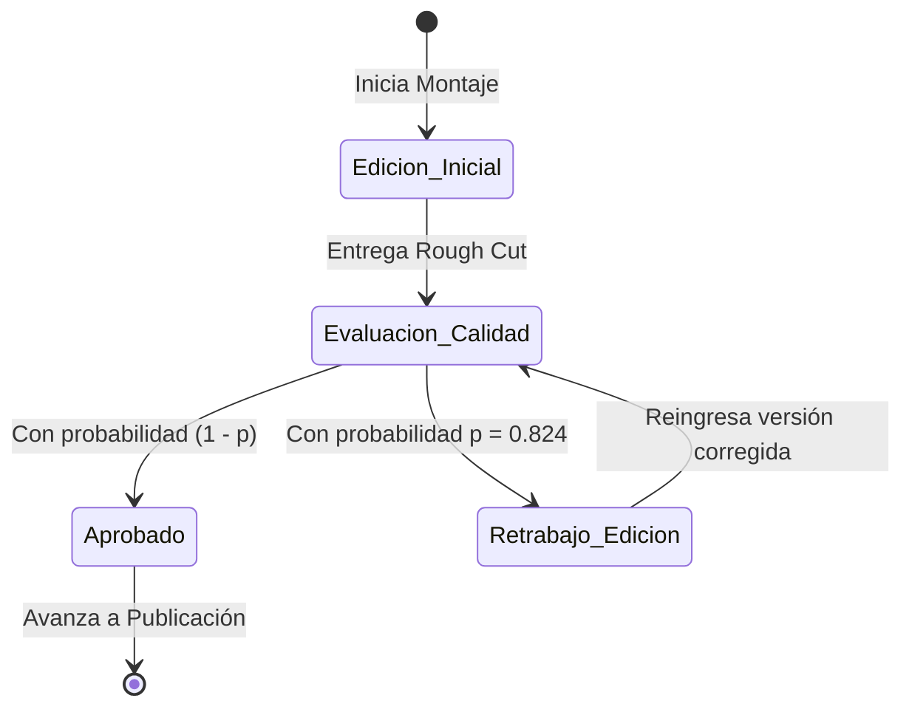

# Anexo 8. Modelamiento Matemático del Bucle de Edición (R1)

<b>Capítulo:</b> 2 (Diagnóstico Operativo) &nbsp;|&nbsp; 
<b>Objetivo Específico:</b> OE1 &nbsp;|&nbsp; 
<b>Investigador:</b> Alvaro Felipe Lopez Russi &nbsp;|&nbsp; 
<b>Entidad:</b> ITY SAS / Universidad Católica de Colombia

## 1. Fundamentación del Modelo de Reproceso Estocástico

El comportamiento dinámico del cuello de botella en la fase de edición (R1) puede modelarse rigurosamente mediante la teoría de procesos estocásticos discretos y series geométricas de retrabajo. En una agencia de marketing tradicional, cada vez que una pieza audiovisual finaliza su primer corte de edición, entra a un nodo de decisión probabilística (Pasos 8 y 10 del flujo):

* Con probabilidad $p$, la pieza es devuelta para corrección, exigiendo un ciclo adicional de edición.
* Con probabilidad $(1 - p)$, la pieza es aprobada sin objeciones y avanza a la siguiente estación.

En la muestra cronometrada de $n_1 = 68$ Reels en ITY SAS, la probabilidad empírica de requerir al menos una ronda de modificación fue de:
$$p = 0,824 \quad (82,4\%)$$

*Figura 1. Modelo de estados del bucle estocástico de retrabajo en edición.*

---

## 2. Derivación del Número Esperado de Ciclos y Tiempo Total

Sea $N_{rev}$ la variable aleatoria que representa el número total de iteraciones de edición que experimenta una pieza. Si asumimos una probabilidad de fallo condicionalmente independiente en cada ciclo, $N_{rev}$ sigue una distribución geométrica:
$$\mathbb{E}[N_{rev}] = \frac{1}{1 - p}$$

Sustituyendo el valor empírico observado de $p = 0,824$:
$$\mathbb{E}[N_{rev}] = \frac{1}{1 - 0,824} = \frac{1}{0,176} \approx 5,68 \text{ ciclos teóricos sin intervención}$$

Sin embargo, en la práctica operativa de ITY SAS existe una política informal de saturación donde, tras la segunda o tercera revisión, el Director Creativo interviene forzando un consenso. Por ello, el promedio empírico observado en la muestra fue de:
$$\bar{N}_{rev} = 2,23 \text{ ciclos reales por pieza}$$

### Modelo del Tiempo Total Invertido por Pieza ($T_{total}$):
Sea $T_0$ el tiempo base de edición del primer corte ($T_0 = 12,20$ horas en Reels) y $\alpha$ el factor de reducción del tiempo de corrección en revisiones subsecuentes ($\lpha \approx 0,45$, indicando que un retrabajo consume en promedio el 45% del tiempo del montaje original):
$$T_{total} = T_0 + \sum_{k=1}^{N_{rev}} \alpha^k T_0$$

Para el caso empírico de $\bar{N}_{rev} = 2,23$ revisiones:
$$T_{total} = 12,20 + (2,23 \times 0,45 \times 12,20) = 12,20 + 12,24 = 24,44 \text{ horas activas directas}$$

---

## 3. Cuantificación de la Capacidad Productiva Perdida

En ITY SAS, el equipo audiovisual contaba con 2 editores a tiempo completo, lo que representa una disponibilidad nominal mensual de:
$$Cap_{nominal} = 2 \text{ editores} \times 160 \text{ h/mes} = 320 \text{ horas/mes}$$

Si cada Reel requirió en promedio 24,44 horas de edición activa (incluyendo retrabajos):
$$Producción_{máx} = \frac{320 \text{ h}}{24,44 \text{ h/Reel}} \approx 13,09 \text{ Reels/mes}$$

Dado que la cartera de clientes de la agencia demandaba una meta de 20 a 30 publicaciones de alta calidad mensuales, el equipo operaba en una condición estructural de sobrecarga y déficit de capacidad.

### Capacidad Perdida por Retrabajo:
De las 24,44 horas consumidas por Reel, 12,24 horas correspondieron exclusivamente a corregir errores evitables. 
$$\text{Desperdicio Mensual} = 13 \text{ Reels} \times 12,24 \text{ h} = 159,12 \text{ horas/mes}$$
**Casi una jornada laboral completa de un editor a tiempo completo (159,12 h sobre 160 h) se disipaba cada mes rehaciendo cortes de video.**

---

## 4. Simulación del Escenario Optimizado con Validación Asistida (To-Be)

El objetivo de la prueba de concepto multiagente es incorporar una guarda estructurada de validación semántica en la ingesta del brief (Agente de Ideación), reduciendo la tasa de devolución a un umbral $\le 15\%$ ($p_{optimizado} = 0,15$):

$$\mathbb{E}[N_{rev}]_{To-Be} = \frac{1}{1 - 0,15} = 1,176 \implies 0,176 \text{ revisiones por pieza}$$
$$T_{total, To-Be} = 12,20 + (0,176 \times 0,45 \times 12,20) = 12,20 + 0,96 = 13,16 \text{ horas}$$

### Impacto en la Capacidad Global:
$$\text{Nueva Capacidad} = \frac{320 \text{ h}}{13,16 \text{ h/Reel}} \approx 24,31 \text{ Reels/mes}$$

La eliminación del bucle de retrabajo en la fuente permite un **incremento del 85,7% en la capacidad instalada** de la agencia sin contratar personal adicional.
