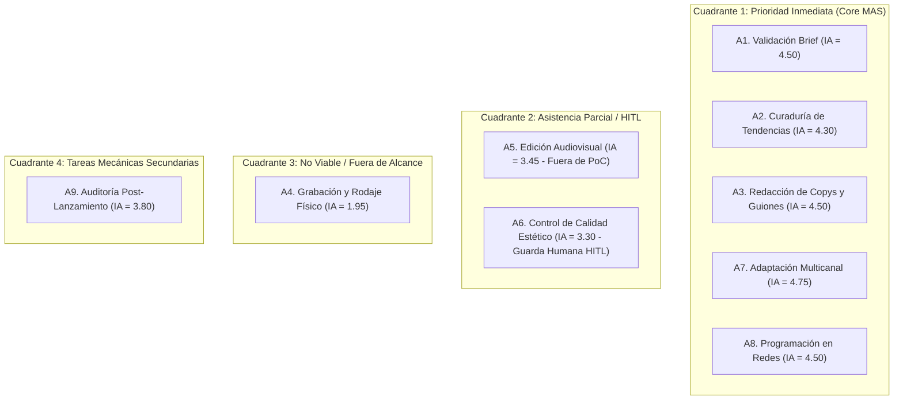

# Anexo 9. Matriz de Evaluación del Índice de Automatización (IA)

<b>Capítulo:</b> 2 (Diagnóstico Operativo) &nbsp;|&nbsp; 
<b>Objetivo Específico:</b> OE1 &nbsp;|&nbsp; 
<b>Investigador:</b> Alvaro Felipe Lopez Russi &nbsp;|&nbsp; 
<b>Entidad:</b> ITY SAS / Universidad Católica de Colombia

## 1. Definición Metodológica del Índice de Automatización (IA)

Para seleccionar objetivamente qué etapas del flujo operativo debían ser intervenidas mediante el sistema multiagente, se diseñó una matriz multicriterio basada en el **Índice de Automatización** ($IA$). Este modelo cuantitativo evalúa la idoneidad técnica y económica de transferir una tarea humana a un agente de software inteligente.

El índice se calcula como un promedio ponderado de cuatro dimensiones clave:
$$IA = (w_1 \times R) + (w_2 \times E) + (w_3 \times V) + (w_4 \times D)$$

Donde cada dimensión se califica en una escala de 1 a 5 y los pesos asignados ($w_i$) reflejan las prioridades estratégicas de ITY SAS:

1. **Repetitividad y Frecuencia ($R$, peso $w_1 = 0,30$):** Frecuencia con la que se ejecuta la tarea en la agencia. (1: Esfuerzo esporádico $\rightarrow$ 5: Múltiples veces al día en cada pieza).
2. **Estructurabilidad y Reglas Claras ($E$, peso $w_2 = 0,25$):** Grado en que la tarea puede formalizarse mediante contratos de datos y reglas lógicas. (1: Juicio subjetivo puro $\rightarrow$ 5: Algoritmizable y tipada).
3. **Volumen de Tiempo Consumido ($V$, peso $w_3 = 0,25$):** Magnitud de horas directas de trabajo humano que la actividad demanda en la línea base. (1: $<15$ min $\rightarrow$ 5: $>4$ horas/pieza).
4. **Disponibilidad de Herramientas y APIs ($D$, peso $w_4 = 0,20$):** Factibilidad de integración con modelos de lenguaje y APIs de terceros. (1: Silo cerrado $\rightarrow$ 5: Ecosistema REST/OpenAPI maduro).

---

## 2. Matriz de Evaluación de las Actividades de la Cadena de Valor

La siguiente tabla refleja la evaluación individual de las actividades clave del proceso:

| Actividad Evaluada en el Flujo | Repetitividad ($R$, 30%) | Estructurabilidad ($E$, 25%) | Volumen Tiempo ($V$, 25%) | Disponibilidad APIs ($D$, 20%) | Puntuación IA Final | Veredicto Operativo |
|---|:---:|:---:|:---:|:---:|:---:|:---:|
| **A1. Validación de Brief e Ingesta** | 5 | 4 | 4 | 5 | **4,50** | **Candidato Óptimo (Agente Ideación)** |
| **A2. Curaduría de Tendencias de Mercado** | 5 | 3 | 5 | 4 | **4,30** | **Candidato Óptimo (Tools / RAG)** |
| **A3. Redacción de Copys y Guiones** | 5 | 4 | 4 | 5 | **4,50** | **Candidato Óptimo (LLM Gateway)** |
| **A4. Grabación y Rodaje Físico** | 2 | 1 | 4 | 1 | **1,95** | **No Viable (Requiere Talento Humano)** |
| **A5. Edición y Montaje Audiovisual** | 5 | 2 | 5 | 2 | **3,45** | **Parcialmente Asistible (Fuera de PoC)** |
| **A6. Control de Calidad Estético** | 4 | 3 | 3 | 3 | **3,30** | **Compuerta Humana Obligatoria (HITL)** |
| **A7. Adaptación Multicanal de Copys** | 5 | 5 | 4 | 5 | **4,75** | **Candidato Óptimo (Agente Publicación)** |
| **A8. Programación en Meta Suite / Redes** | 5 | 5 | 3 | 5 | **4,50** | **Candidato Óptimo (Microservicio Postiz)** |
| **A9. Auditoría y Registro Post-Lanzamiento** | 5 | 4 | 2 | 4 | **3,80** | **Automatizable Secundaria** |

---

## 3. Justificación Técnica de las Decisiones de Alcance

*Figura 1. Cuadrante estratégico de priorización tecnológica.*

1. **Selección del Core del Sistema Multiagente (Cuadrante 1):**
   Las actividades **A1, A2 y A3** obtuvieron un $IA \ge 4,30$ y atacan directamente la causa raíz de la restricción R1 (briefs ambiguos e inconsistencias de tono), lo que fundamentó la creación del **Agente de Ideación**. Por su parte, las actividades **A7 y A8** ($IA \ge 4,50$) atacan la restricción R3, justificando la creación del **Agente de Publicación**.
2. **Exclusión de la Edición Audiovisual Completa (A5) y el Rodaje (A4):**
   Aunque la edición concentra el mayor volumen de tiempo ($V=5$), su estructurabilidad es baja ($E=2$) debido a que el corte de ritmo, el criterio estético y la narrativa visual dependen altamente del juicio humano subjetivo. Intentar reemplazar al editor audiovisual con agentes de software habría introducido una complejidad técnica inmanejable para una prueba de concepto de trabajo de grado, violando el principio de viabilidad.
3. **Incorporación de la Guarda Humana (A6):**
   El control de calidad interno se conservó como un paso estrictamente humano mediante una compuerta *Human-in-the-Loop* (HITL) previa al despacho a redes, satisfaciendo la exigencia unánime de los stakeholders de ITY SAS.

