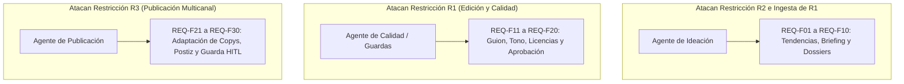

# Anexo 12. Matriz Detallada de los 30 Requisitos Funcionales (FR)

<b>Capítulo:</b> 3 (Especificación de Requerimientos) &nbsp;|&nbsp; 
<b>Objetivo Específico:</b> OE2 &nbsp;|&nbsp; 
<b>Investigador:</b> Alvaro Felipe Lopez Russi &nbsp;|&nbsp; 
<b>Entidad:</b> ITY SAS / Universidad Católica de Colombia

## 1. Introducción y Marco de Especificación

Este anexo despliega la matriz exhaustiva de los **30 Requisitos Funcionales (FR)** que definen el comportamiento operativo del sistema multiagente en ITY SAS. Los requerimientos fueron elicitados conforme al estándar **IEEE Std 830-1998**, priorizados mediante la dinámica **MoSCoW** (Must have, Should have, Could have, Won't have) durante el taller participativo con los directivos de la agencia y formalizados bajo la estructura de **Historias de Usuario** con criterios de aceptación verificables.

La distribución de los 30 requerimientos ataca directamente los tres cuellos de botella priorizados en la Fase de Diagnóstico (OE1):
* **Agente 1 - Ideación y Estrategia (REQ-F01 a REQ-F10):** Focalizado en resolver la restricción R2 y neutralizar la causa raíz de R1 mediante la validación temprana de briefs y la curaduría de tendencias.
* **Agente 2 - Control de Calidad y Edición Asistida (REQ-F11 a REQ-F20):** Focalizado en mitigar la restricción R1 mediante validación estructural de dossiers, alineación de tono de marca y verificación de licencias.
* **Agente 3 - Publicación Multicanal y Scheduling (REQ-F21 a REQ-F30):** Focalizado en resolver la restricción R3 mediante la bifurcación de copys específicos por red social y el despacho asistido vía API.

---

## 2. Catálogo Completo de los 30 Requisitos Funcionales

| Código | Módulo / Agente | Nombre del Requisito | Historia de Usuario | Prioridad MoSCoW | Criterio de Aceptación | Cuello Atacado |
|:---:|---|---|---|:---:|---|:---:|
| **REQ-F01** | Agente Ideación | Consulta de tendencias activas | Como Community Manager, quiero consultar automáticamente tendencias en redes, para inspirar briefs con temas virales. | **Must** | Respuesta JSON con al menos 5 temas y volumen de menciones. | R2 |
| **REQ-F02** | Agente Ideación | Brief estructurado | Como Community Manager, quiero generar un borrador estructurado de brief, para no omitir campos clave de campaña. | **Must** | Generación de brief completo con objetivo, audiencia y formato. | R2 / R1 |
| **REQ-F03** | Agente Ideación | Validación semántica de brief | Como Líder de Proyecto, quiero que el sistema valide la coherencia del brief, para rechazar solicitudes ambiguas. | **Must** | Veredicto 'aprobado' o 'rechazado con observaciones' en $<5$ s. | R1 |
| **REQ-F04** | Agente Ideación | Sugerencia de formato | Como Community Manager, quiero recibir una recomendación de formato (Reel/Post), para maximizar engagement. | **Should** | Justificación basada en el rendimiento histórico de la marca. | R2 |
| **REQ-F05** | Agente Ideación | Rendimiento histórico de cuenta | Como Estratega, quiero consultar métricas históricas de la marca, para replicar patrones exitosos. | **Should** | Top 5 publicaciones con mayor alcance de los últimos 90 días. | R2 |
| **REQ-F06** | Agente Ideación | Monitoreo de competidores | Como Estratega, quiero recibir un resumen de publicaciones de competidores, para detectar brechas de contenido. | **Should** | Listado de 3 competidores con temas clave y formatos usados. | R2 |
| **REQ-F07** | Agente Ideación | Alineación con tono de marca | Como Director Creativo, quiero ser alertado si el concepto desvía la voz de marca, para preservar coherencia. | **Must** | Alerta temprana si el score de similitud semántica cae bajo 0,75. | R1 |
| **REQ-F08** | Agente Ideación | Ideas temáticas multicanal | Como Redactor, quiero recibir 3 ángulos conceptuales por brief, para elegir el más afín a la audiencia. | **Must** | 3 variantes de copy diferenciadas por hook inicial y tono. | R2 |
| **REQ-F09** | Agente Ideación | Sugerencia de KPIs esperados | Como Líder de Cuenta, quiero recibir un rango estimado de alcance e interacciones, para fijar expectativas. | **Could** | Rango estimado con intervalo de confianza del 80%. | R2 |
| **REQ-F10** | Agente Ideación | Exportación de dossier | Como Director Creativo, quiero exportar el dossier de ideación en JSON/PDF, para revisión formal previa. | **Must** | Dossier estandarizado conforme al esquema Pydantic. | R1 / R2 |
| **REQ-F11** | Agente Calidad | Validación de guion técnico | Como Editor Audiovisual, quiero que el guion incluya minutero y gancho, para agilizar el montaje. | **Must** | Guion estructurado en gancho (0-3 s), cuerpo y CTA final. | R1 |
| **REQ-F12** | Agente Calidad | Ingesta de assets de marca | Como Diseñador, quiero acceder centralizadamente a logos y paletas, para no buscar en carpetas dispersas. | **Must** | Acceso tipado a logos SVG, tipografías y códigos HEX de marca. | R1 |
| **REQ-F13** | Agente Calidad | Control de tono y léxico prohibido | Como Director Creativo, quiero verificar que el texto no incluya términos vetados, para evitar sanciones. | **Must** | Detección determinista del 100% de palabras prohibidas. | R1 |
| **REQ-F14** | Agente Calidad | Verificación de claims publicitarios | Como Gerente de Mercadeo, quiero validar afirmaciones comerciales, para cumplir normatividad legal. | **Should** | Alerta ante términos absolutos ('el mejor', 'garantizado'). | R1 |
| **REQ-F15** | Agente Calidad | Adecuación de subtítulos automáticos | Como Editor, quiero generar transcripciones y subtítulos SRT, para mejorar retención en video. | **Could** | Archivo .srt sincronizado con margen de error $<0,5$ s. | R1 |
| **REQ-F16** | Agente Calidad | Verificación de licencias de audio | Como Editor, quiero validar que las pistas musicales tengan licencia comercial, para evitar bloqueos. | **Must** | Confirmación de estatus libre de copyright o biblioteca Meta. | R1 |
| **REQ-F17** | Agente Calidad | Validación de resolución y aspecto | Como Diseñador, quiero verificar dimensiones técnicas (9:16, 1:1, 4:5), para asegurar calidad visual. | **Must** | Verificación técnica de resolución y framerate exactos. | R1 / R3 |
| **REQ-F18** | Agente Calidad | Sugerencias de encuadre y corte | Como Editor, quiero recibir recomendaciones de ritmo de corte, para retener la atención de la audiencia. | **Could** | Marcas de tiempo sugeridas para cortes de transición. | R1 |
| **REQ-F19** | Agente Calidad | Control de cambios y versionado | Como Líder de Cuenta, quiero comparar versiones v1, v2 y v3 de copys, para verificar correcciones. | **Must** | Historial de versiones con diff estructurado por fecha y autor. | R1 |
| **REQ-F20** | Agente Calidad | Visto bueno interno de calidad | Como Director Creativo, quiero emitir aprobación interna formal, para desbloquear la fase de publicación. | **Must** | Registro de firma digital y marca temporal de conformidad. | R1 |
| **REQ-F21** | Agente Publicación | Adaptación de copys por red | Como Community Manager, quiero copys adaptados a Instagram, LinkedIn y TikTok, para optimizar impacto. | **Must** | 3 textos adaptados respetando límites de caracteres y etiquetas. | R3 |
| **REQ-F22** | Agente Publicación | Generación inteligente de hashtags | Como Community Manager, quiero hashtags categorizados por volumen, para mejorar descubribilidad. | **Must** | Bloque de 5 a 15 hashtags filtrados por nicho y tendencia. | R3 |
| **REQ-F23** | Agente Publicación | Previsualización en dispositivo | Como Líder de Cuenta, quiero previsualizar el feed antes de publicar, para validar estética general. | **Should** | Render visual simulado de la interfaz móvil de la red social. | R3 |
| **REQ-F24** | Agente Publicación | Sugerencia de hora de publicación | Como Community Manager, quiero recomendación de hora óptima por canal, para maximizar alcance inicial. | **Should** | Slot horario sugerido según datos de actividad de seguidores. | R3 |
| **REQ-F25** | Agente Publicación | Enlace a Meta Business Suite | Como Community Manager, quiero programar posts directamente vía API, para eliminar carga manual. | **Must** | Despacho exitoso con HTTP 200/201 en la API de publicación. | R3 |
| **REQ-F26** | Agente Publicación | Notificación a WhatsApp de cliente | Como Líder de Cuenta, quiero enviar enlace de visto bueno al cliente, para agilizar aprobaciones. | **Could** | Notificación con preview y botones de Aceptar / Cambios. | R3 |
| **REQ-F27** | Agente Publicación | Publicación multicanal simultánea | Como Community Manager, quiero programar el mismo contenido en varias redes, para ahorrar tiempo. | **Must** | Ejecución desacoplada en paralelo para Instagram y TikTok. | R3 |
| **REQ-F28** | Agente Publicación | Alerta de fallos de publicación | Como Administrador, quiero recibir alertas si expira un token o falla un post, para corregir de inmediato. | **Must** | Notificación crítica en $<60$ s vía webhook con código de error. | R3 |
| **REQ-F29** | Agente Publicación | Guarda de aprobación humana (HITL) | Como Director Creativo, quiero que ningún post se despache sin aprobación, para garantizar control ético. | **Must** | **Bloqueo determinista HTTP 409 (ADR-008)** sin aprobación previa. | R1 / R3 |
| **REQ-F30** | Agente Publicación | Bitácora de auditoría de salida | Como Gerente de Mercadeo, quiero consultar el log de publicaciones realizadas, para control administrativo. | **Must** | Registro inmutable en base de datos con id, timestamp y URL pública. | R3 |

---

## 3. Diagrama de Trazabilidad Requerimientos vs. Agentes

*Figura 1. Descomposición de los 30 requisitos funcionales por agente y restricción.*
