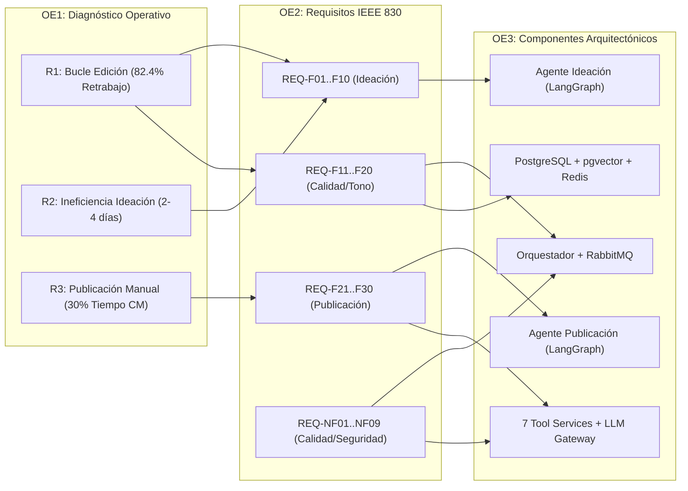

# Anexo 15. Matriz de Trazabilidad Extendida (Cuellos de Botella vs. Requerimientos)

<b>Capítulo:</b> 3 (Especificación de Requerimientos) &nbsp;|&nbsp; 
<b>Objetivo Específico:</b> OE2 &nbsp;|&nbsp; 
<b>Investigador:</b> Alvaro Felipe Lopez Russi &nbsp;|&nbsp; 
<b>Entidad:</b> ITY SAS / Universidad Católica de Colombia

## 1. Propósito de la Trazabilidad Bidireccional

La ingeniería de software exige que ninguna línea de código ni requisito funcional exista de forma aislada; cada requerimiento debe justificarse como una respuesta directa a una falla identificada en el diagnóstico operativo (OE1), y cada componente arquitectónico debe trazar su origen a uno o más requerimientos formalmente aprobados (OE2).

Este anexo consolida la **Matriz de Trazabilidad Extendida**, demostrando la cobertura del 100% de las tres restricciones operativas priorizadas en ITY SAS mediante los 30 Requisitos Funcionales (FR), 9 Requisitos No Funcionales (NFR) y 10 Interfaces Externas (IE).

---

## 2. Matriz de Trazabilidad: Restricción Diagnóstica $\rightarrow$ Requerimientos $\rightarrow$ Componentes

| Restricción Operativa (OE1) | Causa Raíz Diagnosticada | Requisitos Funcionales Asociados (OE2) | Requisitos No Funcionales (NFR) | Interfaces Externas Involucradas | Componente del Sistema Multiagente (OE3) |
|---|---|---|---|---|---|
| **R1: Bucle de Edición y Retrabajo Interno** (Prioridad 1, 82,4% retrabajo en Reels, LT = 134,9 h) | Briefs ambiguos por WhatsApp, falta de validación semántica temprana y desalineación con la guía de estilo de marca. | **REQ-F02**, **REQ-F03**, **REQ-F07**, **REQ-F10**, **REQ-F11**, **REQ-F12**, **REQ-F13**, **REQ-F14**, **REQ-F16**, **REQ-F17**, **REQ-F19**, **REQ-F20**, **REQ-F29** | REQ-NF04 (Seguridad/Secretos), REQ-NF07 (Fallback LLM), REQ-NF09 (Aislamiento Marca) | `REQ-IE03` (FFmpeg/Validación), `REQ-IE04` (LLM Gateway), `REQ-IE07` (WhatsApp/Alertas), `REQ-IE10` (MinIO/S3 Assets) | • **Agente de Ideación** (Validador semántico Pydantic) • **Microservicio RAG** (Memoria semántica PostgreSQL pgvector) • **Orquestador** (Guarda de entrega HITL ADR-008) |
| **R2: Ineficiencia en la Ideación y Estrategia** (Prioridad 2, 2 a 4 días por parrilla, bloqueo creativo) | Búsqueda manual no sistemática de tendencias en redes sociales y falta de ingesta estructurada de competidores. | **REQ-F01**, **REQ-F02**, **REQ-F04**, **REQ-F05**, **REQ-F06**, **REQ-F08**, **REQ-F09**, **REQ-F10** | REQ-NF02 (Latencia $<5$ s), REQ-NF05 (Concurrencia 10 briefs), REQ-NF07 (Fallback Resiliente) | `REQ-IE01` (TikTok Research API), `REQ-IE02` (Instagram Graph API), `REQ-IE04` (LLM Gateway), `REQ-IE08` (YouTube Data API) | • **Microservicio Tool-Trends** (Scraping y tendencias) • **Microservicio Tool-Competitors** (Monitoreo de competencia) • **Agente de Ideación** (Generador de ángulos creativos) |
| **R3: Adaptación Manual y Programación Multicanal** (Prioridad 3, 30% del tiempo de CM en Meta Suite) | Formateo manual repetitivo de textos por red, copiado y pegado en Meta Suite y verificación manual post-publicación. | **REQ-F17**, **REQ-F21**, **REQ-F22**, **REQ-F23**, **REQ-F24**, **REQ-F25**, **REQ-F26**, **REQ-F27**, **REQ-F28**, **REQ-F29**, **REQ-F30** | REQ-NF01 (Microservicios Docker), REQ-NF03 (Disponibilidad 99,5%), REQ-NF06 (Audit Logs 90 d) | `REQ-IE04` (LLM Gateway), `REQ-IE05` (Postiz API / Meta Suite), `REQ-IE06` (Vault Secretos), `REQ-IE09` (Prometheus Métricas) | • **Agente de Publicación** (Bifurcación por canal en LangGraph) • **Microservicio Tool-Postiz** (Despacho REST a redes sociales) • **PostgreSQL** (Tabla inmutable de publicaciones auditadas) |

---

## 3. Grafo de Trazabilidad Integral

*Figura 1. Grafo de trazabilidad extremo a extremo entre diagnóstico, requerimientos y arquitectura.*

---

## 4. Conclusiones del Análisis de Trazabilidad

1. **Cobertura Completa (100%):** Ningún cuello de botella quedó sin requisitos asociados. La restricción R1 cuenta con 13 requisitos que la neutralizan desde el origen (briefing) hasta el control final (HITL).
2. **Eficiencia en la Asignación de Recursos:** Cada microservicio diseñado en el Capítulo 4 responde exactamente a uno o más requisitos funcionales, impidiendo la inclusión de funcionalidades innecesarias (*gold plating*).
