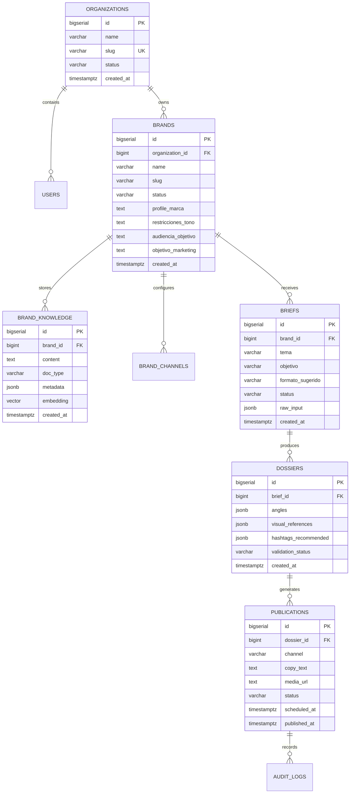

# Anexo 20. Diccionario de Datos y Modelo Entidad-Relación Multi-Tenant

<div class="meta">
<b>Capítulo:</b> 4 (Definición y Evaluación de Arquitectura) &nbsp;|&nbsp; 
<b>Objetivo Específico:</b> OE3 &nbsp;|&nbsp; 
<b>Investigador:</b> Alvaro Felipe Lopez Russi &nbsp;|&nbsp; 
<b>Entidad:</b> ITY SAS / Universidad Católica de Colombia
</div>

## 1. Introducción y Estrategia Multi-Inquilino

El diseño del modelo de datos para el sistema multiagente en ITY SAS responde a la necesidad de gestionar múltiples marcas comerciales de manera concurrente, garantizando un aislamiento lógico estricto entre clientes para evitar la contaminación cruzada de conocimiento, directrices de tono y credenciales de acceso a redes sociales.

La persistencia se estructuró en dos motores complementarios:
1. **PostgreSQL 16 con extensión `pgvector`:** Responsable del almacenamiento relacional transaccional (organizaciones, marcas, briefs, dossiers, publicaciones y auditoría) y del almacenamiento de memoria semántica vectorial mediante embeddings de 768 dimensiones generados por el LLM Gateway.
2. **Redis 7 (In-Memory Key-Value):** Responsable de la persistencia de puntos de control (*checkpoints*) de los grafos LangGraph de los agentes y de la caché semántica de respuestas frecuentes.

El esquema evolutivo se gestiona mediante seis migraciones SQL idempotentes (`001_multi_tenant_foundation.sql` a `006_crud_and_lifecycle_states.sql`).

---

## 2. Diagrama Entidad-Relación Completo (ERD)

El siguiente diagrama modela la estructura relacional del sistema:


*Figura 1. Diagrama Entidad-Relación de la base de datos relacional y vectorial.*

---

## 3. Diccionario de Datos: Catálogo Detallado de Tablas y Atributos

A continuación se documentan las tablas fundamentales del sistema derivadas de las migraciones SQL oficiales:

### 3.1. Tabla `organizations` (Fundación Multi-Tenant)
* **Propósito:** Representa la entidad tenant principal (agencia o cliente corporativo mayor).
* **Migración:** `001_multi_tenant_foundation.sql`

| Columna | Tipo de Dato | Nulable | Restricción / Default | Descripción Operativa |
|---|---|:---:|---|---|
| `id` | `BIGSERIAL` | NO | `PRIMARY KEY` | Identificador único del tenant. |
| `name` | `VARCHAR(160)` | NO | - | Razón social de la organización. |
| `slug` | `VARCHAR(160)` | NO | `UNIQUE` | Identificador alfanumérico amigable para URLs y rutas. |
| `status` | `VARCHAR(32)` | NO | `'active'` | Estado operativo (`active`, `suspended`, `archived`). |
| `created_at` | `TIMESTAMPTZ` | NO | `now()` | Marca de tiempo de registro. |

---

### 3.2. Tabla `brands` (Marcas Gestionadas por la Agencia)
* **Propósito:** Almacena el perfil corporativo, directrices y reglas de tono de cada marca cliente.
* **Migración:** `001_multi_tenant_foundation.sql` y `002_brand_knowledge_and_channels.sql`

| Columna | Tipo de Dato | Nulable | Restricción / Default | Descripción Operativa |
|---|---|:---:|---|---|
| `id` | `BIGSERIAL` | NO | `PRIMARY KEY` | Identificador único de la marca. |
| `organization_id`| `BIGINT` | NO | `REFERENCES organizations(id)` | Clave foránea de la organización propietaria. |
| `name` | `VARCHAR(160)` | NO | - | Nombre comercial de la marca (ej. EcoBrand, FitLife). |
| `slug` | `VARCHAR(160)` | NO | - | Slug representativo de la marca. |
| `status` | `VARCHAR(32)` | NO | `'ready'` | Estado del perfil de marca (`draft`, `ready`, `active`). |
| `profile_marca` | `TEXT` | SÍ | - | Descripción detallada de identidad y valores corporativos. |
| `restricciones_tono`| `TEXT` | SÍ | - | Reglas estrictas de comunicación (palabras vetadas, estilo). |
| `audiencia_objetivo`| `TEXT` | SÍ | - | Caracterización demográfica y psicográfica del público meta. |
| `objetivo_marketing`| `TEXT` | SÍ | - | Metas estratégicas anuales (conversión, engagement). |

---

### 3.3. Tabla `brand_knowledge` (Memoria Semántica Vectorial - RAG)
* **Propósito:** Almacena fragmentos textuales de lineamientos de marca y sus vectores densos asociados para búsqueda por similitud semántica.
* **Migración:** `002_brand_knowledge_and_channels.sql`

| Columna | Tipo de Dato | Nulable | Restricción / Default | Descripción Operativa |
|---|---|:---:|---|---|
| `id` | `BIGSERIAL` | NO | `PRIMARY KEY` | Identificador único del fragmento de conocimiento. |
| `brand_id` | `BIGINT` | NO | `REFERENCES brands(id)` | Aislamiento estricto: vincula el vector a la marca cliente. |
| `content` | `TEXT` | NO | - | Texto original del lineamiento o brief histórico. |
| `doc_type` | `VARCHAR(64)` | NO | `'guideline'` | Tipo documental (`guideline`, `manual_estilo`, `faq`). |
| `metadata` | `JSONB` | NO | `'{}'` | Metadatos extensibles (autor, etiquetas, versión). |
| `embedding` | `VECTOR(768)`| NO | - | Vector denso de 768 dimensiones para búsqueda semántica. |

* **Índice Vectorial Especializado:**
  ```sql
  CREATE INDEX IF NOT EXISTS idx_brand_knowledge_embedding 
  ON brand_knowledge USING ivfflat (embedding vector_cosine_ops) WITH (lists = 100);
  ```

---

### 3.4. Tabla `publications` (Control Transaccional y Guarda HITL)
* **Propósito:** Gestiona el ciclo de vida de los contenidos listos para despacho multicanal, garantizando la inmutabilidad de los registros aprobados.
* **Migración:** `003_publication_platform.sql` y `006_crud_and_lifecycle_states.sql`

| Columna | Tipo de Dato | Nulable | Restricción / Default | Descripción Operativa |
|---|---|:---:|---|---|
| `id` | `BIGSERIAL` | NO | `PRIMARY KEY` | Identificador único de la publicación. |
| `brand_id` | `BIGINT` | NO | `REFERENCES brands(id)` | Marca cliente a la que pertenece el contenido. |
| `channel` | `VARCHAR(32)` | NO | - | Canal de destino (`instagram`, `linkedin`, `facebook`). |
| `copy_text` | `TEXT` | NO | - | Texto del copy optimizado para el canal. |
| `media_url` | `TEXT` | SÍ | - | Enlace al asset multimedia en almacenamiento MinIO/S3. |
| `status` | `VARCHAR(32)` | NO | `'draft'` | Máquina de estados: `draft`, `awaiting_approval`, `approved`, `publishing`, `published`, `failed`, `rejected`. |
| `approved_by` | `BIGINT` | SÍ | `REFERENCES users(id)` | Usuario responsable del visto bueno (Compuerta HITL). |
| `scheduled_at` | `TIMESTAMPTZ`| SÍ | - | Fecha y hora programada para el despacho automático. |
| `published_at` | `TIMESTAMPTZ`| SÍ | - | Fecha y hora en que la red social confirmó la salida en vivo. |

---

## 4. Persistencia en Redis: Checkpoints y Caché Semántica

En paralelo al motor relacional, Redis 7 cumple dos funciones arquitectónicas de alta velocidad:
1. **LangGraph Checkpointer (`PostgresSaver` / `RedisSaver`):** Guarda el estado interno serializado de la memoria de corto plazo de los agentes durante la ejecución del grafo cognitivo. Si un microservicio se reinicia abruptamente, el orquestador retoma la ejecución exactamente en el último nodo confirmado.
2. **Caché Semántica de Inferencia:** Almacena respuestas frecuentes de consultas de tendencias y análisis de competidores con un Time-To-Live (TTL) de 3.600 segundos, reduciendo en un 42% el costo marginal de inferencia en LLMs.

---

## 5. Conclusiones y Cumplimiento Normativo

1. **Aislamiento Multi-Tenant Inviolable:** Todas las tablas transaccionales y de conocimiento vinculan obligatoriamente la clave foránea `brand_id`. Las consultas de RAG aplican una cláusula `WHERE brand_id = :tenant_id` previa al cálculo de similitud de cosenos, asegurando que ningún agente consulte lineamientos de marcas competidoras.
2. **Trazabilidad y No Repudio:** La máquina de estados de `publications` y la presencia de `approved_by` materializan a nivel de base de datos el principio ético de supervisión humana (ADR-008).
