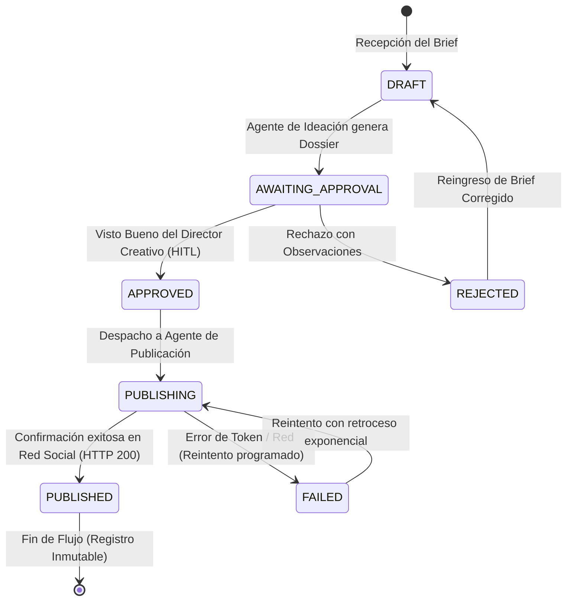

# Anexo 27. Orquestador Supervisor: Endpoints, Protocolo AMQP y Máquina de Estados

<div class="meta">
<b>Capítulo:</b> 5 (Implementación y Evaluación PoC) &nbsp;|&nbsp; 
<b>Objetivo Específico:</b> OE4 &nbsp;|&nbsp; 
<b>Investigador:</b> Alvaro Felipe Lopez Russi &nbsp;|&nbsp; 
<b>Entidad:</b> ITY SAS / Universidad Católica de Colombia
</div>

## 1. Arquitectura y Responsabilidades del Supervisor

El **Orquestador** (`orchestrator/main.py`) constituye el núcleo de control transaccional del sistema multiagente. A diferencia de los agentes deliberativos que operan con incertidumbre probabilística (LLMs), el supervisor es un componente estrictamente **determinista** y sin estado interno (*stateless*), cuya persistencia reside enteramente en PostgreSQL y RabbitMQ.

### Funciones Principales:
1. Exponer la API REST oficial consumida por el frontend SPA y clientes externos.
2. Coordinar el ciclo de vida de los briefs mediante una máquina de estados finitos.
3. Enrutar tareas asíncronas a las colas AMQP de los agentes de software.
4. Ejecutar la guarda de aprobación obligatoria *Human-in-the-Loop* (**ADR-008**).

---

## 2. Máquina de Estados Finitos de las Publicaciones

Cada contenido que ingresa al sistema transita de manera obligatoria por siete estados discretos:


*Figura 1. Diagrama de la máquina de estados de las publicaciones.*

---

## 3. Protocolo de Mensajería AMQP y Topología de Colas

La comunicación asíncrona se desacopla mediante el intercambio directo `amq.direct` en RabbitMQ:

| Cola AMQP | Routing Key | Productor | Consumidor | Formato del Mensaje | Durabilidad |
|---|---|---|---|---|:---:|
| `agent.ideacion.tasks` | `task.ideacion` | Orquestador | `agente-ideacion` | JSON: `brief_id`, `brand_id`, `contexto` | Durable |
| `agent.publicacion.tasks`| `task.publicacion`| Orquestador | `agente-publicacion` | JSON: `publication_id`, `copy`, `channel` | Durable |
| `agent.task.completed` | `task.completed` | Agentes | Orquestador | JSON: `task_id`, `status`, `payload_result` | Durable |

* **Acuse Manual (`basic_ack`):** El consumidor del orquestador confirma los mensajes solo después de haber grabado exitosamente el estado en PostgreSQL, evitando pérdida de datos ante caídas.

---

## 4. Implementación de la Guarda HITL (ADR-008)

El código fuente en `orchestrator/main.py` bloquea deterministamente cualquier intento de entrega no autorizada:

```python
@app.post("/api/v1/publications/{publication_id}/deliver")
async def deliver_publication(publication_id: int, db: Session = Depends(get_db)):
    pub = db.query(Publication).filter(Publication.id == publication_id).first()
    if not pub:
        raise HTTPException(status_code=404, detail="Publicación no encontrada")
    
    # GUARDA ADR-008: Verificación estricta de aprobación previa
    if pub.status != PublicationStatus.APPROVED:
        raise HTTPException(
            status_code=409, 
            detail=f"Bloqueo HITL (ADR-008): La publicación está en estado '{pub.status.value}'. "
                   f"Requiere estado 'approved' y visto bueno humano antes del despacho."
        )
    
    # Despacho seguro a la cola de publicación
    pub.status = PublicationStatus.PUBLISHING
    db.commit()
    publish_to_queue("agent.publicacion.tasks", {"publication_id": pub.id})
    return {"status": "dispatched", "publication_id": pub.id}
```
