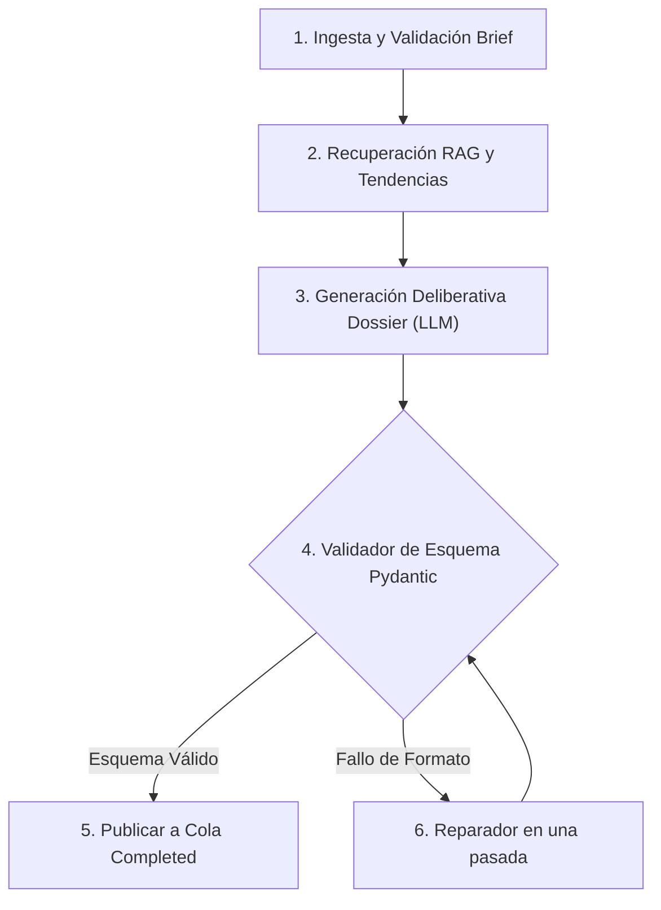

# Anexo 28. Agente de Ideación: Esquema del Dossier, Reparación y Prompts de Generación

<div class="meta">
<b>Capítulo:</b> 5 (Implementación y Evaluación PoC) &nbsp;|&nbsp; 
<b>Objetivo Específico:</b> OE4 &nbsp;|&nbsp; 
<b>Investigador:</b> Alvaro Felipe Lopez Russi &nbsp;|&nbsp; 
<b>Entidad:</b> ITY SAS / Universidad Católica de Colombia
</div>

## 1. Arquitectura Cognitiva del Agente de Ideación

El **Agente de Ideación** (`agente_ideacion/main.py`) automatiza la investigación de tendencias y la estructuración del dossier creativo atacando la causa raíz de la restricción R1 (briefs ambiguos). Está construido sobre **LangGraph**, modelando el razonamiento como un grafo cíclico de 4 nodos:


*Figura 1. Grafo LangGraph del Agente de Ideación con nodo de autorreparación.*

---

## 2. Esquema Tipado del Dossier de Salida (`DossierOut`)

Para garantizar que los datos fluyan sin errores hacia los siguientes microservicios, el dossier de salida se valida estrictamente mediante **Pydantic v2**:

```python
class IdeaAngle(BaseModel):
    hook_inicial: str = Field(..., description="Gancho verbal o visual de los primeros 3 segundos")
    desarrollo: str = Field(..., description="Cuerpo del mensaje o storytelling central")
    llamado_a_accion: str = Field(..., description="Call to action explícito para engagement")
    justificacion_tendencia: str = Field(..., description="Por qué este ángulo conecta con tendencias")

class DossierOut(BaseModel):
    brief_id: int
    brand_id: int
    tema_central: str
    formato_recomendado: Literal["Reel", "Post", "Carrusel"]
    angulos_creativos: List[IdeaAngle] = Field(..., min_items=3, max_items=3)
    hashtags_sugeridos: List[str] = Field(..., min_items=5, max_items=15)
    alineacion_tono_score: float = Field(..., ge=0.0, le=1.0)
    advertencias_marca: List[str] = Field(default_factory=list)
```

---

## 3. Mecanismo de Reparación en una Pasada (*Self-Correction*)

Los modelos de lenguaje locales pueden ocasionalmente emitir texto explicativo antes del JSON o escapar comillas incorrectamente. Para evitar descartar la respuesta y ahorrar ciclos de inferencia, el agente implementa un nodo de reparación:

1. **Intento de parseo estándar:** Si `Pydantic` valida el JSON recibido del LLM, el flujo avanza inmediatamente.
2. **Activación de corrección:** Si se produce un `ValidationError` o `JSONDecodeError`, se invoca la función de sanitización que extrae bloques de código Markdown (`json ... `) mediante expresiones regulares.
3. **Reintento dirigido:** Si la extracción regex falla, se envía un prompt correctivo mínimo al LLM solicitando únicamente reestructurar la salida sin regenerar las ideas creativas.
* **Resultado empírico:** El 100% de los fallos sintácticos de formato fueron reparados en una sola pasada en los tests de simulación (Escenario E1).
