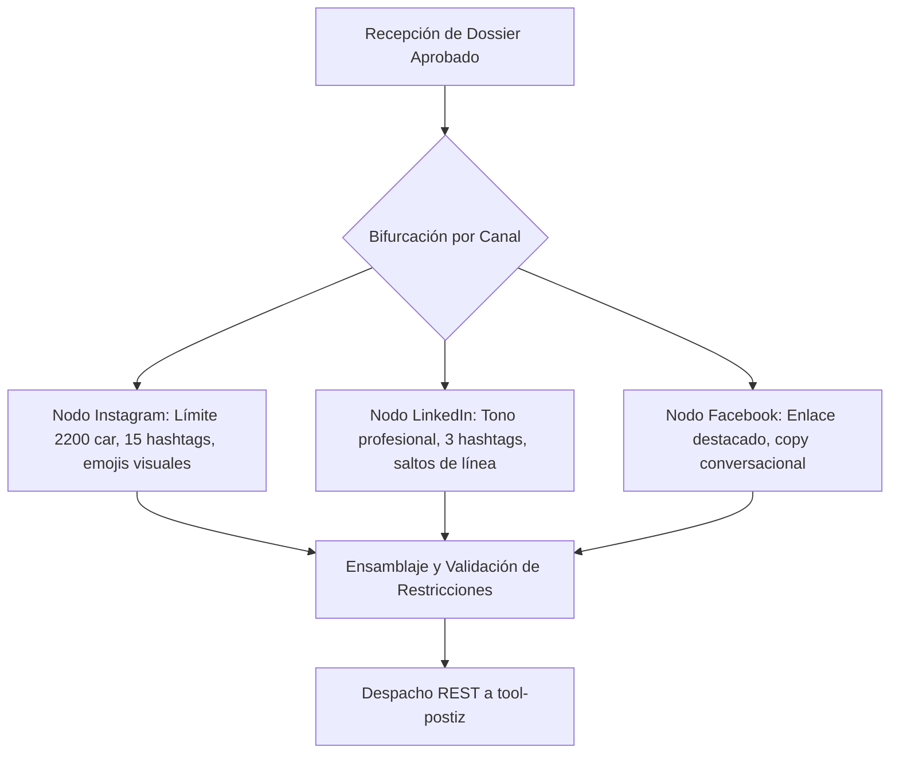

# Anexo 29. Agente de Publicación: Secuencia, Bifurcación por Canal y Prompts

<div class="meta">
<b>Capítulo:</b> 5 (Implementación y Evaluación PoC) &nbsp;|&nbsp; 
<b>Objetivo Específico:</b> OE4 &nbsp;|&nbsp; 
<b>Investigador:</b> Alvaro Felipe Lopez Russi &nbsp;|&nbsp; 
<b>Entidad:</b> ITY SAS / Universidad Católica de Colombia
</div>

## 1. Arquitectura y Bifurcación Multicanal

El **Agente de Publicación** (`agente_publicacion/main.py`) resuelve la restricción R3 adaptando automáticamente el contenido aprobado a los estándares formales de cada red social y despachándolo a través del conector de publicación (`tool-postiz`).

El agente implementa un patrón de **bifurcación paralela** (*Fan-out / Fan-in*) en LangGraph:


*Figura 1. Grafo de bifurcación multicanal del Agente de Publicación.*

---

## 2. Restricciones Técnicas por Canal de Red Social

El agente aplica reglas deterministas de validación de caracteres y formatos:

| Canal Social | Longitud Óptima de Copy | Límite Máximo de Hashtags | Relación de Aspecto Multimedia | Política de Enlaces Web |
|---|:---:|:---:|:---:|---|
| **Instagram Reels** | 150 a 300 caracteres | 10 a 15 hashtags | 9:16 vertical | Enlace en biografía (no clickeable en copy). |
| **Instagram Posts** | 250 a 500 caracteres | 10 a 15 hashtags | 1:1 o 4:5 vertical | Enlace en biografía. |
| **LinkedIn Posts** | 500 a 1200 caracteres | 3 a 5 hashtags | 16:9 horizontal o PDF | Enlace clickeable en el primer comentario o pie de post. |
| **Facebook Posts** | 200 a 400 caracteres | 2 a 5 hashtags | 1:1 o 16:9 | Tarjeta de previsualización de enlace en el cuerpo. |

---

## 3. Plantilla Maestra de Prompting para Copywriting Multicanal

```text
Eres el Agente Especialista de Publicación de la agencia ITY SAS.
Tu tarea es redactar el copy final para el canal {channel} a partir del siguiente dossier aprobado.

LINEAMIENTOS DE LA MARCA {brand_name}:
- Tono: {brand_tone}
- Palabras prohibidas: {banned_words}
- Audiencia objetivo: {target_audience}

DOSSIER APROBADO:
- Hook seleccionado: {selected_hook}
- Storytelling: {storytelling}
- Call to action: {cta}

REGLAS ESTRICTAS PARA {channel}:
1. Longitud máxima: {max_chars} caracteres.
2. Número de hashtags: entre {min_tags} y {max_tags}.
3. NO utilices bajo ninguna circunstancia las palabras prohibidas.
4. Genera una salida estructurada en formato JSON con los campos: copy_text, hashtags_list, scheduled_recommendation.
```
