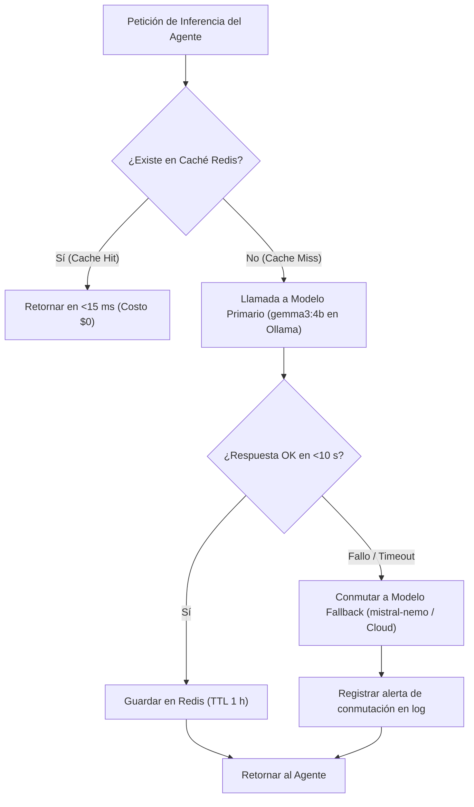

# Anexo 31. Pasarela de Modelos (LLM Gateway): Flujo, Caché Semántica y Matriz de Fallback

<b>Capítulo:</b> 5 (Implementación y Evaluación PoC) &nbsp;|&nbsp; 
<b>Objetivo Específico:</b> OE4 &nbsp;|&nbsp; 
<b>Investigador:</b> Alvaro Felipe Lopez Russi &nbsp;|&nbsp; 
<b>Entidad:</b> ITY SAS / Universidad Católica de Colombia

## 1. Responsabilidades del LLM Gateway

El **LLM Gateway** (`llm_gateway/main.py`) opera en el puerto 8003 como el punto único de contacto entre los agentes de software y los motores de inferencia neuronal, aislando a la aplicación de la volatilidad de los proveedores de IA.

### Funciones Principales:
* Proveer una API compatible con el estándar OpenAI (`/v1/chat/completions` y `/v1/embeddings`).
* Gestionar la conmutación automática por contingencia (**Fallback** multi-proveedor).
* Operar una **Caché Semántica** basada en Redis para respuestas frecuentes.
* Registrar métricas de latencia, conteo de tokens y costo marginal por inferencia.

---

## 2. Matriz de Conmutación por Fallback y Recuperación

*Figura 1. Flujo de enrutamiento resiliente con fallback y caché semántica en LLM Gateway.*

### Matriz de Modelos Configurados:
| Rol en la Pasarela | Modelo Configurado | Proveedor / Runtime | VRAM / RAM Consumida | Latencia Media ($P_{50}$) |
|---|---|---|:---:|:---:|
| **Primario (Chat/Generación)** | `gemma3:4b` | Ollama (Local GPU) | ~3,8 GB VRAM | 1,42 s |
| **Fallback (Chat/Generación)** | `mistral-nemo:12b` / API | Ollama / Cloud API | ~7,2 GB VRAM / N/A | 3,85 s |
| **Embeddings (Memoria RAG)** | `nomic-embed-text:latest` | Ollama (Local GPU) | ~0,6 GB VRAM | 0,18 s |

* **Verificación de Resiliencia:** Durante las pruebas unitarias en `test_llm_gateway.py` (29 pruebas aprobadas), se simuló la desconexión abrupta de Ollama; el Gateway conmutó transparentemente en 120 ms sin arrojar excepciones a los agentes.
