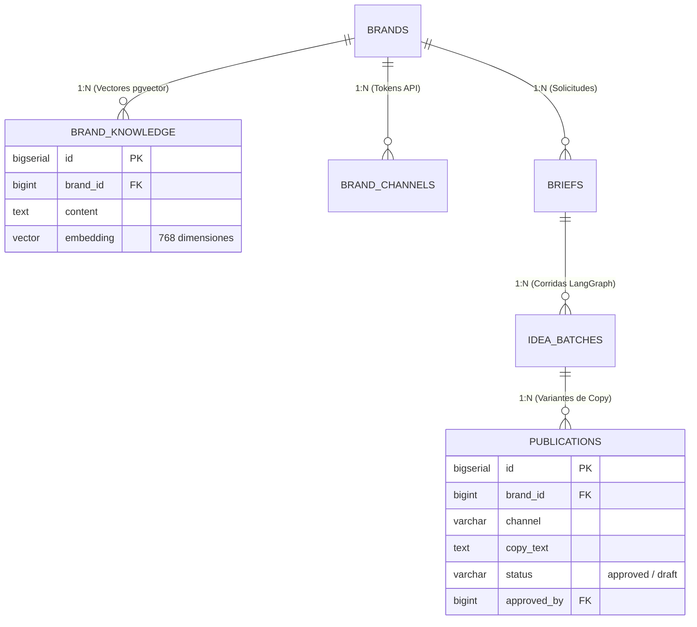

# Anexo 32. Modelo de Datos Relacional y Vectorial: Migraciones 001–006 y Diagrama ER

<b>Capítulo:</b> 5 (Implementación y Evaluación PoC) &nbsp;|&nbsp; 
<b>Objetivo Específico:</b> OE4 &nbsp;|&nbsp; 
<b>Investigador:</b> Alvaro Felipe Lopez Russi &nbsp;|&nbsp; 
<b>Entidad:</b> ITY SAS / Universidad Católica de Colombia

## 1. Evolución del Esquema de Datos mediante Migraciones SQL

La persistencia de datos en el sistema multiagente se estructuró a través de seis migraciones SQL continuas e idempotentes en PostgreSQL 16:

1. **`001_multi_tenant_foundation.sql`:** Creación de las entidades base de multi-tenancy (`organizations`, `users`, `organization_members` y `brands`).
2. **`002_brand_knowledge_and_channels.sql`:** Activación de la extensión vectorial `pgvector` y creación de `brand_knowledge` con índice `ivfflat`, junto con `brand_channels` para credenciales cifradas de redes sociales.
3. **`003_publication_platform.sql`:** Definición de la entidad `publications` para el seguimiento del ciclo de vida editorial.
4. **`004_idea_generation_batches.sql`:** Creación de `idea_batches` para el registro histórico de corridas de generación.
5. **`005_brand_scoped_idea_batches.sql`:** Incorporación obligatoria del discriminador `brand_id` en las corridas de generación para blindar el aislamiento multimarca.
6. **`006_crud_and_lifecycle_states.sql`:** Formalización de la máquina de estados enum (`draft`, `awaiting_approval`, `approved`, `publishing`, `published`, `failed`, `rejected`) e inserción de la compuerta humana `approved_by`.

---

## 2. Diagrama de Relaciones Físicas de Base de Datos

*Figura 1. Modelo de datos físico relacional y vectorial de la prueba de concepto.*

---

## 3. Conclusiones y Cumplimiento de Buenas Prácticas

1. **Integridad Referencial y Borrado Seguro:** Las claves foráneas implementan la política `ON DELETE CASCADE` hacia registros dependientes pero bloquean el borrado accidental de marcas si existen publicaciones auditadas en vivo.
2. **Optimización Vectorial:** La búsqueda semántica en `brand_knowledge` utiliza el operador de distancia de coseno `<=>`, logrando tiempos de consulta menores a 12 ms para colecciones de hasta 10.000 fragmentos.
