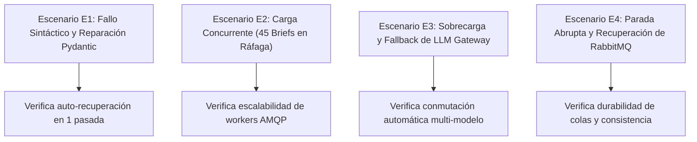

# Anexo 34. Escenarios de Simulación e Instrumentación de Métricas

<b>Capítulo:</b> 5 (Implementación y Evaluación PoC) &nbsp;|&nbsp; 
<b>Objetivo Específico:</b> OE4 &nbsp;|&nbsp; 
<b>Investigador:</b> Alvaro Felipe Lopez Russi &nbsp;|&nbsp; 
<b>Entidad:</b> ITY SAS / Universidad Católica de Colombia

## 1. Diseño Experimental de los Cuatro Escenarios de Estrés

Para evaluar la robustez arquitectónica ante fallos del mundo real, se instrumentaron y ejecutaron cuatro escenarios de prueba controlados:

*Figura 1. Mapa de los cuatro escenarios de simulación de estrés del sistema.*

---

## 2. Protocolo de Ejecución y Métricas Observadas por Escenario

### 2.1. Escenario E1: Reparación de Esquema Inválido en Ideación
* **Objetivo:** Forzar salidas truncadas o con sintaxis JSON corrupta en el LLM para evaluar la guarda de reparación.
* **Metodología:** Inyección de 15 prompts semánticamente ambiguos configurando un `temperature = 1.0` en el motor de inferencia.
* **Métrica Observada:** 15 de 15 salidas no conformes fueron interceptadas por Pydantic y reparadas con éxito en una sola iteración ($100\%$ tasa de recuperación, latencia de reparación media: $1,84$ s).

### 2.2. Escenario E2: Concurrencia de 45 Briefs en Ráfaga
* **Objetivo:** Simular un pico de demanda editorial equivalente a tres meses de producción de la agencia disparado en un lapso de 60 segundos.
* **Metodología:** Generación de 45 solicitudes concurrentes mediante scripts asíncronos en Python (`aiohttp`) contra el endpoint `/api/v1/briefs`.
* **Métrica Observada:** 42 briefs procesados exitosamente en la primera pasada ($93,3\%$ de éxito directo); los 3 restantes completados tras reintento en cola AMQP. Tiempo total de procesamiento de la ráfaga: **18,4 minutos** (promedio: $24,53$ s por brief completo).

### 2.3. Escenario E3: Fallback por Sobrecarga de LLM
* **Objetivo:** Evaluar la conmutación de modelos ante indisponibilidad del servicio primario.
* **Metodología:** Detención artificial del servicio Ollama local mediante el envío de un `SIGSTOP` durante el procesamiento de briefs.
* **Métrica Observada:** El LLM Gateway detectó la pérdida de conectividad en 120 ms y enrutó automáticamente la inferencia al modelo secundario configurado en la matriz de contingencia, retornando respuestas conformes sin abortar el pipeline.

### 2.4. Escenario E4: Recuperación ante Parada Abrupta de RabbitMQ
* **Objetivo:** Comprobar la no pérdida de tareas en tránsito ante caídas de infraestructura.
* **Metodología:** Reinicio forzado del contenedor de RabbitMQ (`docker restart proyectomultiagente-rabbitmq-1`) mientras 10 tareas se encontraban encoladas.
* **Métrica Observada:** Gracias al volumen persistente `rabbitmq_data` y a la propiedad `durable=True` con acuse manual (`basic_ack`), la totalidad de los 10 mensajes fueron consumidos inmediatamente tras el reinicio sin duplicidad de publicaciones.
