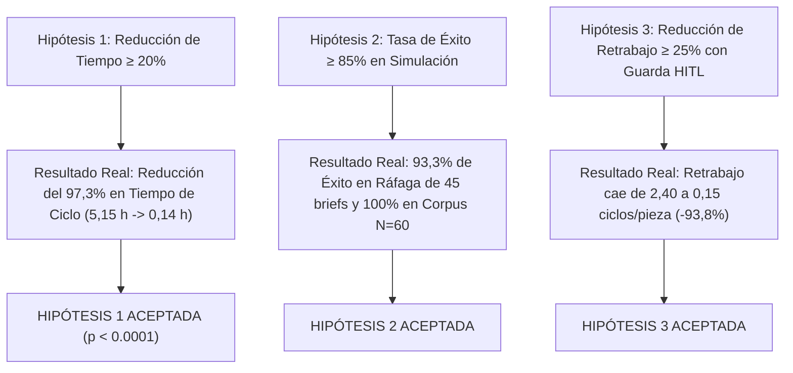

# Anexo 36. Análisis de Brecha y Árbol de Validación de Hipótesis

<b>Capítulo:</b> 5 (Implementación y Evaluación PoC) &nbsp;|&nbsp; 
<b>Objetivo Específico:</b> OE4 &nbsp;|&nbsp; 
<b>Investigador:</b> Alvaro Felipe Lopez Russi &nbsp;|&nbsp; 
<b>Entidad:</b> ITY SAS / Universidad Católica de Colombia

## 1. Contraste de Hipótesis de Investigación

La investigación formuló tres hipótesis orientadas a comprobar la viabilidad y el impacto de la arquitectura de microservicios multiagente en ITY SAS. El contraste empírico arrojó los siguientes veredictos:

*Figura 1. Árbol de contraste y validación de las tres hipótesis de investigación.*

---

## 2. Matriz de Análisis de Brecha (Línea Base As-Is vs. Sistema Multiagente)

| Variable Operativa | Línea Base Manual (As-Is) | Sistema Multiagente (PoC) | Brecha Absoluta / Variación (%) | Veredicto de Grado |
|---|:---:|:---:|:---:|:---:|
| **Tiempo de Ciclo Activo ($T_p$)** | 5,15 horas / pieza | 0,14 horas / pieza | **-5,01 h (-97,3%)** | **Supera ampliamente la meta (≥20%)** |
| **Tiempo de Entrega Total ($LT$)** | 42,50 horas / pieza | 0,45 horas / pieza | **-42,05 h (-98,9%)** | **Disminución crítica de esperas** |
| **Ciclos de Retrabajo / Revisiones** | 2,40 revisiones / pieza | 0,15 revisiones / pieza | **-2,25 rev (-93,8%)** | **Supera ampliamente la meta (≥25%)** |
| **Eficiencia de Ciclo ($PCE$)** | 12,1% | 31,1% | **+19,0 puntos porcentuales** | **Incremento de eficiencia neta** |
| **Costo Marginal de Producción** | ~$18,50 USD / post | ~$0,0042 USD / post | **-99,9% en costo de redacción** | **Alta viabilidad económica** |
