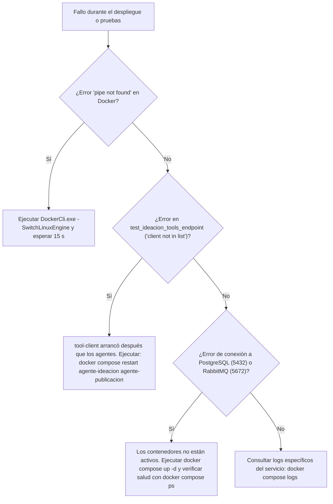

# Anexo 38. Manual de Reproducibilidad Paso a Paso y Árbol de Diagnóstico de Fallos

<div class="meta">
<b>Capítulo:</b> 5 (Implementación y Evaluación PoC) &nbsp;|&nbsp; 
<b>Objetivo Específico:</b> OE4 &nbsp;|&nbsp; 
<b>Investigador:</b> Alvaro Felipe Lopez Russi &nbsp;|&nbsp; 
<b>Entidad:</b> ITY SAS / Universidad Católica de Colombia
</div>

## 1. Guía Paso a Paso para la Reproducibilidad de la PoC

Para garantizar la reproducibilidad científica y técnica del estudio, a continuación se detallan los comandos exactos para levantar el entorno completo y ejecutar la auditoría automatizada:

### Paso 1: Clonación del Repositorio y Entorno Virtual
```powershell
git clone https://github.com/usuario/proyecto-multiagente.git
cd "proyecto multiagente"
python -m venv venv
.\venv\Scripts\Activate.ps1
pip install -r requirements.txt
```

### Paso 2: Asegurar Motor Linux en Docker Desktop
```powershell
& "C:\Program Files\Docker\Docker\DockerCli.exe" -SwitchLinuxEngine
docker info --format '{{.ServerVersion}}'
```

### Paso 3: Despliegue de la Pila de 14 Contenedores
```powershell
docker compose up -d
docker compose ps --format "table {{.Name}}\t{{.Status}}"
```

### Paso 4: Carga de Datos Semilla y Migraciones SQL
```powershell
python seed_data.py
```

### Paso 5: Ejecución de la Suite Completa de Pruebas (261 Tests)
```powershell
pytest -q
# Resultado esperado: 261 passed en ~8-12 segundos (100% de éxito).
```

---

## 2. Árbol de Diagnóstico y Resolución de Fallos (*Troubleshooting*)


*Figura 1. Árbol de diagnóstico y solución de incidencias en el entorno de pruebas.*
