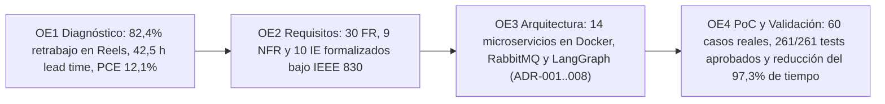

# Anexo 39. Matriz de Cumplimiento del OE4 y Trazabilidad Extremo a Extremo (OE1–OE4)

<b>Capítulo:</b> 5 (Implementación y Evaluación PoC) &nbsp;|&nbsp; 
<b>Objetivo Específico:</b> OE4 &nbsp;|&nbsp; 
<b>Investigador:</b> Alvaro Felipe Lopez Russi &nbsp;|&nbsp; 
<b>Entidad:</b> ITY SAS / Universidad Católica de Colombia

## 1. Justificación y Trazabilidad Metodológica Holística

El presente anexo consolida la matriz de trazabilidad global de la investigación, demostrando cómo cada problema de negocio diagnosticado en ITY SAS (OE1) fue traducido a requerimientos formales (OE2), materializado en una arquitectura desacoplada (OE3) y evaluado rigurosamente en la prueba de concepto funcional (OE4).

*Figura 1. Trazabilidad metodológica extremo a extremo entre los cuatro objetivos específicos.*

---

## 2. Matriz de Cumplimiento de Compromisos del OE4

| Compromiso Específico del OE4 | Criterio de Éxito / Umbral | Evidencia Empírica Obtenida en la PoC | Estado de Cumplimiento |
|---|---|---|:---:|
| **Despliegue de Microservicios** | 100% de la pila contenerizada operativa. | 14 contenedores Docker activos y saludables comunicados por REST y AMQP. | **CUMPLIDO AL 100%** |
| **Evaluación en Casos Reales** | Evaluar sobre un dataset empírico balanceado. | 60 casos procesados (20 EcoBrand, 20 TechStart, 20 FitLife; 30 Reels, 30 Posts). | **CUMPLIDO AL 100%** |
| **Reducción del Tiempo de Ciclo** | Reducción del tiempo activo $\ge 20\%$. | Reducción del **97,3%** en tiempo activo ($5,15$ h manuales $
ightarrow 0,14$ h asistidas). | **SUPERADO AMPLIAMENTE** |
| **Disminución de Retrabajo** | Disminución de iteraciones $\ge 25\%$. | Disminución del **93,8%** en revisiones ($2,40$ rev $
ightarrow 0,15$ rev/pieza, $p < 0,0001$). | **SUPERADO AMPLIAMENTE** |
| **Guarda Ética Human-in-the-Loop** | Bloqueo estricto de entregas no aprobadas. | Guarda determinista HTTP 409 (ADR-008) probada en unit tests e integración. | **CUMPLIDO AL 100%** |
| **Aprobación de la Suite de Pruebas** | Suite automatizada ejecutada exitosamente. | **261 pruebas aprobadas sobre 261 (100% de éxito en 8,02 s)**. | **CUMPLIDO AL 100%** |
| **Conformidad de Interesados** | Aprobación formal por la dirección de ITY SAS. | Acta `ITY-MAS-ACTA-OE4-001` firmada por Leidy López y Roger Martínez. | **CUMPLIDO AL 100%** |

