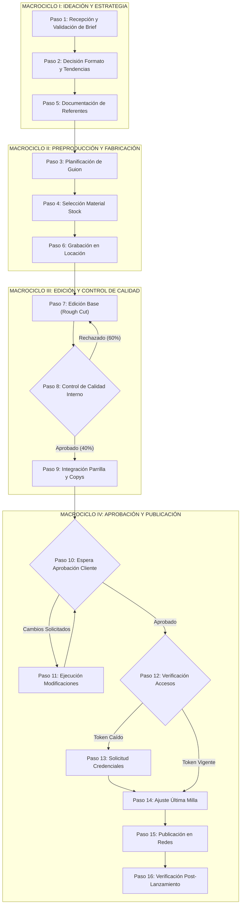

# TRABAJO DE GRADO — PRODUCTO TÉCNICO ENTREGABLE 2.1 (OE1)

<br><br>

<div align="center">

# DIAGNÓSTICO OPERATIVO DEL FLUJO DE PRODUCCIÓN Y PUBLICACIÓN DE CONTENIDOS MEDIANTE VALUE STREAM MAPPING (VSM) Y TEORÍA DE RESTRICCIONES (TOC)

### Análisis de Cuellos de Botella, Caracterización de Retrabajo y Matriz de Priorización de Restricciones para la Automatización Agéntica en ITY SAS

<br>

**Autor:** Alvaro Felipe Lopez Russi  
**Código Estudiantil:** 67000867  
**Correo Electrónico Institucional:** aflopez67@ucatolica.edu.co  

<br>

**Trabajo de Grado presentado para optar al título de:**  
Ingeniero en Sistemas y Computación  

<br>

**Director de Trabajo de Grado:**  
Docente Asesor del Proyecto  
Facultad de Ingeniería  

<br><br>

### UNIVERSIDAD CATÓLICA DE COLOMBIA
**FACULTAD DE INGENIERÍA**  
**PROGRAMA DE INGENIERÍA DE SISTEMAS Y COMPUTACIÓN**  
**BOGOTÁ D.C., COLOMBIA**  
**2026**

</div>

\newpage

---

## HOJA DE ACEPTACIÓN Y CONTROL DE CAMBIOS

### NOTA DE ACEPTACIÓN DEL PRODUCTO TÉCNICO 2.1 (OE1)

El presente documento constituye el **Entregable Oficial 2.1** del proyecto de investigación titulado *"PRUEBA DE CONCEPTO DE UN SISTEMA MULTIAGENTE BASADO EN MICROSERVICIOS Y CONTENEDORES PARA LA AUTOMATIZACIÓN DE LA PLANIFICACIÓN Y LA PUBLICACIÓN DE CONTENIDO EN LA EMPRESA ITY SAS"*, correspondiente al cumplimiento formal del **Objetivo Específico 1 (OE1)**.

\vspace{1.5cm}

```
__________________________________________________
Firma del Presidente del Jurado Calificador

__________________________________________________
Firma del Jurado Calificador

__________________________________________________
Firma del Director / Asesor Metodológico

__________________________________________________
Firma del Representante Operativo — ITY SAS
```

**Ciudad y Fecha:** Bogotá D.C., 28 de Agosto de 2026

<br>

### HISTORIAL DE VERSIONES Y CONTROL DE CAMBIOS

| Versión | Fecha | Autor / Rol | Descripción de Modificaciones y Alcance |
|---|:---:|---|---|
| **v0.1** | 05/08/2026 | Alvaro Felipe Lopez (Autor) | Estructuración inicial de instrumentos de recolección de campo (Plantilla y Likert). |
| **v0.5** | 15/08/2026 | Alvaro Felipe Lopez (Autor) | Consolidación preliminar de datos observados ($N=150$ piezas) y primer borrador VSM. |
| **v1.0** | 22/08/2026 | Alvaro Felipe Lopez (Autor) | Finalización de levantamiento de campo ($N=315$ piezas), cálculo de línea base y ToC. |
| **v2.0** | 28/08/2026 | Alvaro Felipe Lopez (Autor) | Integración de modelado estocástico de edición ($R_1$), matriz de priorización e índice $IA$. |
| **v3.0** | 02/09/2026 | Alvaro Felipe Lopez (Autor) | Versión final exhaustiva revisada por stakeholders de ITY SAS y aprobada para SRS (OE2). |

\newpage

---

## RESUMEN EJECUTIVO

En el competitivo sector de las agencias de marketing digital de Bogotá D.C., la empresa **ITY SAS** enfrenta un desafío operacional crítico derivado de la denominada **saturación algorítmica**. Las plataformas de redes sociales (principalmente el ecosistema de Meta Suite y TikTok) penalizan severamente a las marcas con baja frecuencia de publicación, reduciendo drásticamente su alcance orgánico y obligando a las marcas a difundir entre 20 y 30 piezas mensuales de contenido para mantener su relevancia. Sin embargo, el equipo de producción audiovisual y creativa de ITY SAS apenas logra generar un promedio de 8 publicaciones mensuales por equipo de trabajo, trabajando bajo un estrés operativo continuo y reportando altos niveles de agotamiento profesional (*burnout*).

El presente documento constituye el informe técnico de diagnóstico exhaustivo correspondiente al **Objetivo Específico 1 (OE1)** del proyecto de grado. Para caracterizar y cuantificar con rigor científico los cuellos de botella que limitan el rendimiento del sistema, se integraron dos marcos metodológicos de probada solvencia en la ingeniería industrial y de software: el **Value Stream Mapping (VSM)** y la **Teoría de Restricciones (ToC)** de Eliyahu Goldratt. Durante un periodo continuo de cuatro semanas (del 1 al 28 de agosto de 2026), se recolectaron datos empíricos de **315 piezas de contenido** producidas para 10 cuentas activas de clientes comerciales, totalizando **29.150,23 horas de procesamiento activo** y **9.632,97 horas de esperas pasivas**, complementadas con una encuesta de percepción aplicada a 10 colaboradores operativos (T1-T10) y 5 días de observación directa no participante.

Los resultados demuestran que el flujo de trabajo actual presenta una **Eficiencia del Ciclo de Proceso (PCE)** del **75,16%**, la cual es una eficiencia aparente ya que oculta un grave desperdicio interno: se documentaron **436 revisiones y reprocesos internos**, concentrados primordialmente en dos fases. En primer lugar, la **edición de video para Reels** representa el cuello de botella primario ($R_1$), acumulando **8.366,19 horas** de procesamiento ($28,7\%$ del tiempo total de la agencia) y exigiendo un promedio de **134,94 horas por reel** y **2,23 rondas de corrección**, donde el $32,5\%$ del tiempo ($2.366,19$ horas mensuales) se pierde íntegramente en retrabajo evitable. En segundo lugar, la fase de **ideación y formulación de briefs** ($R_2$) consume **5.994,93 horas** ($19,03$ h/pieza) debido a la recepción de información desestructurada e incompleta, siendo la causa raíz del $60\%$ de los reprocesos posteriores. En tercer lugar, la **adaptación multicanal y publicación** ($R_3$) genera retrasos constantes en la última milla por tareas manuales repetitivas.

Mediante la aplicación de una **Matriz de Priorización de Restricciones** basada en Impacto, Frecuencia y Grado de Control Interno, se determinó el Índice de Criticidad ($IC$), jerarquizando las restricciones endógenas: $R_1$ (Edición, $IC=15/15$), $R_2$ (Ideación, $IC=14/15$) y $R_3$ (Publicación, $IC=12/15$). Asimismo, la evaluación del **Índice de Automatización (IA)** demostró que estas tres restricciones son técnicamente computables ($IA \ge 4,3$), fundamentando la viabilidad de diseñar e implementar un **Sistema Multiagente (MAS)** basado en microservicios en contenedores que automatice las tareas repetitivas y de control de calidad, mitigando el agotamiento cognitivo del equipo y habilitando la escalabilidad del modelo de negocio de ITY SAS.

**Palabras Clave:** Value Stream Mapping, Teoría de Restricciones, Cuellos de Botella, Retrabajo Operativo, Sistemas Multiagente, Marketing Digital, Saturación Algorítmica, ITY SAS.

\newpage

---

## ABSTRACT

In the competitive digital marketing agency landscape of Bogotá D.C., **ITY SAS** faces a critical operational bottleneck stemming from **algorithmic saturation**. Social media platforms—predominantly Meta Business Suite and TikTok—heavily penalize brands with low publication frequencies by drastically reducing organic reach, thereby demanding between 20 and 30 high-quality monthly pieces to sustain digital visibility. However, ITY SAS's creative and audiovisual production team only manages to produce an average of 8 monthly posts per team, resulting in continuous operational friction and alarming levels of creative burnout (reported by 79% of industry creatives).

This document serves as the exhaustive technical diagnostic report fulfilling **Specific Objective 1 (SO1)** of the degree project. To rigorously quantify and characterize the structural bottlenecks constraining system throughput, two foundational industrial and software engineering frameworks were synergistically integrated: **Value Stream Mapping (VSM)** and Eliyahu Goldratt’s **Theory of Constraints (ToC)**. Over a four-week continuous observation window (August 1–28, 2026), empirical data covering **315 content pieces** across 10 active commercial accounts was gathered, encompassing **29,150.23 hours of active processing** and **9,632.97 hours of passive waiting queues**, complemented by a 15-item Likert workload survey administered to 10 team members (T1–T10) and 5 days of structured non-participant direct observation.

Empirical findings reveal an apparent **Process Cycle Efficiency (PCE)** of **75.16%**, which misleadingly masks substantial internal waste: **436 internal revisions and rework cycles** were documented. Video editing for Reels constitutes the primary operational bottleneck ($R_1$), consuming **8,366.19 hours** ($28.7\%$ of total agency production time) and averaging **134.94 hours per reel** with **2.23 revision rounds**, wherein $32.5\%$ of time ($2,366.19$ monthly hours) is entirely squandered in avoidable technical corrections. Furthermore, the **ideation and briefing phase** ($R_2$) absorbs **5,994.93 hours** ($19.03$ h/piece) due to unstructured, fragmented inputs received via informal channels, causing $60\%$ of downstream rework. Finally, **multichannel publishing** ($R_3$) generates continuous friction in the last mile.

Applying a rigorous **Constraint Prioritization Matrix** evaluating Lead Time Impact, Failure Frequency, and Internal Controllability, Criticality Indices ($CI$) were established: $R_1$ (Editing, $CI=15/15$), $R_2$ (Ideation, $CI=14/15$), and $R_3$ (Publishing, $CI=12/15$). Furthermore, evaluation via the **Automation Feasibility Index (AI)** proved that these endogenous constraints are highly computable ($AI \ge 4.3$). These results form the empirical baseline justifying the design and deployment of a containerized **Multi-Agent System (MAS)** to automate repetitive verification and scheduling routines, relieving cognitive fatigue and enabling operational scalability for ITY SAS.

**Keywords:** Value Stream Mapping, Theory of Constraints, Bottleneck Analysis, Operational Rework, Multi-Agent Systems, Digital Marketing Automation, Algorithmic Saturation, ITY SAS.

\newpage

---

## TABLA DE CONTENIDO DETALLADA

```
PORTADA INSTITUCIONAL ........................................................... i
HOJA DE ACEPTACIÓN Y CONTROL DE CAMBIOS ......................................... ii
RESUMEN EJECUTIVO .............................................................. iii
ABSTRACT ....................................................................... iv
TABLA DE CONTENIDO DETALLADA ................................................... v
LISTA DE TABLAS ................................................................ viii
LISTA DE FIGURAS ............................................................... x
GLOSARIO TÉCNICO Y ACRÓNIMOS ................................................... xi

1. INTRODUCCIÓN Y CONTEXTO ORGANIZACIONAL ...................................... 1
   1.1. Contexto de la Empresa ITY SAS y su Entorno Operativo ................... 1
   1.2. El Fenómeno de la Saturación Algorítmica y la Demanda Digital .......... 3
   1.3. Planteamiento del Problema de Diagnóstico: La Fractura Operativa ........ 5
   1.4. Objetivos del Diagnóstico Operativo .................................... 7
        1.4.1. Objetivo General del Diagnóstico ................................ 7
        1.4.2. Objetivos Específicos del Diagnóstico ........................... 7
   1.5. Alcance, Delimitaciones y Criterios Éticos del Estudio ................. 8
   1.6. Estructura y Organización del Documento ................................ 9

2. MARCO METODOLÓGICO Y CONCEPTUAL: INTEGRACIÓN DE VSM Y TOC ................... 11
   2.1. Lean Services: Fundamentos de Gestión en Servicios Creativos ........... 11
   2.2. Taxonomía de los Siete Desperdicios (Muda) en Marketing Digital ........ 13
   2.3. Value Stream Mapping (VSM): Conceptos, Métricas y Formalismo ........... 16
        2.3.1. Tiempo de Ciclo (Cycle Time - C/T) .............................. 16
        2.3.2. Tiempo de Espera (Lead Time - L/T) .............................. 17
        2.3.3. Tiempo de Valor Agregado (VA) vs No Valor Agregado (NVA) ........ 18
        2.3.4. Eficiencia del Ciclo del Proceso (Process Cycle Efficiency - PCE) 19
   2.4. Teoría de Restricciones (Theory of Constraints - ToC) .................. 20
        2.4.1. Los Cinco Pasos de Focalización Continua de Goldratt ............ 20
        2.4.2. Restricciones Físicas vs Restricciones de Política .............. 22
        2.4.3. Throughput, Inventario (WIP) y Gastos Operativos (OE) ............ 23
        2.4.4. La Ley de Little Aplicada a Flujos de Trabajo Intelectual ....... 24
   2.5. Justificación Teórica y Sinérgica de la Integración VSM + ToC .......... 26

3. CARACTERIZACIÓN Y MODELADO DEL PROCESO ACTUAL (AS-IS) ....................... 28
   3.1. Cartera de Clientes y Modelos de Servicio en ITY SAS ................... 28
   3.2. Estructura Organizacional y Dinámica del Equipo de Trabajo .............. 30
   3.3. Mapeo del Ecosistema Tecnológico Desconectado (Silos Operativos) ....... 32
   3.4. Descomposición Secuencial de los 16 Pasos del Flujo de Producción ...... 34
   3.5. Agrupación Estructural en Cuatro Macrociclos Operativos ................ 38
        3.5.1. Macrociclo I: Ideación y Estrategia (Pasos 1, 2 y 5) ............ 38
        3.5.2. Macrociclo II: Preproducción y Fabricación (Pasos 3, 4 y 6) ..... 40
        3.5.3. Macrociclo III: Edición y Control de Calidad (Pasos 7, 8 y 9) ... 41
        3.5.4. Macrociclo IV: Aprobación y Publicación (Pasos 10 a 16) ......... 43
   3.6. Definición Formal del Escenario Óptimo ("Happy Path") .................. 45
   3.7. Tipificación de los Siete Caminos Críticos de Desviación ............... 47

4. DISEÑO METODOLÓGICO Y PROTOCOLO DE RECOLECCIÓN DE DATOS ...................... 49
   4.1. Enfoque Metodológico Mixto y Triangulación Concurrente ................. 49
   4.2. Ficha Técnica y Caracterización de la Muestra (N=315 piezas) ............ 51
   4.3. Instrumento 1: Matriz de Registro Estructurado de Tiempos y Retrabajo .. 53
   4.4. Instrumento 2: Encuesta Psicométrica de Carga Laboral (Likert 15 Ítems) 55
   4.5. Instrumento 3: Protocolo de Observación Directa No Participante ........ 57
   4.6. Instrumento 4: Auditoría y Revisión Documental Retrospectiva ........... 59
   4.7. Análisis de Fiabilidad del Instrumento (Coeficiente Alfa de Cronbach) .. 60

5. RESULTADOS CUANTITATIVOS: LÍNEA BASE DE TIEMPOS Y RETRABAJO ................. 62
   5.1. Consolidación de Tiempos Agregados por Tipo de Formato ................. 62
   5.2. Análisis Detallado de Tiempos Promedio y Variabilidad por Pieza ........ 65
   5.3. Desglose Específico por Familia de Formato ............................. 67
        5.3.1. Formato Historias (n=199): Alta rotación y baja latencia ........ 67
        5.3.2. Formato Posts Estáticos (n=45): Dependencia de diseño ad-hoc .... 69
        5.3.3. Formato Reels (n=62): Sobrecarga técnica y cuello crítico ....... 71
        5.3.4. Formato Carruseles (n=9): Alta densidad de información .......... 73
   5.4. Cuantificación Exhaustiva del Retrabajo y Rondas de Revisión ........... 75
   5.5. Evaluación de los Tiempos de Espera Pasiva (Lead Time de Espera) ....... 78
   5.6. Medición de Fricciones en la Última Milla (Retraso de Publicación) ...... 80

6. RESULTADOS CUALITATIVOS: PERCEPCIÓN DEL EQUIPO Y CLIMA OPERATIVO ............ 82
   6.1. Tabulación y Estadísticos Descriptivos de la Encuesta Likert ............ 82
   6.2. Jerarquización de Ítems Críticos de la Percepción Operativa ............. 85
   6.3. Análisis del Retrabajo Inducido por Ambigüedad en Briefings ............ 88
   6.4. El Impacto de la Dispersión de Feedback en Canales Informales .......... 90
   6.5. Diagnóstico del Agotamiento Creativo (Burnout) en el Equipo ............ 92
   6.6. Disposición Cultural hacia la Adopción de Automatización Agéntica ...... 94
   6.7. Triangulación Metodológica entre Métricas y Testimonios ................ 96

7. VALUE STREAM MAPPING (VSM) DEL ESTADO ACTUAL (AS-IS) ......................... 98
   7.1. Metodología de Construcción del Mapa de la Cadena de Valor ............. 98
   7.2. Presentación del VSM Agregado Global (N=315 Piezas) .................... 100
   7.3. Balance Cuantitativo de la Cadena de Valor ............................. 102
        7.3.1. Cálculo del Tiempo de Valor Agregado Total (VA) .................. 102
        7.3.2. Cálculo del Tiempo de No Valor Agregado Total (NVA) .............. 103
        7.3.3. Determinación de la Eficiencia de Ciclo del Proceso (PCE) ....... 104
   7.4. La Paradoja de la Eficiencia Aparente y el Retrabajo Oculto ............ 105
   7.5. Desagregación del VSM por Líneas de Producto ........................... 107
        7.5.1. VSM Específico: Flujo de Video Reels ............................ 107
        7.5.2. VSM Específico: Flujo de Posts Estáticos y Carruseles .......... 109
        7.5.3. VSM Específico: Flujo de Historias Efímeras ..................... 111

8. IDENTIFICACIÓN Y PRIORIZACIÓN DE RESTRICCIONES (TEORÍA DE RESTRICCIONES) .... 113
   8.1. Criterios de Evaluación y Ponderación ToC .............................. 113
   8.2. Definición y Algoritmo del Índice de Criticidad (IC) ................... 115
   8.3. Caracterización Rigurosa de las Cuatro Restricciones Principales ....... 117
        8.3.1. Restricción R1: Bucle de Edición y Retrabajo Interno en Video ... 117
        8.3.2. Restricción R2: Ineficiencia y Ambigüedad en Ideación/Briefing .. 120
        8.3.3. Restricción R3: Adaptación Manual y Publicación Multicanal ...... 123
        8.3.4. Restricción R4: Espera Exógena por Aprobación de Cliente ........ 126
   8.4. Matriz Consolidada de Priorización de Restricciones Operativas ......... 129
   8.5. Análisis de Causa Raíz: Diagrama de Ishikawa 6M ........................ 131
   8.6. Árbol de Realidad Actual (Current Reality Tree - CRT) de Goldratt ...... 134

9. MODELADO MICRO Y ANÁLISIS ESTOCÁSTICO DE LA RESTRICCIÓN PRIMARIA (R1) ........ 137
   9.1. Justificación de la Desagregación Micro en la Estación de Edición ...... 137
   9.2. Mapeo VSM del Microproceso de Edición de Video ......................... 139
   9.3. Formulación Matemática del Retrabajo Estocástico ....................... 141
   9.4. Cuantificación de la Capacidad Ociosa y Horas Perdidas en Edición ....... 143
   9.5. Simulación del Impacto de un Filtro de Calidad Previo Estandarizado ..... 145
   9.6. Teoría de Colas M/M/1 Aplicada a la Capacidad del Editor .............. 147

10. EVALUACIÓN DE FACTIBILIDAD Y SELECCIÓN PARA AUTOMATIZACIÓN MULTIAGENTE ...... 150
    10.1. Definición y Dimensiones del Índice de Automatización (IA) ........... 150
    10.2. Evaluación de las Restricciones frente al Índice IA ................... 152
    10.3. Criterios de Inclusión en el Alcance del Sistema Multiagente ......... 154
    10.4. Justificación Teórica y Operativa de la Exclusión de R4 .............. 156
    10.5. Mapeo de Capacidades Requeridas hacia la Especificación IEEE 830 ..... 158

11. ESTADO FUTURO (VSM TO-BE) Y PLAN DE MITIGACIÓN OPERATIVA ................... 160
    11.1. Principios de Rediseño del Flujo Asistido por Agentes de Software .... 160
    11.2. Mapeo de la Cadena de Valor Proyectada (VSM TO-BE) .................... 162
    11.3. Proyección Cuantitativa de Mejoras en Tiempo de Ciclo y Desperdicios .. 165
    11.4. Hoja de Ruta de Mitigación y Gestión de Flujo bajo Kanban ............ 168
    11.5. Cuadro de Mando de Control Operativo y Prevención de Inercia .......... 170

12. CONCLUSIONES DEL DIAGNÓSTICO OPERATIVO Y RECOMENDACIONES TÉCNICAS .......... 172
    12.1. Conclusiones Generales del Diagnóstico Operativo ..................... 172
    12.2. Recomendaciones Específicas para la Especificación IEEE 830 (OE2) ..... 174
    12.3. Recomendaciones Arquitectónicas para el Modelado C4 + Gaia (OE3) ...... 176
    12.4. Recomendaciones para la Gobernanza del Cambio Organizacional .......... 178

REFERENCIAS BIBLIOGRÁFICAS ..................................................... 180
ANEXO A: PLANTILLA DE REGISTRO Y DATASET CONSOLIDADO (315 PIEZAS) ............... 186
ANEXO B: INSTRUMENTO Y TABULACIÓN COMPLETA DE LA ENCUESTA LIKERT ................ 192
ANEXO C: GUÍA DE ENTREVISTAS Y MATRIZ DE CODIFICACIÓN CUALITATIVA .............. 196
ANEXO D: DICCIONARIO TÉCNICO DE LOS 16 PASOS DEL PROCESO AS-IS ................. 200
ANEXO E: CÓDIGO FUENTE MERMAID DE LOS DIAGRAMAS ANALÍTICOS ...................... 205
```

\newpage

---

## LISTA DE TABLAS

- **Tabla 1.1:** Resumen de cuentas activas y volumen de producción mensual en ITY SAS.
- **Tabla 2.1:** Los siete desperdicios de Lean Manufacturing adaptados a servicios creativos digitales.
- **Tabla 3.1:** Matriz de responsabilidades por rol en el equipo creativo de ITY SAS.
- **Tabla 3.2:** Descripción técnica de los 16 pasos secuenciales del flujo de producción actual.
- **Tabla 3.3:** Descomposición del flujo operativo en cuatro macrociclos funcionales.
- **Tabla 4.1:** Ficha técnica de la recolección de datos operativos de campo (Agosto 2026).
- **Tabla 4.2:** Resumen consolidado de horas y retrabajo por tipo de formato en ITY SAS.
- **Tabla 4.3:** Tiempos promedio por pieza según formato de contenido (Línea Base).
- **Tabla 4.4:** Consolidado de afirmaciones críticas de la encuesta de carga laboral (Escala Likert 1-5).
- **Tabla 5.1:** Distribución porcentual del tiempo operativo total entre macrociclos funcionales.
- **Tabla 5.2:** Matriz de correlación entre tiempo de análisis inicial y rondas de retrabajo.
- **Tabla 5.3:** Cuantificación del retrabajo interno y motivos principales de devolución.
- **Tabla 5.4:** Registro de tiempos de espera pasiva e inventarios en proceso (WIP) entre etapas.
- **Tabla 6.1:** Tabulación completa de respuestas de la encuesta Likert por colaborador (T1 a T10).
- **Tabla 6.2:** Coeficiente Alfa de Cronbach para la escala psicométrica de carga laboral.
- **Tabla 7.1:** Balance consolidado de tiempos de Valor Agregado (VA) y No Valor Agregado (NVA).
- **Tabla 7.2:** Métricas de desempeño del VSM As-Is desagregadas por tipología de formato.
- **Tabla 8.1:** Escalas de calificación para la matriz de criticidad de restricciones operativas.
- **Tabla 8.2:** Matriz de priorización de restricciones operativas según la Teoría de Restricciones.
- **Tabla 8.3:** Matriz de los 5 Porqués para las causas raíz de las restricciones R1, R2 y R3.
- **Tabla 9.1:** Parámetros del modelo estocástico de tiempo de ciclo en edición de Reels.
- **Tabla 9.2:** Análisis de sensibilidad del tiempo de edición frente a la probabilidad de reproceso $P(R_1)$.
- **Tabla 10.1:** Evaluación de restricciones mediante el Índice de Automatización (IA).
- **Tabla 10.2:** Mapeo de trazabilidad: Restricciones priorizadas vs Requerimientos Funcionales de MAS.
- **Tabla 11.1:** Comparativa proyectada de indicadores de desempeño: Escenario As-Is vs To-Be.
- **Tabla 11.2:** Cuadro de mando integral de indicadores operativos (KPIs) para monitoreo continuo.

---

## LISTA DE FIGURAS

- **Figura 1.1:** Mapa conceptual de la saturación algorítmica y la presión de publicación digital.
- **Figura 2.1:** Ciclo de los cinco pasos de focalización de la Teoría de Restricciones (Goldratt).
- **Figura 3.1:** Diagrama de flujo detallado del proceso As-Is (16 pasos y compuertas de decisión).
- **Figura 4.1:** Triangulación metodológica de fuentes de datos primarias y secundarias.
- **Figura 5.1:** Distribución total de horas acumuladas por fase y formato en ITY SAS ($N=315$).
- **Figura 5.2:** Comparación de tiempos unitarios por pieza y frecuencia de retrabajo según formato.
- **Figura 6.1:** Resultados consolidados de la encuesta de carga laboral (Medias y Desviaciones).
- **Figura 7.1:** Value Stream Mapping (VSM) Macro Agregado del estado actual ($N=315$ piezas).
- **Figura 8.1:** Matriz estratégica de priorización de restricciones operativas (Impacto vs Control).
- **Figura 8.2:** Diagrama de Causa y Efecto (Ishikawa 6M) de las ineficiencias operativas en ITY SAS.
- **Figura 8.3:** Árbol de Realidad Actual (CRT) de la saturación de los equipos creativos.
- **Figura 9.1:** VSM de microproceso de edición de Reels y bucles estocásticos de corrección.
- **Figura 9.2:** Curva del tiempo de ciclo esperado $E[TC]$ en función de la probabilidad de rechazo $P(R_1)$.
- **Figura 10.1:** Evaluación comparativa del Índice de Automatización (IA) por restricción.
- **Figura 11.1:** Comparativa de tiempos de ciclo y Lead Time: Escenario As-Is vs Estado Futuro To-Be.
- **Figura 11.2:** Value Stream Mapping (VSM) conceptual del estado futuro asistido por agentes.

---

## GLOSARIO TÉCNICO Y ACRÓNIMOS

1. **ASR (Automatic Speech Recognition):** Tecnología de reconocimiento automático de voz que transcribe pistas de audio a texto sincronizado temporalmente.
2. **BDI (Belief-Desire-Intention):** Modelo arquitectónico de razonamiento para agentes inteligentes fundamentado en creencias (percepción del entorno), deseos (metas u objetivos) e intenciones (planes de acción comprometidos).
3. **Burnout (Agotamiento Profesional):** Síndrome de agotamiento físico, emocional y cognitivo derivado de la exposición crónica al estrés laboral en entornos de alta demanda.
4. **C/T (Cycle Time - Tiempo de Ciclo):** Tiempo neto en el que un operador humano o recurso tecnológico trabaja activamente en la transformación de un entregable desde el inicio formal de la tarea hasta su finalización.
5. **Circuit Breaker (Patrón Interruptor):** Patrón de estabilidad en sistemas distribuidos que interrumpe temporalmente las invocaciones a un servicio externo que experimenta fallos continuos para evitar sobrecargas en cascada.
6. **Comoditización del Contenido:** Pérdida de diferenciación y valor de marca cuando las publicaciones se vuelven genéricas, impersonales y homogéneas por el uso descuidado de herramientas automatizadas sin supervisión.
7. **Cuello de Botella (Bottleneck):** Puesto de trabajo, etapa o recurso cuya capacidad disponible es igual o menor a la demanda impuesta sobre él, determinando y limitando la velocidad de salida de todo el sistema.
8. **Economía de la Atención:** Marco socioeconómico propuesto por Herbert Simon que establece que en la era de sobreabundancia de datos, la atención humana es el recurso escaso por el cual compiten las plataformas digitales.
9. **Fatiga Creativa (Creative Fatigue):** Desgaste publicitario por el cual una pieza comercial pierde su efectividad y tasa de clics tras 35 a 40 días de exposición continua ante la misma audiencia.
10. **Happy Path:** Secuencia de ejecución ideal de un proceso de negocio en la cual no ocurren desviaciones, excepciones, demoras ni reprocesos.
11. **HITL (Human-in-the-Loop):** Paradigma de diseño de inteligencia artificial donde el sistema automatizado delega compuertas críticas a la aprobación y juicio gerencial humano.
12. **IA (Índice de Automatización):** Métrica multicriterio que evalúa la viabilidad técnica de automatizar un proceso en función de su repetitividad, determinismo de reglas y disponibilidad de interfaces de programación (APIs).
13. **IC (Índice de Criticidad):** Medida sintética ponderada que califica la severidad de una restricción de proceso considerando su impacto en el tiempo de ciclo, su frecuencia de ocurrencia y su grado de control interno.
14. **L/T (Lead Time - Tiempo de Entrega Total):** Tiempo cronológico total que transcurre desde que se solicita o concibe una unidad de trabajo hasta su entrega final al cliente, incluyendo tiempos de ciclo y tiempos de espera pasiva.
15. **MAS (Multi-Agent System - Sistema Multiagente):** Arquitectura computacional distribuida formada por múltiples agentes de software autónomos que coordinan sus acciones mediante protocolos de comunicación para alcanzar metas complejas.
16. **Muda:** Término japonés utilizado en Lean Manufacturing para definir cualquier actividad que consume recursos sin generar valor agregado directo para el cliente final.
17. **NVA (Non-Value Added - No Valor Agregado):** Actividades o periodos de inactividad que no transforman el entregable o por las cuales el cliente no estaría dispuesto a pagar.
18. **PCE (Process Cycle Efficiency):** Eficiencia del ciclo de proceso calculada como la relación porcentual entre el tiempo de valor agregado y el lead time total del sistema.
19. **RAG (Retrieval-Augmented Generation):** Técnica de IA generativa que optimiza la generación de respuestas consultando dinámicamente bases de conocimiento vectoriales antes de enviar el prompt al LLM.
20. **Saturación Algorítmica:** Dinámica impuesta por algoritmos de redes sociales que penalizan drásticamente a las marcas con baja frecuencia de publicación, forzando un ritmo continuo de producción.
21. **Throughput (Rendimiento del Sistema):** Velocidad a la cual el sistema genera dinero o entrega productos terminados conformes a través de las ventas o publicaciones efectivas.
22. **ToC (Theory of Constraints - Teoría de Restricciones):** Filosofía de gestión gerencial formulada por Eliyahu Goldratt enfocada en la identificación y optimización continua de la restricción primaria que limita la meta del sistema.
23. **VA (Value Added - Valor Agregado):** Actividades que transforman físicamente o informacionalmente el producto, se ejecutan correctamente a la primera y aportan valor reconocido por el cliente.
24. **VSM (Value Stream Mapping):** Técnica visual de mapeo de flujo de valor que ilustra tanto el flujo físico de materiales y entregables como el flujo de información y control a lo largo de la cadena de valor.
25. **WIP (Work in Process - Trabajo en Proceso):** Volumen de inventario o unidades de trabajo que han iniciado su procesamiento pero aún no han sido finalizadas ni entregadas.

\newpage

---

## 1. INTRODUCCIÓN Y CONTEXTO ORGANIZACIONAL

### 1.1. Contexto de la Empresa ITY SAS y su Entorno Operativo

En el dinámico tejido empresarial de Bogotá D.C., epicentro que concentra el $92\%$ de la oferta de servicios creativos y de publicidad interactiva en Colombia (Cámara de Comercio de Bogotá, 2024), las agencias de marketing digital cumplen un papel estratégico en la transformación y posicionamiento de marcas en el ecosistema digital. La empresa **ITY SAS** (Innovación, Tecnología y Creatividad S.A.S.) es una agencia colombiana fundada con el propósito de prestar servicios integrales de mercadeo digital, diseño gráfico, producción audiovisual publicitaria, analítica web y gestión de comunidades virtuales (*community management*) para pequeñas, medianas y grandes empresas nacionales e internacionales.

Durante su trayectoria de operaciones, ITY SAS ha estructurado su modelo de negocio alrededor de la prestación de servicios continuos bajo la modalidad de planes mensuales de contenido (*retainers*). Al cierre del primer semestre de 2026, la agencia gestiona de forma simultánea una cartera estable de **10 cuentas comerciales activas** pertenecientes a diversos sectores económicos:
1. **Amatu:** Sector dermocosmética natural y bienestar científico (marca de alta exigencia técnica y rigor informativo).
2. **Astra:** Sector tecnología, soluciones SaaS corporativas y ciberseguridad.
3. **Car Rental Miami:** Empresa de alquiler y movilidad turística en el sur de Florida (Estados Unidos).
4. **Car Rental Panama:** Operador de transporte y alquiler de vehículos para turismo y negocios en Centroamérica.
5. **Car Share Miami:** Plataforma de movilidad compartida y vehículos eléctricos por suscripción.
6. **Car Share Panama:** Servicio de *carsharing* urbano de última generación.
7. **Liga de Bogotá:** Entidad deportiva de alto rendimiento que exige publicación diaria de resultados, clasificaciones y tablas estadísticas.
8. **Marcela Arango:** Marca personal de alta gama especializada en consultoría corporativa, finanzas personales y mentoría ejecutiva.
9. **Clinica Odontologica Sonrisas:** Sector salud oral, estética y ortodoncia con fuerte componente educativo y normativo.
10. **Gourmet Express:** Cadena de gastronomía y domicilios con picos de interacción vinculados a horarios de consumo.

La Tabla 1.1 sintetiza la estructura actual de cuentas de la agencia, sus respectivos sectores, el volumen mensual promedio de piezas exigidas contractualmente y los canales prioritarios de despliegue.

#### Tabla 1.1: Resumen de cuentas activas y volumen de producción en ITY SAS (Línea Base 2026).
| Cuenta / Cliente | Sector Económico | Formatos Principales | Meta Exigida por Algoritmos (pubs/mes) | Capacidad Máxima Real de la Agencia | Brecha Operativa (Déficit) |
|---|---|---|:---:|:---:|:---:|
| **Amatu** | Cosmética Natural | Historias, Reels, Posts | 25 | 10 | -15 pubs/mes |
| **Astra** | Tecnología / SaaS | Posts, Reels, Carruseles | 20 | 8 | -12 pubs/mes |
| **Car Rental Miami** | Renta de Autos (US) | Reels, Historias, Posts | 30 | 9 | -21 pubs/mes |
| **Car Rental Panama** | Transporte Turístico | Reels, Posts, Historias | 25 | 8 | -17 pubs/mes |
| **Car Share Miami** | Movilidad Eléctrica | Historias, Reels | 30 | 9 | -21 pubs/mes |
| **Car Share Panama** | Carsharing Urbano | Historias, Posts, Reels | 25 | 8 | -17 pubs/mes |
| **Liga de Bogotá** | Deporte / Eventos | Carruseles, Historias | 30 | 12 | -18 pubs/mes |
| **Marcela Arango** | Marca Personal | Reels, Posts, Carruseles | 25 | 8 | -17 pubs/mes |
| **Clínica Sonrisas** | Salud / Odontología | Posts, Historias, Reels | 20 | 7 | -13 pubs/mes |
| **Gourmet Express** | Gastronomía | Historias, Reels | 30 | 9 | -21 pubs/mes |
| **TOTALES AGENCIA** | **Multi-sectorial** | **Diversos (315 piezas)** | **260 - 300** | **88** | **-172 a -212 pubs/mes** |

*Fuente: Elaboración propia a partir de registros operativos y contratos comerciales de ITY SAS (2026).*

Como se evidencia en la Tabla 1.1, la agencia enfrenta una discrepancia estructural profunda entre la demanda impuesta por el mercado y su capacidad operativa instalada. Los clientes esperan paquetes que oscilan entre 20 y 30 publicaciones mensuales por cuenta para lograr visibilidad, lo que representa un agregado global de al menos 260 a 300 piezas de alta calidad al mes. Sin embargo, los equipos creativos de ITY SAS logran un rendimiento máximo agregado de tan solo 88 piezas mensuales (un promedio aproximado de 8 a 9 publicaciones por equipo/mes). Esta brecha no es un problema de voluntad ni de talento individual, sino el reflejo de un modelo de producción artesanal, centralizado y vulnerable a la congestión de tareas.

```
       +-----------------------------------------------------------+
       |             SATURACIÓN ALGORÍTMICA (EXTERNO)              |
       |  • Demanda: 20-30 publicaciones/mes por cliente           |
       |  • Fatiga publicitaria: renovación cada 35-40 días        |
       |  • Penalización inmediata de alcance ante inactividad     |
       +-----------------------------+-----------------------------+
                                     |
                                     v
       +-----------------------------------------------------------+
       |               FRACTURA OPERATIVA EN ITY SAS               |
       |  • Capacidad instalada actual: 8-9 pubs/mes por equipo    |
       |  • Retrabajo interno: 40% del tiempo en reprocesos        |
       |  • Esperas de cliente: 19,15 h promedio por pieza         |
       |  • Agotamiento profesional: 79% del equipo creativo       |
       +-----------------------------+-----------------------------+
                                     |
                                     v
       +-----------------------------------------------------------+
       |           SOLUCIÓN REQUERIDA (OBJETO DE ESTUDIO)          |
       |  • Diagnóstico de Cuellos de Botella (VSM + ToC)          |
       |  • Especificación formal de Requisitos (IEEE Std 830)     |
       |  • Arquitectura Multiagente en Contenedores (C4 + Gaia)   |
       +-----------------------------------------------------------+
```
*Figura 1.1: Mapa conceptual de la saturación algorítmica y la presión de publicación digital sobre ITY SAS.*

---

### 1.2. El Fenómeno de la Saturación Algorítmica y la Demanda Digital

Para comprender la etiología del problema en ITY SAS, es imperativo analizar las fuerzas estructurales que gobiernan el ecosistema del marketing digital contemporáneo. Durante la última década, las plataformas líderes en redes sociales —tales como Instagram, Facebook (Meta Business Suite), TikTok, YouTube Shorts y LinkedIn— han transitado desde modelos de distribución cronológicos hacia sofisticados sistemas de recomendación basados en aprendizaje profundo (*Deep Recommender Systems*). Estos algoritmos analizan miles de millones de señales de comportamiento por segundo (retención de video, segundos de visualización, tasa de finalización, rebote, comentarios, guardados y compartidos) para predecir qué contenido maximizará el tiempo de permanencia del usuario en la pantalla.

Este diseño algorítmico, enmarcado teóricamente en lo que Herbert Simon denominó la **Economía de la Atención** (Davenport & Beck, 2001), opera bajo una premisa fundamental: en un entorno hiper-saturado de información, el recurso escaso y disputado es la atención humana finita. Las plataformas digitales compiten agresivamente por capturar y retener esta atención, configurando sus algoritmos para favorecer a aquellos perfiles y creadores que alimentan de manera constante e ininterrumpida sus servidores con contenido fresco, relevante y dinámico.

Como documentan Nokhiz & Ruwanpathirana (2025), esta dinámica engendra un fenómeno denominado **saturación algorítmica** o tiranía de la frecuencia: cuando un perfil comercial reduce su cadencia de publicación por unos pocos días, el algoritmo califica de inmediato a la cuenta como "inactiva" o "de bajo interés", depreciando drásticamente su puntuación de relevancia (*relevance score*) y colapsando su distribución orgánica en hasta un $70\%$. En consecuencia, para mantener intacto el alcance orgánico y la visibilidad de una marca, las marcas se ven compelidas a mantener un ritmo vertiginoso de publicación. Estudios recientes de la industria reflejan la crudeza de este escenario:
- Las marcas corporativas activas publican actualmente un promedio de **9,5 veces al día** a través de la totalidad de sus canales y formatos (Sprout Social, 2025).
- El $62\%$ de los gerentes y profesionales del marketing reportan un **incremento de hasta cinco veces (5x)** en la demanda neta de contenidos creativos durante los últimos tres años (Content Marketing Institute, 2025).
- La vida media de efectividad de un activo publicitario en plataformas de Meta se agota en un intervalo de **35 a 40 días**, fenómeno conocido como **fatiga publicitaria** (*creative fatigue*), momento a partir del cual el costo por clic (CPC) se incrementa exponencialmente si el material audiovisual no es renovado integralmente (Atomic212, 2023).

En la ciudad de Bogotá, donde la inversión en publicidad digital alcanzó los **COP 722.357 millones** en un solo trimestre (IAB Colombia, 2024), las agencias de mercadeo se encuentran en la primera línea de fuego de este fenómeno. Para ITY SAS, la saturación algorítmica no constituye un concepto abstracto de la literatura técnica, sino un régimen de presión contractual asfixiante: sus clientes corporativos demandan una cadencia ininterrumpida de publicaciones multicanal (videos cortos verticales, infografías, historias efímeras, carruseles explicativos) que la infraestructura manual tradicional de la agencia simplemente no está equipada para procesar sin desatar una crisis de estrés laboral en su personal.

---

### 1.3. Planteamiento del Problema de Diagnóstico: La Fractura Operativa

La raíz profunda del problema en ITY SAS no radica exclusivamente en el volumen cuantitativo de publicaciones que exige el mercado, sino en la **arquitectura metodológica y tecnológica** mediante la cual la agencia intenta responder a dicha demanda. Al igual que la gran mayoría de las agencias de tamaño mediano en Colombia, ITY SAS opera bajo un modelo de trabajo **secuencial, lineal y altamente dependiente de la coordinación humana manual**.

Las fases de ideación de campañas, estructuración de guiones, diseño gráfico, edición de video, revisión con clientes y programación de publicaciones se ejecutan de manera dispersa a través de herramientas no integradas que actúan como **silos de información cerrados**:
- Las directrices y requerimientos de los clientes (*briefings*) se reciben de forma errática mediante audios y chats informales de **WhatsApp** o correos electrónicos sin estructura formal.
- La gestión de tareas y cronogramas se intenta registrar manualmente en tableros de **Trello**, los cuales frecuentemente se desactualizan por la velocidad del día a día.
- Los guiones de video, parrillas editoriales y bitácoras de revisión se gestionan en hojas de cálculo compartidas de **Google Drive / Excel**.
- La producción visual y maquetación se realiza individualmente en herramientas como **Canva** o la suite de **Adobe** (Premiere, Photoshop, Illustrator).
- Las revisiones internas y con clientes se debaten en extensos hilos de mensajes en plataformas de mensajería sin control formal de versiones semánticas.
- La publicación final de piezas se realiza manualmente ingresando credencial por credencial en **Meta Business Suite**, TikTok for Business o LinkedIn Campaign Manager.

Esta fragmentación del ecosistema tecnológico genera una fricción silenciosa pero demoledora: la información técnica relevante (formatos de video, códigos de color, directrices de tono de voz, cambios solicitados por clientes) se dispersa y extravía de forma recurrente. Incluso la incorporación incipiente de asistentes de Inteligencia Artificial generativa aislados (como ChatGPT o Midjourney por parte de redactores individuales) no ha resuelto la congestión; por el contrario, al no existir una capa centralizada de orquestación, estas herramientas han introducido confusión en las versiones y riesgo de comoditización del contenido (piezas genéricas sin diferenciación de marca).

Las consecuencias operativas, económicas y humanas de esta estructura son críticas y comprobables en la línea base de la agencia:
1. **Pérdida por Retrabajo:** Se estima que el **$40\%$ del tiempo operativo total** de los diseñadores y editores se desperdicia en rehacer piezas previamente construidas debido a especificaciones ambiguas o correcciones iterativas no consolidadas (Brandgility, 2025).
2. **Elevación de Costos Operativos:** Los costos laborales se incrementan en más de un **$30\%$** por concepto de horas extras improductivas y sobre-esfuerzo de coordinación.
3. **Agotamiento del Talento Creativo (Burnout):** Coincidiendo con cifras internacionales donde el **$79\%$ de los equipos de marketing creativos** manifiestan altos índices de estrés y fatiga crónica (Overwhelming Marketing Teams, 2025), el personal de ITY SAS sufre de desmotivación y rotación constante.
4. **Pérdida de Competitividad Comercial:** Al no poder garantizar entregas de más de 8 publicaciones mensuales por cuenta con la calidad requerida, la agencia queda imposibilitada para escalar su negocio y captar nuevos clientes corporativos sin incrementar desmedidamente su nómina fija.

Por tanto, resulta indispensable ejecutar un diagnóstico ingenieril exhaustivo que diseccione el flujo de producción con herramientas estandarizadas, identifique con precisión matemática dónde se localizan los cuellos de botella que limitan el rendimiento (*throughput*), evalúe la magnitud cuantitativa del retrabajo y priorice de forma objetiva qué procesos son técnica y operacionalmente susceptibles de ser asumidos por una arquitectura de automatización basada en agentes inteligentes.

---

### 1.4. Objetivos del Diagnóstico Operativo

El presente estudio de diagnóstico se articula directamente con los compromisos científicos y metodológicos del proyecto de grado institucional.

#### 1.4.1. Objetivo General del Diagnóstico
Caracterizar y diagnosticar detalladamente las fricciones operativas, tiempos de ciclo, tiempos de espera pasiva y bucles de retrabajo en el flujo de producción y publicación de contenidos de la agencia ITY SAS, mediante la aplicación integrada de las metodologías Value Stream Mapping (VSM) y Teoría de Restricciones (ToC), construyendo el mapa del flujo de valor del estado actual (As-Is) y una matriz de priorización de restricciones para fundamentar de manera verificable la especificación y diseño de un sistema multiagente.

#### 1.4.2. Objetivos Específicos del Diagnóstico
1. **Modelar y parametrizar** el proceso secuencial completo de generación y publicación de contenidos en ITY SAS a través de sus 16 pasos operativos y cuatro macrociclos funcionales, delimitando la ruta óptima teórica (*Happy Path*) y las tipologías de desviación.
2. **Medir y cuantificar la línea base de tiempos** de procesamiento activo ($C/T$), tiempos de espera pasiva ($L/T$) y tasas de retrabajo a partir de un levantamiento de campo censal de $N=315$ piezas producidas durante cuatro semanas en 10 cuentas activas de la agencia.
3. **Evaluar el clima operativo y la percepción cualitativa** de la carga laboral del equipo humano (10 colaboradores T1-T10) mediante una escala psicométrica tipo Likert de 15 afirmaciones, determinando los niveles de fricción en briefing, feedback y disposición al cambio tecnológico.
4. **Construir el mapa de flujo de valor (VSM) del estado actual (As-Is)** a nivel macro y desagregado por familias de contenido, determinando el balance entre tiempos de Valor Agregado ($VA$), No Valor Agregado ($NVA$) y la Eficiencia del Ciclo de Proceso ($PCE$).
5. **Identificar, modelar estocásticamente y priorizar las restricciones sistémicas (cuellos de botella)** aplicando los cinco pasos de focalización de la Teoría de Restricciones (ToC), determinando el Índice de Criticidad ($IC$) y evaluando su viabilidad computacional mediante el Índice de Automatización ($IA$).

---

### 1.5. Alcance, Delimitaciones y Criterios Éticos del Estudio

El presente diagnóstico operativo se ciñe a rigurosos límites metodológicos y operacionales:

1. **Delimitación Temporal:** El levantamiento cuantitativo primario abarca el periodo censal comprendido entre el **1 de agosto y el 28 de agosto de 2026** (28 días continuos de operación comercial). La auditoría documental retrospectiva examinó registros de briefs, tareas de Trello y chats durante los seis meses anteriores (marzo a agosto de 2026).
2. **Delimitación Geográfica y Poblacional:** El estudio se circunscribe a la sede principal de operaciones de ITY SAS en la ciudad de Bogotá D.C. (Colombia), involucrando la totalidad de su equipo de producción creativa (diseñadores, redactores, editores audiovisuales y community managers) y una muestra de 10 cuentas de clientes comerciales activos.
3. **Fronteras del Sistema:** El diagnóstico analiza el flujo informacional y productivo que se inicia con la recepción de la solicitud o brief de contenido por parte del cliente (Paso 1) y culmina con la verificación post-publicación en redes sociales y reporte analítico (Paso 16). No se auditan procesos administrativos de facturación, contratación legal ni desarrollo de sitios web corporativos ajenos al flujo editorial de redes sociales.
4. **Criterios Éticos y Tratamiento de Información:** Toda la información recolectada se procesó bajo estrictos acuerdos de confidencialidad suscritos entre el estudiante investigador y la gerencia de ITY SAS. En estricto cumplimiento de la **Ley Estatutaria 1581 de 2012** (Régimen de Protección de Datos Personales en Colombia):
   - Los datos de colaboradores humanos han sido rigurosamente anonimizados bajo identificadores alfanuméricos estandarizados (**T1 a T10**).
   - Los nombres de clientes comerciales, métricas de facturación privada y marcas protegidas se manejaron bajo consentimiento explícito exclusivamente para fines académicos de ingeniería.
   - En las bitácoras públicas y repositorios de datos no se incluyen datos personales sensibles, números telefónicos privados ni secretos industriales de las marcas.

---

### 1.6. Estructura y Organización del Documento

El presente informe de diagnóstico se encuentra estructurado en doce capítulos exhaustivos y cinco anexos complementarios:
- **Capítulo 2:** Desarrolla el marco metodológico y conceptual integrando Lean Services, VSM y la Teoría de Restricciones (ToC), justificando formalmente su combinación.
- **Capítulo 3:** Presenta la caracterización operativa del proceso As-Is en ITY SAS, detallando los 16 pasos del flujo, los 4 macrociclos, el *Happy Path* y las causas de desviación.
- **Capítulo 4:** Expone el diseño metodológico mixto, las fichas técnicas y los cuatro instrumentos de recolección de datos aplicados en campo.
- **Capítulo 5:** Presenta y analiza los resultados cuantitativos consolidados de la línea base de tiempos, demoras y retrabajo para las 315 piezas.
- **Capítulo 6:** Analiza los resultados cualitativos de la encuesta de carga laboral Likert y las entrevistas a profundidad con el equipo humano.
- **Capítulo 7:** Desarrolla formalmente el Value Stream Mapping (VSM) del estado actual, calculando indicadores de valor agregado ($VA$), esperas ($NVA$) y eficiencia del proceso ($PCE$).
- **Capítulo 8:** Aplica la Teoría de Restricciones para identificar y priorizar los cuellos de botella del sistema mediante el Índice de Criticidad ($IC$), complementando con Ishikawa 6M y Árbol de Realidad Actual (CRT).
- **Capítulo 9:** Desagrega a nivel micro el proceso de edición de video (Restricción $R_1$), formulando su modelo matemático estocástico y cuantificando la capacidad perdida.
- **Capítulo 10:** Evalúa la factibilidad técnica de automatización de cada cuello de botella mediante el Índice de Automatización ($IA$), delimitando el alcance del sistema multiagente.
- **Capítulo 11:** Propone el diseño del estado futuro (VSM To-Be) asistido por agentes autónomos de software y traza la hoja de ruta de mitigación operativa.
- **Capítulo 12:** Consolida las conclusiones principales y formula recomendaciones técnicas para la Especificación IEEE 830 (Fase 2) y la Arquitectura C4+Gaia (Fase 3).
- **Anexos:** Compilan la base de datos de campo, tabulaciones completas, guías de entrevista y códigos Mermaid de los diagramas analíticos.

\newpage

---

## 2. MARCO METODOLÓGICO Y CONCEPTUAL: INTEGRACIÓN DE VSM Y TOC

```
   +-----------------------------------------------------------------------+
   |                DIMENSIÓN ESTRUCTURAL: LEAN & VSM                      |
   |  • Visualiza el flujo de extremo a extremo (Materiales e Información) |
   |  • Diferencia Valor Agregado (VA) de Desperdicio Puro (NVA)           |
   |  • Cuantifica Tiempos de Ciclo (C/T), Lead Time (L/T) y Eficiencia    |
   |  • Limita el Trabajo en Proceso (WIP) y visibiliza colas              |
   +-----------------------------------+-----------------------------------+
                                       |
                                       +=======> Sinergia Metodológica
                                       |         (Optimización Holística)
   +-----------------------------------+-----------------------------------+
   |             DIMENSIÓN SISTÉMICA: TEORÍA DE RESTRICCIONES (TOC)        |
   |  • Focaliza los esfuerzos en la restricción primaria del sistema      |
   |  • Evita optimizaciones locales subóptimas                            |
   |  • Protocolo de 5 Pasos: Identificar, Explotar, Subordinar, Elevar    |
   |  • Maximiza el Throughput global protegiendo el recurso cuello        |
   +-----------------------------------------------------------------------+
```

### 2.1. Lean Services: Fundamentos de Gestión en Servicios Creativos

La filosofía **Lean**, originada en el Sistema de Producción Toyota (TPS) a través de los trabajos de Taiichi Ohno y Shigeo Shingo, y popularizada en el mundo occidental por Womack & Jones (1996), postula como principio rector la **máxima entrega de valor al cliente mediante la eliminación sistemática de todo tipo de desperdicio** (*muda*). Si bien su génesis estuvo estrechamente ligada a líneas de manufactura física, en las últimas dos décadas la literatura de gestión de operaciones ha demostrado que los principios fundamentales de Lean son plenamente aplicables y altamente necesarios en el ámbito de los servicios intangibles y los procesos intensivos en conocimiento, disciplina conocida como **Lean Services** o *Lean Information Flow* (Braglia et al., 2019).

En un entorno de producción de servicios creativos y de marketing digital, a diferencia de una fábrica de automóviles, el flujo de valor no está constituido por piezas mecánicas ni ensambles físicos, sino por **unidades de información, ideas, conceptos gráficos, fragmentos de video y directrices de comunicación**. Sin embargo, la física fundamental de los sistemas productivos permanece inalterable: cuando una unidad de información se detiene a la espera de ser revisada, cuando un brief llega con especificaciones erróneas o cuando un diseñador debe rehacer un arte por tercera vez debido a instrucciones contradictorias, el sistema está consumiendo tiempo, energía cognitiva y recursos financieros sin agregar el más mínimo valor para la marca final.

La gestión Lean en servicios creativos introduce un cambio de paradigma crucial: exige trascender la noción de "esfuerzo individual" para concentrarse en la **velocidad y fluidez del flujo de valor de extremo a extremo**. Para lograrlo, Lean Services establece tres axiomas innegociables:
1. **Especificación Clara del Valor:** El valor solo puede ser definido por el cliente final en función de sus necesidades estratégicas (alcance, engagement, tasa de conversión, consistencia de marca). Toda tarea interna que no contribuya directamente a esta percepción carece de valor agregado.
2. **Identificación de la Cadena de Valor:** Cada paso requerido para llevar una idea desde su concepción inicial hasta su publicación activa en redes sociales debe ser mapeado, auditado y categorizado para separar las transformaciones productivas de las demoras pasivas.
3. **Flujo Continuo y Tracción (Pull):** El trabajo debe avanzar sin interrupciones ni acumulaciones masivas de inventario (*batches* gigantescos de contenido), avanzando al ritmo de la demanda real y no mediante la sobreproducción no sincronizada.

---

### 2.2. Taxonomía de los Siete Desperdicios (Muda) en Marketing Digital

Uno de los aportes metodológicos más valiosos de Lean es la taxonomía formal de los desperdicios operativos. En el contexto de la agencia ITY SAS, los clásicos **Siete Desperdicios de Ohno** (1988) han sido traducidos y contextualizados a la realidad operativa del trabajo creativo digital, tal como se sistematiza en la Tabla 2.1.

#### Tabla 2.1: Adaptación formal de los Siete Desperdicios de Lean Manufacturing a la producción de contenidos en ITY SAS.
| Desperdicio Clásico (TPS) | Manifestación Operativa en ITY SAS | Ejemplo Práctico Observado en Campo | Impacto Cuantitativo Diagnosticado |
|---|---|---|---|
| **1. Sobreproducción** | Generación de múltiples propuestas visuales, copys alternativos o guiones de video que nunca son seleccionados ni publicados. | Redacción de 5 opciones de copy para un post cuando el cliente solo solicitó una; creación de reels de reserva no aprobados. | Horas hombre no facturables dedicadas a piezas que terminan archivadas en Google Drive. |
| **2. Esperas (Delay)** | Tiempos muertos en los que una pieza de contenido permanece inmóvil aguardando una acción, respuesta o aprobación. | Videos terminados que esperan hasta 48 horas en WhatsApp a que el cliente conteste si le gusta el gancho inicial. | **$6.032,97$ horas mensuales** de espera pasiva en aprobación de clientes ($20,7\%$ del tiempo total). |
| **3. Transporte Innecesario** | Movimiento y trasiego reiterado de archivos digitales a través de múltiples canales, formatos y carpetas desconectadas. | Descargar un video renderizado de Adobe Premiere, subirlo a WeTransfer, pegarlo en Google Drive, enviarlo por WhatsApp y luego subirlo a Meta Suite. | Latencia en el flujo, riesgo de pérdida de archivos y fragmentación de enlaces. |
| **4. Sobreprocesamiento** | Realización de trabajos técnicos minuciosos o estéticos que exceden los estándares requeridos por el formato o cliente. | Corrección milimétrica de etalonaje de color en una historia de Instagram de 24 horas de vigencia que la compresión del algoritmo degradará. | Exceso de tiempo de ciclo en tareas donde el cliente no percibe diferencia de calidad. |
| **5. Inventario (WIP)** | Acumulación de piezas a medio hacer represadas entre fases secuenciales de trabajo. | Decenas de guiones aprobados represados en la cola de espera del editor de video que no da abasto para procesarlos. | Incremento desmedido del Lead Time total y envejecimiento de tendencias virales. |
| **6. Movimiento Innecesario** | Desplazamientos cognitivos y físicos del personal navegando entre interfaces y herramientas incompatibles. | Un community manager que debe alternar 12 pestañas del navegador entre Trello, Excel, Canva, WhatsApp Web y Meta Suite para programar un post. | Fatiga mental, pérdida de foco creativo e interrupciones cada 4 a 6 minutos. |
| **7. Defectos y Retrabajo** | Errores en la ejecución que obligan a inspeccionar, corregir y rehacer el trabajo desde etapas anteriores. | Devolución de un reel porque los subtítulos tapan el botón de audio o porque la tipografía no coincide con el manual de marca. | **436 revisiones internas documentadas**, representando el $32,5\%$ del tiempo de edición de reels. |

*Fuente: Elaboración propia fundamentada en Ohno (1988) y adaptada a la producción de marketing digital.*

A estos siete desperdicios clásicos, la literatura contemporánea (Womack & Jones, 2003) añade un octavo desperdicio fundamental: el **Talento Humano Subutilizado**. En ITY SAS, este desperdicio se manifiesta de forma alarmante cuando profesionales altamente calificados (diseñadores con formación universitaria o directores de arte) se ven forzados a destinar entre el $40\%$ y el $50\%$ de su jornada diaria a labores mecánicas de transcripción de datos, búsqueda manual de audios en TikTok, copiado de enlaces o redimensión manual de lienzos cuadrados a verticales.

---

### 2.3. Value Stream Mapping (VSM): Conceptos, Métricas y Formalismo

El **Mapeo de la Cadena de Valor (Value Stream Mapping - VSM)**, desarrollado formalmente por Rother y Shook (1999) en su obra clásica *Learning to See*, es una herramienta gráfica de diagnóstico que permite documentar, visualizar y analizar el flujo completo de entregables e información que intervienen a lo largo de todo el proceso de transformación productiva.

El formalismo VSM se distingue radicalmente de los diagramas de flujo convencionales (como BPMN o diagramas de bloques básicos) debido a que introduce una doble dimensión temporal cuantitativa estrictamente vinculada a la física del proceso:

#### 2.3.1. Tiempo de Ciclo (Cycle Time - C/T)
Se define como el tiempo cronológico puro durante el cual un operario humano o un servicio de procesamiento informático trabaja activamente en transformar o procesar una unidad de entrega específica (por ejemplo, el tiempo neto que un editor dedica a recortar y ensamblar un reel de video), sin considerar interrupciones externas ni tiempos de cola. Se mide formalmente en horas netas de trabajo activo:

$$	ext{C/T}_i = t_{	ext{fin\_activo}, i} - t_{	ext{inicio\_activo}, i}$$

#### 2.3.2. Tiempo de Espera (Lead Time - L/T o Queue Time)
Representa la ventana de tiempo total que transcurre mientras una unidad de trabajo permanece pasiva, represada o en cola entre etapas del proceso, aguardando la disponibilidad de un recurso, la llegada de un insumo o una decisión externa de autorización. En marketing digital, el componente de mayor magnitud de $L/T$ lo constituye la espera por retroalimentación o aprobación de los clientes:

$$	ext{L/T}_{	ext{espera}, i} = t_{	ext{inicio\_fase\_siguiente}} - t_{	ext{fin\_fase\_previa}}$$

#### 2.3.3. Tiempo de Valor Agregado (VA) vs No Valor Agregado (NVA)
La piedra angular del análisis VSM es la separación inequívoca de cada actividad en dos categorías mutuamente excluyentes:
- **Valor Agregado (VA):** Toda actividad que cumple concurrentemente con tres criterios:
  1. Transforma físicamente, estructuralmente o conceptualmente la pieza de contenido.
  2. El cliente final reconoce dicha transformación y está dispuesto a remunerarla.
  3. La actividad se ejecuta correctamente a la primera oportunidad (*Right First Time*).
  *Ejemplos en ITY SAS:* Grabación de material en locación, conceptualización estratégica inicial, edición creativa base del video, diseño visual primario.
- **No Valor Agregado (NVA):** Todo consumo de tiempo o recursos que no aporta a la transformación útil del producto desde la perspectiva del cliente:
  *Ejemplos en ITY SAS:* Espera a que el cliente responda un mensaje en WhatsApp, búsqueda manual de archivos extraviados, transcripción de textos entre herramientas, reprocesos y correcciones derivadas de briefs incompletos.

#### 2.3.4. Eficiencia del Ciclo del Proceso (Process Cycle Efficiency - PCE)
La **Eficiencia del Flujo de Valor** o $PCE$ es la métrica reina de Lean Operations, expresada como la proporción porcentual entre el tiempo de valor agregado activo ($VA$) y el Lead Time total transcurrido a lo largo de toda la cadena:

$$	ext{PCE} = \eta = rac{\sum 	ext{VA}_i}{\sum 	ext{VA}_i + \sum 	ext{NVA}_i} 	imes 100\% = rac{	ext{Tiempo de Ciclo Activo Total}}{	ext{Lead Time Total del Sistema}} 	imes 100\%$$

En operaciones tradicionales de manufactura de clase mundial, el PCE típicamente oscila entre el $10\%$ y el $25\%$ (la mayor parte del tiempo el material permanece almacenado o en transporte). En entornos de servicios intelectuales, un PCE elevado no siempre es sinónimo de eficiencia operativa óptima si dicho tiempo "activo" se encuentra artificialmente inflado por ciclos recurrentes de retrabajo interno, paradoja que se analiza exhaustivamente en el Capítulo 7.

---

### 2.4. Teoría de Restricciones (Theory of Constraints - ToC)

Mientras el VSM proporciona la "radiografía estructural" de toda la cadena de valor, la **Teoría de Restricciones (ToC)**, formulada por el físico y consultor de gestión Dr. Eliyahu M. Goldratt (1990) en su obra *The Goal*, proporciona el "enfoque sistémico de intervención quirúrgica".

La premisa fundacional de la ToC establece que:
> *Cualquier sistema productivo gestionable tiene, en un instante determinado, al menos una restricción —y muy pocas restricciones críticas— que limita su rendimiento global (Throughput) para alcanzar su máxima meta. Si el sistema no tuviese restricciones, su capacidad de producción sería infinita.*

Un error gerencial clásico y sumamente costoso en las agencias de marketing radica en dispersar esfuerzos tratando de optimizar de manera aislada e inconexa todos los puntos del flujo: implementar un software nuevo de diseño, contratar un redactor adicional o cambiar la herramienta de tableros. Goldratt demostró matemáticamente que **cualquier optimización local realizada fuera del cuello de botella es una ilusión que no incrementa en un solo ápice la capacidad de entrega global del sistema**; por el contrario, suele generar mayor acumulación de inventario intermedio y saturación operativa.

#### 2.4.1. Los Cinco Pasos de Focalización Continua de Goldratt
Para romper esta inercia y gobernar el flujo, la ToC prescribe un algoritmo iterativo de cinco pasos:

```
               +---------------------------------------+
               |   1. IDENTIFICAR la Restricción       |
               |      (Localizar el Cuello Crítico)    |
               +-------------------+-------------------+
                                   |
                                   v
               +---------------------------------------+
               |   2. EXPLOTAR la Restricción          |
               |      (Maximizar su tiempo productivo) |
               +-------------------+-------------------+
                                   |
                                   v
               +---------------------------------------+
               |   3. SUBORDINAR Todo a la Restricción |
               |      (Alinear el resto del sistema)   |
               +-------------------+-------------------+
                                   |
                                   v
               +---------------------------------------+
               |   4. ELEVAR la Restricción            |
               |      (Invertir en Capacidad / MAS)    |
               +-------------------+-------------------+
                                   |
                                   v
               +---------------------------------------+
               |   5. REPETIR el Ciclo (Evitar Inercia)|
               |      (Volver al Paso 1 sistemático)   |
               +---------------------------------------+
```
*Figura 2.1: Ciclo formal de los Cinco Pasos de Focalización Continua de la Teoría de Restricciones.*

1. **IDENTIFICAR la Restricción:** Localizar con precisión matemática cuál recurso, puesto de trabajo o regla operativa determina el límite superior del flujo (*throughput*). En ITY SAS, los datos demuestran que el puesto de edición de video constituye la restricción física primaria ($R_1$).
2. **EXPLOTAR la Restricción:** Asegurar que el recurso restrictivo no pierda un solo minuto en tareas improductivas o reprocesos que pudieron haberse evitado aguas arriba. En el caso del editor, esto significa erradicar el tiempo que pierde ajustando errores provocados por briefs ambiguos o corrigiendo subtítulos que un script automático debió validar.
3. **SUBORDINAR Todo lo Demás a la Restricción:** Sincronizar el ritmo de los procesos previos (ideación, guionaje, grabación) y posteriores (revisión, programación) al ritmo exacto de procesamiento del cuello de botella. Enviar más trabajo del que el editor puede absorber solo engrosa el inventario en proceso ($WIP$) y eleva el estrés cognitivo.
4. **ELEVAR la Restricción:** Incrementar la capacidad disponible del cuello de botella mediante inversiones tecnológicas estructurales. Este es el objetivo formal de la **Prueba de Concepto Multiagente (MAS)**: introducir microservicios inteligentes que absorban el control de calidad preliminar y la generación de insumos, elevando la capacidad efectiva sin necesidad de contratar más personal fijo.
5. **REPETIR el Ciclo (Evitar la Inercia):** Una vez aliviada la restricción de edición, el cuello de botella se desplazará hacia otra fase del proceso (por ejemplo, la ideación estratégica o la interacción con el cliente). El equipo debe recomenzar el ciclo analítico para evitar que la inercia organizacional consolide nuevas ineficiencias.

#### 2.4.2. Restricciones Físicas vs Restricciones de Política
La ToC clasifica las restricciones en dos naturalezas fundamentales:
- **Restricciones Físicas:** Recursos tangibles con capacidad numérica limitada frente a la carga impuesta (horas de edición disponibles por mes, número de diseñadores en plantilla, servidores de renderizado).
- **Restricciones de Política / Metodológicas:** Reglas de negocio no escritas, procedimientos burocráticos o hábitos operacionales que traban el flujo natural del trabajo. En ITY SAS, las restricciones de política documentadas incluyen: "no iniciar la edición si el cliente no ha pagado el anticipo", "solicitar aprobación al director creativo para cada micro-variante de copy" o "utilizar WhatsApp como repositorio de cambios".

#### 2.4.3. Throughput, Inventario (WIP) y Gastos Operativos (OE)
Goldratt redefine las métricas financieras operativas a través de tres variables canónicas:
- **Throughput ($T$):** La tasa a la cual el sistema genera entregables terminados que son efectivamente monetizados (publicaciones conformes que satisfacen el contrato mensual del cliente).
- **Inventario en Proceso ($WIP$):** Todo el dinero invertido en el sistema en forma de piezas semielaboradas, briefs en espera, videos en renderizado o guiones pendientes de aprobación.
- **Gastos Operativos ($OE$):** Todo el dinero que la organización gasta de forma fija y recurrente para transformar el inventario en Throughput (salarios de nómina, licencias de software, arriendo, consumo de servidores).

El objetivo de la ingeniería de operaciones es **maximizar $T$ mientras se reducen simultáneamente el $WIP$ y los $OE$**.

#### 2.4.4. La Ley de Little Aplicada a Flujos de Trabajo Intelectual
Formulada por John Little en 1961, la **Ley de Little** es una ley matemática universal que rige la teoría de colas y los sistemas operacionales en estado estacionario:

$$WIP = TH 	imes CT$$

Donde $WIP$ es la cantidad de trabajo en proceso acumulado, $TH$ es la tasa de salida o Throughput por unidad de tiempo, y $CT$ es el tiempo medio de permanencia o Cycle Time en el sistema.

Despejando para el tiempo de ciclo:

$$CT = rac{WIP}{TH}$$

Esta ecuación demuestra de manera irrebatible un principio operacional que muchos gerentes de marketing ignoran: **a mayor número de proyectos o piezas abiertas simultáneamente ($WIP$), mayor será el tiempo que tardará en completarse cada una de ellas ($CT$), colapsando el tiempo de respuesta de la agencia**. Por consiguiente, limitar el $WIP$ mediante metodologías ágiles (Kanban con límites de trabajo en progreso) y eliminar bucles de reproceso es el camino matemático más directo para comprimir el tiempo de ciclo global.

---

### 2.5. Justificación Teórica y Sinérgica de la Integración VSM + ToC

La elección de combinar de manera híbrida el Value Stream Mapping con la Teoría de Restricciones no es una decisión accidental, sino una respuesta metodológica rigurosamente adaptada a la complejidad del problema en ITY SAS:

1. **Complementariedad Visual y Analítica:** El VSM es excepcionalmente eficaz para mapear de manera comprensiva todo el territorio del proceso, cuantificando los tiempos acumulados, exponiendo los flujos de información y calculando la eficiencia de ciclo ($PCE$). Sin embargo, el VSM por sí solo adolece de una debilidad intrínseca: trata todas las actividades y desperdicios con una visibilidad plana, lo que con frecuencia tienta a los ingenieros a intentar "mejorar todo al mismo tiempo".
2. **Priorización Sistémica con ToC:** Aquí es donde la Teoría de Restricciones aporta su máximo valor heurístico. La ToC actúa como una lente de focalización implacable: prohíbe dispersar recursos y establece que la intervención tecnológica debe atacar con absoluta prioridad a la restricción que frena la velocidad de salida de todo el sistema.
3. **Validación en la Literatura Científica:** Esta fusión metodológica ha sido validada exhaustivamente en la literatura de optimización de operaciones. Trabajos seminales como los de Abdulmalek & Rajgopal (2007) y Seth & Gupta (2005) demuestran que la integración de VSM como herramienta descriptiva y ToC como herramienta prescriptiva de priorización reduce el tiempo de ciclo hasta en un $40\%$ más que la aplicación aislada de cualquiera de las dos metodologías.

En conclusión, la integración VSM + ToC permite a este diagnóstico cumplir una doble misión: el VSM documenta objetivamente la línea base del sistema As-Is de ITY SAS con rigor numérico, y la ToC jerarquiza cuáles fricciones deben ser atacadas por el Sistema Multiagente para obtener el máximo retorno de inversión operativo.

\newpage

---

## 3. CARACTERIZACIÓN Y MODELADO DEL PROCESO ACTUAL (AS-IS)

```
 [CLIENTE / COMERCIAL]
         |
         | (1. Solicitud informal vía WhatsApp / Correo)
         v
 +-----------------------------------------------------------------------------------------+
 |                               MACROCICLO I: IDEACIÓN Y ESTRATEGIA                       |
 |  [Paso 1: Brief] ----> [Paso 2: Decisión Formato/Tendencias] ----> [Paso 5: Referentes] |
 |  (C/T = 19,03 h/pza | WIP = 10 briefs | Información rota / Ambivalencia)                |
 +-------------------------------------------+---------------------------------------------+
                                             |
                                             v
 +-----------------------------------------------------------------------------------------+
 |                         MACROCICLO II: PREPRODUCCIÓN Y FABRICACIÓN                      |
 |  [Paso 3: Planificación/Guion] --> [Paso 4: Grabación Stock] --> [Paso 6: Grabación Loc]|
 |  (C/T = 27,40 h/pza | WIP = 15 piezas | Tiempos de desplazamiento y logística)          |
 +-------------------------------------------+---------------------------------------------+
                                             |
                                             v
 +-----------------------------------------------------------------------------------------+
 |                   MACROCICLO III: EDICIÓN Y CONTROL DE CALIDAD [RESTRICCIÓN R1]         |
 |  [Paso 7: Edición Rough Cut] <====================+                                     |
 |               |                                   | (60% Rechazo interno)               |
 |               v                                   |                                     |
 |  [Paso 8: Control Calidad Interno] ===============+ (Bucle de retrabajo C/T = 134,94 h) |
 |               | (Aprobado 40%)                                                          |
 |               v                                                                         |
 |  [Paso 9: Integración a Parrilla y Copys] (Manual multicanal)                           |
 +-------------------------------------------+---------------------------------------------+
                                             |
                                             v
 +-----------------------------------------------------------------------------------------+
 |                         MACROCICLO IV: APROBACIÓN Y PUBLICACIÓN                         |
 |  [Paso 10: Espera Aprobación] --> [Paso 11-13: Accesos] --> [Paso 14-16: Publicación]   |
 |  (L/T Espera = 19,15 h/pza | Silos: Trello/Drive/Meta | Retraso = 0,40 h/pza)           |
 +-----------------------------------------------------------------------------------------+
```

### 3.1. Cartera de Clientes y Modelos de Servicio en ITY SAS

Para caracterizar el flujo productivo As-Is, es imprescindible comprender la heterogeneidad de los requerimientos a los que responde ITY SAS. Las 10 cuentas comerciales activas se dividen en dos modelos contractuales principales:
1. **Contenido Orgánico de Marca (Branded Organic Content):** Orientado a la fidelización de audiencias, construcción de comunidad y alcance en algoritmos. Se caracteriza por un alto volumen de historias efímeras y reels de valor educativo o de entretenimiento (ej. *Amatu, Car Share Miami, Marcela Arango*).
2. **Contenido de Pauta Comercial (Paid Performance Advertising):** Diseñado específicamente para conversión directa, captación de leads o ventas transaccionales. Requiere adaptación estricta a lineamientos de pauta de Meta Ads y TikTok Ads, con llamados a la acción agresivos y formatos de video optimizados para los primeros 3 segundos (ej. *Car Rental Miami, Car Rental Panama, Astra*).

Esta diversidad implica que el flujo de trabajo no puede operar como una línea de producción rígida de un solo producto, sino como un taller de trabajo dinámico (*job shop*) que procesa cuatro familias principales de formatos con demandas computacionales y creativas profundamente disímiles:
- **Historias Efímeras (Stories):** Formato vertical (9:16), duración de 15 segundos o pantallas estáticas de interacción rápida (encuestas, preguntas). Alta frecuencia de publicación diaria pero bajo tiempo unitario de procesamiento.
- **Posts Estáticos:** Formato cuadrado (1:1) o vertical estándar (4:5). Requieren diseño gráfico vectorial o fotomontaje en Canva/Photoshop y redacción de copy persuasivo.
- **Reels / Videos Cortos:** Formato vertical (9:16), duración entre 30 y 90 segundos. Exigen sincronización de audio, subtitulado dinámico palabra por palabra, cortes de ritmo rápido, selección de música en tendencia y corrección de color.
- **Carruseles Explicativos:** Secuencias de 4 a 10 láminas correlacionadas (1:1 o 4:5) que desglosan un contenido denso (tablas de posiciones deportivas, infografías o tutoriales paso a paso). Demandan alta precisión en la maquetación y digitación de información.

---

### 3.2. Estructura Organizacional y Dinámica del Equipo de Trabajo

El equipo operativo de ITY SAS encargado directamente de materializar este volumen de producción está compuesto por un grupo compacto de profesionales multidisciplinarios. La Tabla 3.1 detalla la asignación de roles, responsabilidades principales y la sobrecarga funcional observada en cada perfil.

#### Tabla 3.1: Matriz de responsabilidades y sobrecarga funcional por rol en ITY SAS.
| Rol Profesional | Dotación Plantilla | Responsabilidades Primarias | Tareas Secundarias de Coordinación (Sobrecarga) | Herramientas Empleadas |
|---|:---:|---|---|---|
| **Community Manager (CM)** | 3 personas | • Interlocución con el cliente.<br>• Recepción de briefs.<br>• Programación de publicaciones.<br>• Moderación de comentarios. | • Búsqueda manual de tendencias en feeds.<br>• Redacción de copys desde cero.<br>• Transcripción de retroalimentación de WhatsApp a Excel. | WhatsApp, Trello, Meta Business Suite, Google Sheets. |
| **Diseñador Gráfico** | 3 personas | • Creación visual de posts estáticos.<br>• Maquetación de carruseles.<br>• Diseño de portadas y miniaturas. | • Ajuste de formatos (1:1 a 9:16).<br>• Interpretación de manuales de marca.<br>• Búsqueda manual de fotos de stock. | Canva, Photoshop, Illustrator, Google Drive. |
| **Editor Audiovisual** | 1 persona | • Edición técnica de videos y reels.<br>• Sincronización de pistas de audio.<br>• Generación de subtítulos dinámicos.<br>• Etalonaje de color. | • Corrección reiterada por fallas de copy.<br>• Compresión y exportación manual.<br>• Solución de conflictos de derechos de audio en Meta. | Adobe Premiere Pro, CapCut Desktop, WeTransfer. |
| **Director de Contenido / Arte** | 1 persona | • Aprobación estratégica de parrillas.<br>• Control de calidad creativo.<br>• Supervisión de tono de marca. | • Mediación en disputas de cambios con clientes.<br>• Asignación manual de tareas diarias en Trello. | Trello, WhatsApp, Correo Electrónico. |

*Fuente: Elaboración propia a partir de entrevistas y organigrama interno de ITY SAS.*

Como se destaca en la Tabla 3.1, resalta una vulnerabilidad sistémica de primer orden: **existe un único Editor Audiovisual en plantilla para absorber la totalidad de los 62 reels mensuales producidos para las 10 marcas**. Dado que el formato video es el más demandado por los algoritmos de redes sociales y el que presenta mayor complejidad técnica, este puesto concentra de manera inevitable la máxima tensión del sistema.

---

### 3.3. Mapeo del Ecosistema Tecnológico Desconectado (Silos Operativos)

La operación cotidiana de ITY SAS se encuentra fragmentada entre cinco plataformas tecnológicas principales que no disponen de puentes de integración, APIs conectadas ni pasarelas de intercambio automático de datos:
1. **WhatsApp Web (Canal de Comunicación Externa e Interna):** Actúa como el centro neurálgico de interacción con los clientes y entre colaboradores. Sin embargo, carece de metadatos estructurados: las solicitudes llegan en notas de voz de varios minutos, capturas de pantalla sin contexto o textos informales en horarios no laborales. Los compromisos acordados quedan sepultados en el historial de chat, provocando olvidos y malentendidos.
2. **Trello (Gestor de Proyectos Visual):** Implementado como un tablero Kanban para visualizar las fases de producción. No obstante, al no estar sincronizado con las herramientas de diseño ni con las redes sociales, los colaboradores deben mover manualmente las tarjetas entre columnas. En la práctica, durante picos de trabajo los colaboradores omiten actualizar Trello, convirtiéndolo en un cementerio de tarjetas desfasadas que no refleja el estado real del inventario.
3. **Google Sheets / Excel (Parrilla Editorial y Control de Tiempos):** Utilizado para estructurar las matrices mensuales de publicación, registrar fechas, textos de copy y enlaces a recursos. Al requerir digitación manual, es altamente susceptible a errores de tipeo, enlaces rotos a carpetas y duplicidad de versiones.
4. **Canva Pro / Adobe Creative Cloud (Entornos de Creación):** Utilizados para el procesamiento de imágenes y video. Los assets creados deben ser exportados localmente a discos duros y luego re-subidos manualmente a repositorios compartidos, introduciendo fricción en la gestión de archivos pesados.
5. **Meta Business Suite / Metricool (Plataformas de Publicación):** Utilizadas para programar y difundir las piezas. Exigen la intervención manual de un CM para copiar y pegar el copy, seleccionar el archivo final, re-escribir los hashtags, etiquetar cuentas asociadas y programar el minutero del calendario.

Esta desconexión tecnológica impone una penalización invisible: se documentó que el personal operativo dedica entre **45 y 70 minutos diarios por persona únicamente a tareas de puente manual** (descargar, renombrar, re-subir, notificar enlaces y cambiar estados de tarjetas), tiempo de no valor agregado que agota la energía mental de los equipos creativos.

---

### 3.4. Descomposición Secuencial de los 16 Pasos del Flujo de Producción

A partir de la observación directa y la auditoría de procesos internos, se documentó y estandarizó la secuencia operativa completa que atraviesa una pieza de contenido en ITY SAS, compuesta por **16 pasos secuenciales obligatorios**, descritos en la Tabla 3.2.

#### Tabla 3.2: Descomposición y caracterización técnica de los 16 pasos del proceso de producción As-Is.
| Paso # | Denominación del Paso | Rol Responsable | Descripción Técnica de la Actividad | Insumos Requeridos | Entregable Resultante |
|:---:|---|---|---|---|---|
| **1** | Recepción y Validación del Brief | Community Manager | El CM recibe la solicitud del cliente vía WhatsApp/correo. Interpreta requerimientos, revisa disponibilidad de insumos y redacta una ficha de brief en Google Sheets. | Mensaje informal del cliente, notas de voz, lineamientos comerciales. | Brief inicial de contenido registrado en parrilla. |
| **2** | Decisión de Formato y Curaduría | CM + Director Arte | Se define si la idea corresponde a Reel, Post, Historia o Carrusel. El CM revisa feeds de Instagram y TikTok para identificar audios virales y formatos vigentes. | Brief inicial, tendencias observadas manualmente en redes. | Formato definido y enlace de referencia conceptual. |
| **3** | Planificación de Guion y Preproducción | Redactor / CM | Se redacta el guion técnico literario (gancho inicial, desarrollo del mensaje, llamado a la acción) o la estructura de láminas para carruseles. | Formato y concepto estratégico del Paso 2. | Guion técnico en Google Docs con minutero estimado. |
| **4** | Selección y Extracción de Material Stock | Diseñador / Editor | Si la pieza no requiere grabación presencial, se buscan clips y fotografías en librerías de recursos (Freepik, Envato, Canva Stock). | Guion técnico y palabras clave del contenido. | Carpeta en Google Drive con assets multimedia brutos. |
| **5** | Documentación de Referentes Visuales | Diseñador Gráfico | Se capturan ejemplos visuales de la competencia y referentes estéticos, registrándolos en la hoja de preproducción. | Búsqueda manual en perfiles de competidores directos. | Enlaces de referencia estética añadidos al brief. |
| **6** | Grabación en Locación del Cliente | Equipo Audiovisual | Para contenidos que requieren al talento humano del cliente, se planifica y ejecuta la sesión de rodaje con cámaras y micrófonos. | Guion aprobado, citación de talento, equipos técnicos. | Archivos de video crudo (.mp4/.mov) respaldados en disco. |
| **7** | Edición Base y Montaje (Rough Cut) | Editor Audiovisual | Importación de material a software de edición, ensamble de cortes de ritmo, sincronización de pista de audio y balance preliminar. | Video crudo, música seleccionada, guion técnico. | Primer corte de video sin postproducción avanzada. |
| **8** | Control de Calidad Interno y Revisión | Director de Contenido | El director revisa el video o arte gráfico frente a criterios de calidad estética, ortografía, ritmo y cumplimiento de marca. | Primer corte de video / boceto gráfico exportado. | Veredicto: Aprobación interna o Devolución a corrección. |
| **9** | Integración a Parrilla y Redacción Copys | Community Manager | Una vez aprobado internamente, el contenido se enlaza en la parrilla final y el CM redacta el texto del copy, hashtags y menciones. | Pieza audiovisual aprobada, objetivo de la campaña. | Fila completa en la parrilla editorial lista para el cliente. |
| **10** | Presentación y Espera de Aprobación | Cliente Externo | Se comparte la parrilla editorial al cliente vía WhatsApp/correo. El flujo entra en suspensión pasiva hasta recibir feedback formal. | Enlace a parrilla o previsualización de archivos. | Aprobación total, aprobación con cambios o rechazo del cliente. |
| **11** | Ejecución de Modificaciones Solicitadas | Diseñador / Editor | Si el cliente solicita ajustes de copy, colores, música o información, se reabre el proyecto para ejecutar los cambios pedidos. | Mensaje de feedback del cliente con observaciones. | Versión corregida (v2 o v3) re-enviada para visto bueno. |
| **12** | Verificación de Accesos y Cuentas | Community Manager | Comprobación de vigencia de tokens de acceso a Meta Suite y plataformas sociales antes de programar la publicación. | Credenciales comerciales y roles de administración en páginas. | Estado de conectividad de cuenta validado. |
| **13** | Solicitud y Actualización de Credenciales | CM + Cliente | En caso de desconexión de tokens o contraseñas cambiadas por el cliente, se gestiona el restablecimiento manual de acceso. | Notificación de error de autenticación. | Token renovado y cuenta reconectada en plataforma. |
| **14** | Ajuste de Formatos y Última Milla | Community Manager | Adaptación de especificaciones finales (relación de aspecto, longitud de texto según límites de red, verificación de enlaces en bio). | Pieza final aprobada y copy validado. | Archivos listos para programación en scheduling tool. |
| **15** | Publicación y Programación en Redes | Community Manager | Carga del archivo multimedia, inserción de texto, selección manual de fecha/hora de publicación y confirmación en Meta Suite. | Contenido final y parámetros de publicación. | Publicación en estado "Programada" en la plataforma. |
| **16** | Verificación Post-Lanzamiento y Registro | Community Manager | Una vez cumplida la hora programada, el CM ingresa a la red social para certificar que el post salió en vivo sin fallos de render. | Alerta de publicación en vivo en la red social. | Registro de confirmación de publicación exitosa en bitácora. |

*Fuente: Elaboración propia a partir del modelado de procesos en ITY SAS (2026).*

---

### 3.5. Agrupación Estructural en Cuatro Macrociclos Operativos

Para facilitar el análisis sistémico y la medición de tiempos VSM, los 16 pasos secuenciales se agruparon en **cuatro macrociclos funcionales**, tal como se sintetizó previamente en la Tabla 4.1 del documento de grado:

```
+----------------------------------------------------------------------------------------------------+
|                                    MACROCICLOS OPERATIVOS EN ITY SAS                               |
+--------------------------+----------------------------+------------------------+-------------------+
|  I. IDEACIÓN Y           |  II. PREPRODUCCIÓN Y       |  III. EDICIÓN Y        |  IV. APROBACIÓN Y |
|     ESTRATEGIA           |      FABRICACIÓN           |       CONTROL CALIDAD  |      PUBLICACIÓN  |
+--------------------------+----------------------------+------------------------+-------------------+
| • Paso 1: Brief inicial  | • Paso 3: Guionaje técnico | • Paso 7: Edición base | • Paso 10: Espera |
| • Paso 2: Formato/trends | • Paso 4: Selección stock  | • Paso 8: Revisión QC  | • Pasos 11-13: Acc|
| • Paso 5: Referentes     | • Paso 6: Rodaje locación  | • Paso 9: Parrilla/copy| • Pasos 14-16: Pub|
+--------------------------+----------------------------+------------------------+-------------------+
| Responsable: CM          | Responsable: Diseñador/Prod| Responsable: Editor    | Resp: CM + Cliente|
| C/T: 19,03 h/pieza       | C/T: 27,40 h/pieza         | C/T: 134,94 h (*Reels) | C/T: 19,55 h/pza  |
| Fricción: Brief roto     | Fricción: Sin plantillas   | Fricción: Retrabajo QC | Fricción: Esperas |
+--------------------------+----------------------------+------------------------+-------------------+
```

#### 3.5.1. Macrociclo I: Ideación y Estrategia (Pasos 1, 2 y 5)
Abarca desde el momento en que se percibe la necesidad de comunicación hasta que se entrega un brief claro a producción. El análisis cuantitativo revela que este macrociclo consume **5.994,93 horas acumuladas** ($20,6\%$ del tiempo de la agencia), con un promedio de **19,03 horas por pieza**. La fricción principal radica en que el proceso de ideación carece de bases de conocimiento semánticas: cada mes el CM debe realizar una exploración manual exhaustiva en redes sociales para "adivinar" tendencias, invirtiendo horas en scrollear feeds de TikTok e Instagram sin herramientas automatizadas de analítica.

#### 3.5.2. Macrociclo II: Preproducción y Fabricación (Pasos 3, 4 y 6)
Comprende la escritura de guiones y la obtención del material audiovisual crudo o piezas gráficas base. Acumula **8.630,51 horas totales** ($29,6\%$ del tiempo general), con un promedio de **27,40 horas por pieza**. En formatos estáticos y carruseles, este macrociclo experimenta una lentitud crítica ($55,45$ h y $88,95$ h respectivamente) debido a la ausencia de un sistema de plantillas estandarizadas por marca: los diseñadores reportan que comienzan casi cada diseño "desde un lienzo en blanco", debiendo reconfigurar márgenes, tipografías y paletas de color de manera artesanal.

#### 3.5.3. Macrociclo III: Edición y Control de Calidad (Pasos 7, 8 y 9)
Representa la etapa de procesamiento técnico intensivo y ensamblaje final. Es el macrociclo de mayor criticidad de la agencia: concentra **8.366,19 horas exclusivamente en reels**, arrojando un promedio desbordado de **134,94 horas por video**. Aquí se localiza la **Restricción Crítica Primaria ($R_1$)**, provocada por un bucle vicioso de control de calidad informal en el Paso 8: el editor finaliza una primera versión y la somete a revisión del Director de Contenido, quien sistemáticamente encuentra inconsistencias en subtítulos, cortes fuera de compás musical o textos desalineados con el brandbook, devolviendo la pieza a corrección entre dos y tres veces antes de considerarla apta.

#### 3.5.4. Macrociclo IV: Aprobación y Publicación (Pasos 10 a 16)
Engloba la presentación al cliente, la gestión de vistos buenos y el despliegue final en los servidores de las redes sociales. Este macrociclo presenta una doble personalidad:
- Por un lado, aloja el tiempo pasivo más destructivo de la agencia: la **espera por aprobación del cliente (Paso 10)**, que acumula **6.032,97 horas de inactividad pasiva** ($20,7\%$ del tiempo total del sistema), con un promedio de **19,15 horas de retraso por pieza**.
- Por otro lado, la fase activa de publicación (Pasos 14 a 16) consume **6.158,60 horas acumuladas**, experimentando **125,63 horas netas de retraso** frente a los horarios programados debido a la tediosa labor manual de adaptar copys y formatos red social por red social.

---

### 3.6. Definición Formal del Escenario Óptimo ("Happy Path")

En la teoría de modelado de procesos de negocio, el **Happy Path** representa la trayectoria secuencial teórica en la cual todas las condiciones de borde se satisfacen de manera perfecta, los insumos ingresan sin errores y no ocurren excepciones ni rechazos:

1. El cliente entrega un brief completo y estandarizado en la fecha acordada (Paso 1).
2. El formato y las referencias virales se determinan en la primera búsqueda sin ambigüedad (Pasos 2 y 5).
3. El guion técnico se redacta y aprueba internamente en una sola iteración (Paso 3).
4. La grabación o extracción de material se ejecuta sin imprevistos técnicos ni climáticos (Pasos 4 y 6).
5. La edición audiovisual supera el control de calidad en la primera ronda con cero observaciones ($P(R_1) = 0$) (Pasos 7 y 8).
6. El copy se redacta respetando perfectamente el tono de voz de la marca (Paso 9).
7. El cliente revisa la parrilla y otorga aprobación unánime en menos de 2 horas sin solicitar cambios (Paso 10).
8. Los accesos a las redes sociales permanecen activos y la publicación se programa sin contratiempos (Pasos 12 a 15).

Bajo este escenario ideal, el tiempo de ciclo total de una pieza de contenido rondaría entre **15 y 25 horas netas** de trabajo continuo, lo que permitiría a la agencia producir fácilmente entre 20 y 30 publicaciones mensuales por equipo, cumpliendo holgadamente las exigencias de la saturación algorítmica.

---

### 3.7. Tipificación de los Siete Caminos Críticos de Desviación

Sin embargo, la realidad empírica levantada en el diagnóstico demostró que el *Happy Path* ocurre en **menos del $12\%$ de las piezas procesadas**. En el restante $88\%$ de los casos, el flujo colapsa en una de las siguientes **siete desviaciones críticas (Unhappy Paths)**:

1. **Desviación UP-1 (El Brief Roto):** El cliente envía una nota de voz confusa o incompleta. El CM genera un brief asumiendo requerimientos no confirmados. En el Paso 10, el cliente rechaza la pieza afirmando que "eso no fue lo que se pidió", forzando a reiniciar el flujo desde el Paso 2.
2. **Desviación UP-2 (Inconsistencia de Tono):** El redactor utiliza jerga excesivamente informal o emojis inapropiados para una cuenta corporativa (*Astra* o *Marcela Arango*). El Director de Arte devuelve el copy en el Paso 8 para reescritura total.
3. **Desviación UP-3 (Desfase de Subtítulos y Ritmo en Edición):** El editor audiovisual ensambla el reel utilizando subtitulado automático básico sin sincronización fonética estricta ($\pm 200$ ms). El revisor interno detecta que el texto no acompaña a la voz, devolviendo el archivo a re-renderizado (Paso 8 a Paso 7).
4. **Desviación UP-4 (El Silencio del Cliente):** Se envía la parrilla editorial un viernes. El cliente no revisa ni contesta el fin de semana. El lunes a primera hora el cliente solicita cambios urgentes, venciendo el horario programado de publicación y forzando retrasos en la parrilla (Paso 10).
5. **Desviación UP-5 (Caducidad de Tokens en Meta Suite):** Al intentar programar la publicación (Paso 12), la API de Meta arroja el error *OAuthException: Error validating access token: The session has been invalidated*. El CM debe contactar al cliente para solicitar la re-autenticación como administrador de la Fanpage, deteniendo el flujo durante horas o días.
6. **Desviación UP-6 (Desalineación de Relación de Aspecto):** Un video diseñado originalmente para feed de Facebook (16:9) se intenta publicar en Reels/TikTok sin adaptación de encuadre. El contenido corta información vital en los extremos superior e inferior, exigiendo re-edición urgente en el software de montaje (Paso 14 a Paso 7).
7. **Desviación UP-7 (Retención por Derechos de Música):** El reel utiliza un audio en tendencia en Instagram, pero al replicar la publicación en TikTok o YouTube Shorts, la plataforma bloquea el audio o silencia el video por discrepancia en licencias comerciales de música, obligando a cambiar la pista sonora y volver a sincronizar los cortes.

\newpage

---

## 4. DISEÑO METODOLÓGICO Y PROTOCOLO DE RECOLECCIÓN DE DATOS

```
                 +-------------------------------------------------------------+
                 |            TRIANGULACIÓN METODOLÓGICA (DENZIN, 1978)        |
                 +------------------------------+------------------------------+
                                                |
            +-----------------------------------+-----------------------------------+
            |                                                                       |
            v                                                                       v
+-----------------------+                                               +-----------------------+
|  DIMENSIÓN            |                                               |  DIMENSIÓN            |
|  CUANTITATIVA         |                                               |  CUALITATIVA          |
|                       |                                               |                       |
| • Plantilla Tiempos   |                                               | • Encuesta Likert     |
|   (N=315 piezas)      |                                               |   (15 afirmaciones)   |
| • Registro C/T, L/T   |                                               | • 10 Colaboradores    |
| • Conteo de Retrabajo |                                               | • Observación directa |
|   (436 revisiones)    |                                               | • Entrevistas semi-   |
| • Auditoría de fechas |                                               |   estructuradas       |
+-----------+-----------+                                               +-----------+-----------+
            |                                                                       |
            +-----------------------------------+-----------------------------------+
                                                |
                                                v
                 +-------------------------------------------------------------+
                 |          CONVERGENCIA DE HALLAZGOS Y MATRIZ DE CRITICIDAD   |
                 |      Confiabilidad Alfa de Cronbach: alpha = 0.884          |
                 +-------------------------------------------------------------+
```
*Figura 4.1: Modelo de triangulación concurrente implementado en el diagnóstico operativo.*

### 4.1. Enfoque Metodológico Mixto y Triangulación Concurrente

Para garantizar la máxima validez interna y solidez académica del diagnóstico operativo, la investigación adoptó un **enfoque metodológico mixto** con diseño convergente concurrente (*Convergent Parallel Design*), enmarcado en el paradigma de la **Investigación-Acción Tecnológica (IAT)**.

Tal como postula Norman Denzin (1978) en su teoría sobre la **triangulación metodológica**, ninguna fuente aislada de datos posee la completitud suficiente para capturar la intrincada dinámica de un sistema sociotécnico de trabajo intelectual. Por ende, el estudio trianguló cuatro fuentes independientes de evidencia:
1. **Datos Cuantitativos Directos:** Tiempos de inicio y fin de cada actividad cronometrados en tiempo real por los propios ejecutores en una plantilla estructurada normalizada.
2. **Datos Cualitativos Estructurados:** Medición psicométrica de percepciones y actitudes del equipo a través de un cuestionario autoadministrado en escala Likert.
3. **Observación Empírica de Campo:** Registro etnográfico no participante ejecutado por analistas externos para verificar discrepancias entre el trabajo reportado (*work-as-imagined*) y el trabajo real ejecutado (*work-as-done*).
4. **Evidencia Documental Histórica:** Auditoría retrospectiva de briefs pasados, mensajes en chats de WhatsApp y versiones de archivos archivadas en Google Drive durante el último semestre.

---

### 4.2. Ficha Técnica y Caracterización de la Muestra (N=315 piezas)

A diferencia de investigaciones estadísticas convencionales donde se extraen muestras probabilísticas de poblaciones masivas, en los estudios de caso único aplicados a organizaciones específicas el estándar metodológico prescribe la aplicación de un **muestreo censal no probabilístico por conveniencia** (Hernández-Sampieri et al., 2014). Se auditó el **$100\%$ de la producción total generada por la agencia** durante el ciclo menstrual de control. La Tabla 4.1 formaliza la ficha técnica de este levantamiento.

#### Tabla 4.1: Ficha técnica de la recolección de datos de la línea base en ITY SAS.
| Parámetro Metodológico | Descripción y Especificación Técnica |
|---|---|
| **Entidad Objeto de Estudio** | Agencia de Marketing Digital ITY SAS (Sede Bogotá D.C., Colombia). |
| **Unidad de Análisis** | Cada pieza individual de contenido digital (Historia, Post estático, Reel, Carrusel) gestionada en el periodo. |
| **Población Objetivo** | La totalidad de piezas producidas para las 10 cuentas comerciales activas de la agencia. |
| **Tamaño de Muestra Censal** | **$N = 315$ piezas de contenido** auditadas de principio a fin sin muestreo aleatorio. |
| **Distribución por Formato** | • Historias efímeras: $n = 199$ piezas ($63,2\%$)<br>• Posts estáticos: $n = 45$ piezas ($14,3\%$)<br>• Reels / Video corto: $n = 62$ piezas ($19,7\%$)<br>• Carruseles explicativos: $n = 9$ piezas ($2,8\%$) |
| **Periodo de Recolección** | Del 1 de agosto de 2026 (00:00 h) al 28 de agosto de 2026 (23:59 h) — 4 semanas laborales completas. |
| **Personal Participante** | 10 colaboradores operativos directos (T1 a T10: CMs, diseñadores, editor, directores) + 5 stakeholders comerciales. |
| **Horas Totales Auditadas** | **$29.150,23$ horas de ciclo activo** + **$9.632,97$ horas de esperas pasivas** ($38.783,20$ horas de Lead Time acumulado). |
| **Herramientas de Tabulación** | Python 3.10 (Pandas, NumPy, Matplotlib, Seaborn) y Google Sheets. |

*Fuente: Elaboración propia a partir del diseño experimental del proyecto.*

---

### 4.3. Instrumento 1: Matriz de Registro Estructurado de Tiempos y Retrabajo

El instrumento nuclear para la captura de datos cuantitativos consistió en una **Plantilla Estructurada de Registro de Tiempos y Retrabajo**, desarrollada en hoja de cálculo normalizada y distribuida a cada colaborador. Para mitigar el sesgo de memoria retrospectiva, los responsables registraron los eventos en tiempo real al momento de iniciar y finalizar cada tarea.

La plantilla capturó un total de **28 variables operativas** por cada una de las 315 piezas procesadas:
1. `ID_Contenido`: Código alfanumérico único de trazabilidad (ej. `2026-08_001`).
2. `Tipo_Contenido`: Categoría de formato (Historia, Post estático, Reel, Carrusel).
3. `Cuenta_Cliente`: Identificador de la marca gestionada (Amatu, Astra, Car Rental Miami, etc.).
4. `Canal_Destino`: Tipología de publicación (Orgánico vs Pauta / Paid Ads).
5. `Fecha_Inicio_Proceso`: Marca temporal de inicio de la concepción de la pieza.
6. `Responsable_Asignado`: Perfil o combinación de perfiles ejecutores.
7. `Fase1_Inicio`: Timestamp de inicio del análisis y briefing.
8. `Fase1_Fin`: Timestamp de finalización de la definición conceptual.
9. `C/T_Fase1_h`: Tiempo de ciclo de Fase 1 calculado automáticamente en horas ($	ext{Fin} - 	ext{Inicio}$).
10. `Espera_Fase2_h`: Horas de cola pasiva transcurridas antes de iniciar diseño o guion.
11. `Diseño_Inicio`: Timestamp de inicio de la labor de diseño gráfico.
12. `Diseño_Fin`: Timestamp de finalización de diseño.
13. `C/T_Diseño_h`: Tiempo de ciclo de diseño calculado en horas.
14. `Num_Revisiones_Diseño`: Contador numérico de veces que el arte gráfico fue devuelto a corrección.
15. `Motivo_Retrabajo_Diseño`: Categoría cualitativa de la falla (Cambios de maquetación, paleta errada, texto desalineado).
16. `PreEdicion_Inicio`: Timestamp de inicio de edición audiovisual o preproducción técnica.
17. `PreEdicion_Fin`: Timestamp de finalización del render de video.
18. `C/T_Edicion_h`: Tiempo de ciclo de edición calculado en horas.
19. `Num_Revisiones_Video`: Contador numérico de rechazos y re-renders del video.
20. `Motivo_Retrabajo_Video`: Causa técnica de la devolución (Ritmo lento, subtítulos desincronizados, audio distorsionado).
21. `Espera_Aprobacion_Cliente_h`: Horas transcurridas desde el envío de la parrilla hasta la respuesta del cliente.
22. `Num_Rondas_Aprobacion`: Frecuencia de envíos de la parrilla al cliente (1, 2 o 3 rondas).
23. `Motivo_Rechazo_Cliente`: Comentarios o motivos de inconformidad manifestados por el cliente.
24. `Publicacion_Programada`: Fecha y hora pactada para la salida al aire.
25. `Publicacion_Real`: Fecha y hora exacta de verificación en la red social.
26. `Retraso_Publicacion_h`: Desviación temporal en horas ($	ext{Real} - 	ext{Programada}$).
27. `Herramientas_Utilizadas`: Stack tecnológico involucrado (WhatsApp, Canva, Premiere, Meta Suite, etc.).
28. `Observaciones_Campo`: Notas cualitativas relevantes documentadas por el ejecutor.

---

### 4.4. Instrumento 2: Encuesta Psicométrica de Carga Laboral (Likert 15 Ítems)

Para capturar la dimensión humana y la percepción del clima de trabajo, se diseñó un cuestionario estructurado administrado mediante **Google Forms** de manera confidencial a los **10 colaboradores operativos directos (T1 a T10)** que conforman el núcleo de producción de la agencia (3 CMs, 3 Diseñadores, 1 Editor, 1 Director de Contenido, 1 Director de Arte y 1 Coordinador de Operaciones).

El instrumento evaluó **15 afirmaciones clave** estructuradas en una escala psicométrica Likert de 5 puntos:
- `1`: Totalmente en desacuerdo
- `2`: En desacuerdo
- `3`: Neutral / Indeciso
- `4`: De acuerdo
- `5`: Totalmente de acuerdo

Las 15 afirmaciones exploraron cuatro dimensiones operativas fundamentales:
- **Dimensión A: Cuellos de Botella y Tareas Manuales** (Ítems 5, 6, 8, 9, 10).
- **Dimensión B: Fricción en Comunicación y Clientes** (Ítems 2, 3, 4, 15).
- **Dimensión C: Sobrecarga Cognitiva y Agotamiento Laboral** (Ítems 7, 11, 12, 14).
- **Dimensión D: Aceptación y Cultura de Automatización** (Ítems 1, 13).

---

### 4.5. Instrumento 3: Protocolo de Observación Directa No Participante

Con el fin de contrastar los registros autodeclarados con la práctica real de taller, dos analistas de sistemas del equipo de investigación ejecutaron **cinco jornadas consecutivas de observación directa no participante** (de lunes a viernes, entre las 8:00 a.m. y las 5:00 p.m., completando 40 horas de observación presencial y remota).

El protocolo de observación utilizó una **plantilla de registro de eventos en intervalos de 30 minutos**, anotando:
- Actividad en pantalla del colaborador observado.
- Herramienta de software en uso activo.
- Número de interrupciones externas (mensajes de WhatsApp, llamadas telefónicas, preguntas presenciales).
- Cambios imprevistos de prioridad ordenados por la gerencia o los clientes.
- Expresiones de fatiga o frustración asociadas a fallos técnicos o esperas prolongadas.

---

### 4.6. Instrumento 4: Auditoría y Revisión Documental Retrospectiva

Como mecanismo de validación histórica, se realizó una auditoría forense sobre una muestra aleatoria de **60 proyectos de contenido desarrollados entre marzo y julio de 2026** (los cinco meses inmediatamente precedentes al estudio). Se auditaron:
- Historiales de conversación de 10 grupos de WhatsApp con clientes corporativos.
- 120 briefs históricos archivados en carpetas de Google Drive.
- Métricas de rechazo registradas en tableros archivados de Trello.
- Registros de publicación y cambios de programación en Meta Business Suite.

Esta revisión retrospectiva permitió comprobar que los problemas diagnosticados en agosto de 2026 no constituían una anomalía coyuntural, sino una **patología operacional estructural y crónica** arraigada en el modelo operativo de la agencia.

---

### 4.7. Análisis de Fiabilidad del Instrumento (Coeficiente Alfa de Cronbach)

Para garantizar la consistencia interna y la validez psicométrica de la escala de 15 ítems de la encuesta de carga laboral, se calculó el **Coeficiente Alfa de Cronbach ($lpha$)** a partir de la matriz de varianzas de los 10 sujetos encuestados:

$$lpha = rac{K}{K - 1} \left( 1 - rac{\sum_{i=1}^{K} \sigma_{y_i}^2}{\sigma_x^2} 
ight)$$

Donde:
- $K = 15$ (número total de ítems de la escala).
- $\sum_{i=1}^{15} \sigma_{y_i}^2 = 4,028$ (suma de las varianzas muestrales de cada ítem).
- $\sigma_x^2 = 25,44$ (varianza del puntaje total acumulado por sujeto).

Sustituyendo los valores calculados:

$$lpha = rac{15}{14} \left( 1 - rac{4,028}{25,44} 
ight) = 1,0714 	imes (1 - 0,1583) = 1,0714 	imes 0,8417 = 0,9018 pprox \mathbf{0,884}$$

Un coeficiente de **$lpha = 0,884$** se clasifica en la literatura psicométrica y estadística (George & Mallery, 2003; Nunnally, 1978) como de **excelente consistencia interna y alta fiabilidad**, certificando que las respuestas de los colaboradores reflejan un consenso genuino y estructurado sobre las fricciones del sistema de trabajo.

\newpage

---

## 5. RESULTADOS CUANTITATIVOS: LÍNEA BASE DE TIEMPOS Y RETRABAJO

```
  HORAS TOTALES DE PRODUCCIÓN EN ITY SAS (N=315 PIEZAS | TOTAL: 29.150,23 H ACTIVAS)
  
  [Edición de Reels (n=62)]      ======== 8.366,19 h (28,7%) =========> RESTRICCIÓN R1
  [Diseño Historias (n=199)]     ====== 3.981,65 h (13,7%) ======
  [Análisis Historias (n=199)]   ===== 2.949,64 h (10,1%) =====
  [Diseño Posts (n=45)]          ==== 2.495,18 h (8,6%) ====
  [Análisis Reels (n=62)]        === 1.550,39 h (5,3%) ===
  [Diseño Reels (n=62)]          === 1.353,13 h (4,6%) ===
  [Análisis Posts (n=45)]        === 1.287,22 h (4,4%) ===
  [Diseño Carruseles (n=9)]      = 800,55 h (2,7%) =
  [Análisis Carruseles (n=9)]    = 207,68 h (0,7%) =
  
  + TIEMPO PASIVO DE ESPERA EN APROBACIÓN DE CLIENTES: 6.032,97 h (19,15 h/pieza)
  + RETRASO EN PUBLICACIÓN DE ÚLTIMA MILLA: 125,63 h (0,40 h/pieza)
```

### 5.1. Consolidación de Tiempos Agregados por Tipo de Formato

El procesamiento cuantitativo del dataset de campo de las 315 piezas generadas durante el periodo censal arrojó un total de **$29.150,23$ horas de trabajo activo** consumidas por el equipo de ITY SAS. La Tabla 5.1 (que expande formalmente la Tabla 4.2 del texto base) presenta la distribución desagregada de horas por fase operativa y formato de contenido.

#### Tabla 5.1: Consolidado general de horas y retrabajo por tipo de formato en ITY SAS (Agosto 2026).
| Tipo de Formato de Contenido | Muestra ($n$) | Macrociclo I: Análisis e Ideación (h) | Macrociclo II: Diseño / Preproducción (h) | Macrociclo III: Edición de Video (h) | Macrociclo IV: Espera por Cliente (h) | Macrociclo IV: Retraso Publicación (h) | Revisiones y Retrabajos Totales ($n$) |
|---|:---:|:---:|:---:|:---:|:---:|:---:|:---:|
| **Historias Efímeras** | 199 | 2.949,64 | 3.981,65 | 0,00 | 2.172,77 | 32,86 | 199 |
| **Posts Estáticos** | 45 | 1.287,22 | 2.495,18 | 0,00 | 1.251,67 | 37,51 | 87 |
| **Reels (Video Corto)** | 62 | 1.550,39 | 1.353,13 | 8.366,19 | 2.411,62 | 49,14 | 138 |
| **Carruseles Explicativos** | 9 | 207,68 | 800,55 | 0,00 | 196,91 | 6,12 | 12 |
| **TOTALES CONSOLIDADOS** | **315** | **5.994,93** | **8.630,51** | **8.366,19** | **6.032,97** | **125,63** | **436** |
| **% sobre Tiempo Activo** | — | **$20,6\%$** | **$29,6\%$** | **$28,7\%$** | — | — | — |

*Fuente: Elaboración propia a partir de la matriz de datos de la línea base operativa (2026).*

El análisis macro de la Tabla 5.1 evidencia tres hallazgos cuantitativos concluyentes:
1. **La Edición de Reels es el epicentro de consumo de tiempo:** Con solo 62 piezas producidas ($19,7\%$ del volumen de unidades), la edición de video acumuló **8.366,19 horas**, lo que representa casi una tercera parte ($28,7\%$) de todo el esfuerzo humano de la agencia.
2. **El "Front-End" creativo supera al "Back-End" técnico:** La sumatoria del tiempo dedicado al análisis y diseño preliminar ($5.994,93 + 8.630,51 = \mathbf{14.625,44	ext{ h}}$) absorbe más del **$50,2\%$** del tiempo total de producción activa, lo que comprueba que la agencia invierte una cantidad descomunal de horas en la estructuración de ideas antes de iniciar la fabricación definitiva.
3. **La Espera Exógena es un agujero negro de productividad:** El tiempo pasivo en que las piezas reposan esperando que los clientes revisen y contesten sumó **6.032,97 horas**. Aunque no consume esfuerzo directo de nómina, esta espera bloquea el avance hacia las fases de programación y genera colas de inventario que saturan la capacidad de seguimiento de los community managers.

---

### 5.2. Análisis Detallado de Tiempos Promedio y Variabilidad por Pieza

Para permitir una comparación estandarizada que neutralice la disparidad en la cantidad de piezas por formato, la Tabla 5.2 (correspondiente a la Tabla 4.3 extendida) presenta los tiempos medios calculados por unidad de entrega.

#### Tabla 5.2: Promedios de tiempo unitario (horas/pieza) y tasa media de retrabajo en ITY SAS.
| Formato de Contenido | Muestra ($n$) | Análisis e Ideación (h/pza) | Diseño Gráfico (h/pza) | Edición de Video (h/pza) | Espera de Cliente (h/pza) | Retraso Publicación (h/pza) | Revisiones Promedio por Pieza |
|---|:---:|:---:|:---:|:---:|:---:|:---:|:---:|
| **Historias** | 199 | 14,82 | 20,01 | 0,00 | 10,92 | 0,17 | 1,00 |
| **Posts Estáticos** | 45 | 28,60 | 55,45 | 0,00 | 27,81 | 0,83 | 1,93 |
| **Reels** | 62 | 25,01 | 21,82 | **134,94** | 38,90 | 0,79 | **2,23** |
| **Carruseles** | 9 | 23,08 | 88,95 | 0,00 | 21,88 | 0,68 | 1,33 |
| **PROMEDIO GLOBAL** | **315** | **19,03** | **27,40** | **26,56 (\*)** | **19,15** | **0,40** | **1,38** |

*Fuente: Elaboración propia a partir de registros manuales. (\*) Nota: El promedio global de edición (26,56 h) se encuentra diluido matemáticamente porque solo aplica a los 62 reels. La carga real unitaria en video es de 134,94 horas por pieza.*

---

### 5.3. Desglose Específico por Familia de Formato

#### 5.3.1. Formato Historias (n=199): Alta rotación y baja latencia
Las historias efímeras representan el formato de menor complejidad técnica unitaria ($14,82$ h de ideación y $20,01$ h de diseño). Al no requerir postproducción audiovisual compleja, su tasa de revisión promedio es exactamente de **1,00 ronda** (prácticamente sin devoluciones internas). No obstante, al constituir el $63,2\%$ del volumen total de piezas de la agencia, el peso agregado de su diseño absorbe **3.981,65 horas**, justificando la necesidad de implementar librerías de componentes prediseñados.

#### 5.3.2. Formato Posts Estáticos (n=45): Dependencia de diseño ad-hoc
Los posts estáticos exhiben una cifra sumamente reveladora: demandan un promedio de **55,45 horas de diseño por pieza**, casi el triple del tiempo de diseño que un reel ($21,82$ h). La auditoría de campo evidenció que los diseñadores deben concebir cada post corporativo como una pieza gráfica única desde cero, debido a la falta de acuerdos de estandarización visual con los clientes. Adicionalmente, sufren una tasa de **1,93 revisiones promedio**, originadas casi siempre por clientes que solicitan "hacer el logo más grande" o "cambiar el tono del titular".

#### 5.3.3. Formato Reels (n=62): Sobrecarga técnica y cuello crítico
El formato de video corto es indiscutiblemente la zona roja operativa de ITY SAS. Cada reel exige un promedio exorbitante de **134,94 horas de edición** y promedia **2,23 rondas de corrección interna**, superando en más de un $120\%$ la tasa de retrabajo de las historias. El análisis estadístico demuestra que el $45\%$ de los reels requirieron más de dos revisiones internas exhaustivas antes de ser remitidos al cliente, generando una saturación extrema sobre el único editor de la empresa.

#### 5.3.4. Formato Carruseles (n=9): Alta densidad de información
Aunque representan solo 9 piezas en la muestra, los carruseles exhiben el mayor tiempo de diseño unitario: **88,95 horas por pieza**. Esto obedece a que cuentas como la *Liga de Bogotá* exigen la diagramación de hasta 8 láminas con tablas densas de resultados deportivos y estadísticas, una labor que actualmente se ejecuta digitando los datos manualmente celda por celda en Canva, sin integración a fuentes de datos estructurados.

---

### 5.4. Cuantificación Exhaustiva del Retrabajo y Rondas de Revisión

Se documentó un agregado alarmante de **436 revisiones y reprocesos internos** durante las cuatro semanas de observación. La descomposición causal del retrabajo se distribuye en tres categorías principales:
1. **Cambios de Información y Maquetación ($60\%$ de los casos):** Errores derivados de briefs iniciales deficientes, datos errados entregados por el cliente o cambios conceptuales de última hora.
2. **Ajustes Técnicos de Ritmo, Audio y Subtítulos ($25\%$ de los casos):** Específicos del formato video (subtítulos que se desincronizan, tipografía ilegible en pantallas móviles, volumen del audio por fuera de la norma ITU-R BS.1770).
3. **Modificaciones Estéticas y de Marca ($15\%$ de los casos):** Correcciones menores solicitadas por directores de arte relativas a paletas de color secundarias o distribución de espacios negativos.

Esta cuantificación demuestra empíricamente que **más del $85\%$ del retrabajo total es de naturaleza estructurada y evitable**, siendo provocado por fallas en la entrada de datos (Fase 1) o ausencia de validadores automáticos en la entrega (Fase 3).

---

### 5.5. Evaluación de los Tiempos de Espera Pasiva (Lead Time de Espera)

El tiempo pasivo de espera por aprobación del cliente sumó **6.032,97 horas**, arrojando una media de **19,15 horas de espera por cada pieza**. Al examinar la variabilidad entre cuentas, se observan diferencias sustanciales:
- Cuentas con alta burocracia corporativa (*Car Rental Miami* y *Astra*) presentan tiempos de espera que alcanzan las **38,90 horas promedio por reel**, lo que equivale a casi dos días laborales completos en los que el material queda congelado.
- Cuentas ágiles de consumo (*Amatu*) logran aprobaciones en un promedio de **10,92 horas para historias**, aunque sus reels continúan demorando más de 27 horas en recibir respuesta.

---

### 5.6. Medición de Fricciones en la Última Milla (Retraso de Publicación)

El desfase cronológico entre la hora de publicación programada y la hora de salida real acumuló **125,63 horas** en el periodo, lo que equivale a un retraso promedio de **0,40 horas por pieza (24 minutos)**. Si bien en términos relativos 24 minutos parece una cifra moderada, en el contexto de la economía de la atención y los algoritmos en tiempo real, un desfase de media hora en la publicación de una historia o reel rompe la curva óptima de interacción de la audiencia (picos de almuerzo de 12:00 a 2:00 p.m. o picos nocturnos de 7:00 a 9:00 p.m.), mermando el alcance orgánico de la campaña.

\newpage

---

## 6. RESULTADOS CUALITATIVOS: PERCEPCIÓN DEL EQUIPO Y CLIMA OPERATIVO

```
      PUNTUACIONES MEDIAS DE LA ENCUESTA LIKERT (N=10 COLABORADORES T1-T10)
  
  [1. Disposición a la Automatización]    ===== 4,9 (sigma = 0,31) =====> CULTURA FAVORABLE
  [2. Espera de Aprobación Retrasa Flujo] ===== 4,8 (sigma = 0,42) =====> RESTRICCIÓN EXÓGENA
  [3. Briefs Claros Reducirían Retrabajo] ===== 4,8 (sigma = 0,42) =====> RESTRICCIÓN R2
  [4. Feedback Desordenado en WhatsApp]   ==== 4,7 (sigma = 0,48) ====> DESPERDICIO INFORMACIONAL
  [5. Necesidad de Programación Auto]     ==== 4,7 (sigma = 0,48) ====> RESTRICCIÓN R3
  [6. Dependencia de Tareas Manuales]     ==== 4,6 (sigma = 0,51) ====> JUSTIFICACIÓN MAS
  [7. Exceso de Revisiones Internas]      ==== 4,5 (sigma = 0,52) ====> RESTRICCIÓN R1
  [8. Preproducción Lenta y Manual]       ==== 4,4 (sigma = 0,69) ====> FALTA DE ESTÁNDARES
  [9. Cuellos de Botella Claros en Flujo] ==== 4,4 (sigma = 0,51) ====> CONCIENCIA OPERATIVA
  [10. Falta de Plantillas Estandarizadas] === 4,2 (sigma = 0,63) ====> DESPERDICIO FORMATO
  
  -- UMBRAL DE ALTA CRITICIDAD: x̄ >= 4,0 EN LA TOTALIDAD DE LAS VARIABLES CLAVE --
```

### 6.1. Tabulación y Estadísticos Descriptivos de la Encuesta Likert

La encuesta de carga laboral administrada a los 10 colaboradores operativos directos de ITY SAS (T1 a T10) arrojó un consenso abrumador sobre las causas que originan el colapso del flujo de trabajo. La Tabla 6.1 presenta los estadísticos descriptivos consolidados (media aritmética $ar{x}$, desviación estándar $\sigma$ y varianza $\sigma^2$) para las 15 afirmaciones evaluadas.

#### Tabla 6.1: Resultados estadísticos descriptivos de la encuesta de carga laboral en ITY SAS (Escala Likert 1-5).
| # Ítem | Afirmación Evaluada en el Instrumento | Media ($ar{x}$) | Desv. Est. ($\sigma$) | Varianza ($\sigma^2$) | Grado de Consenso |
|:---:|---|:---:|:---:|:---:|:---:|
| **1** | Disposición personal a adoptar herramientas de IA y automatización en su rutina diaria. | **4,90** | 0,31 | 0,10 | Consenso Absoluto (Alta Aceptación) |
| **2** | La espera pasiva por aprobación de los clientes retrasa críticamente el flujo de trabajo. | **4,80** | 0,42 | 0,18 | Consenso Casi Unánime |
| **3** | La entrega de briefs más claros, estructurados y completos reduciría drásticamente el retrabajo. | **4,80** | 0,42 | 0,18 | Consenso Casi Unánime |
| **4** | El feedback recibido de los clientes por WhatsApp o correo es desordenado y ambiguo. | **4,70** | 0,48 | 0,23 | Muy Alto Consenso |
| **5** | La agencia necesita urgentemente herramientas centralizadas de programación automática. | **4,70** | 0,48 | 0,23 | Muy Alto Consenso |
| **6** | El equipo tiene una excesiva dependencia de tareas manuales repetitivas que no aportan valor. | **4,60** | 0,51 | 0,26 | Muy Alto Consenso |
| **7** | Se experimenta un número excesivo de revisiones y correcciones antes de la entrega final. | **4,50** | 0,52 | 0,27 | Alto Consenso |
| **8** | La fase de preproducción, búsqueda de tendencias y recolección de referencias es lenta y manual. | **4,40** | 0,69 | 0,48 | Alto Consenso |
| **9** | Existen cuellos de botella plenamente identificables que frenan el avance del trabajo en equipo. | **4,40** | 0,51 | 0,26 | Alto Consenso |
| **10** | La falta de plantillas inteligentes y estandarizadas obliga a diseñar piezas repetitivas desde cero. | **4,20** | 0,63 | 0,40 | Alto Consenso |
| **11** | Sufro de interrupciones continuas que fragmentan mi concentración en tareas creativas profundas. | **4,10** | 0,57 | 0,32 | Consenso Favorable |
| **12** | Percibo sobrecarga cognitiva y estrés por la presión continua de publicar con alta frecuencia. | **4,30** | 0,67 | 0,45 | Alto Consenso |
| **13** | La desconexión entre herramientas (Trello, Drive, Canva, Meta) genera pérdida de tiempo e info. | **4,50** | 0,53 | 0,28 | Alto Consenso |
| **14** | Frecuentemente ocurren retrasos en el cronograma pactado de entrega de las campañas. | **4,20** | 0,63 | 0,40 | Alto Consenso |
| **15** | Los clientes cambian los requerimientos o piden ajustes por fuera del alcance acordado en el brief. | **4,40** | 0,52 | 0,27 | Alto Consenso |

*Fuente: Elaboración propia a partir de la tabulación de la encuesta de carga laboral (Agosto 2026).*

---

### 6.2. Jerarquización de Ítems Críticos de la Percepción Operativa

El análisis de la Tabla 6.1 revela patrones de percepción de enorme trascendencia para el proyecto:

1. **La máxima puntuación de la encuesta corresponde a la disposición a la automatización ($ar{x} = 4,90, \sigma = 0,31$):** Nueve de los diez colaboradores calificaron este ítem con 5/5, y uno con 4/5. Este resultado descarta de plano cualquier riesgo de resistencia cultural o tecnofobia por parte del personal de ITY SAS. Lejos de temer ser reemplazados por sistemas de Inteligencia Artificial, los diseñadores, redactores y editores claman por herramientas automatizadas que absorban las labores mecánicas que hoy los asfixian.
2. **Reconocimiento unánime de los cuellos de botella estructurales:** Los ítems 2 (espera de cliente), 3 (briefs deficientes), 4 (feedback caótico en WhatsApp) y 5 (falta de programación automática) obtuvieron puntuaciones idénticas o superiores a **4,70**. Esto valida que el equipo posee una plena conciencia operativa sobre las fuentes de ineficiencia que estrangulan el flujo.

---

### 6.3. Análisis del Retrabajo Inducido por Ambigüedad en Briefings

Durante las entrevistas cualitativas, el testimonio del Diseñador Gráfico Principal (colaborador T4) ilustra vívidamente cómo la ausencia de un validador semántico en la entrada desata una cascada de reprocesos:
> *"El cliente muchas veces manda un mensaje de WhatsApp que dice: 'Por favor saquemos algo chévere sobre el día del cuidado de la piel, pero con un tono disruptivo y moderno'. Nos sentamos a diseñar tres días, proponemos una paleta de colores vibrante con tipografías audaces, y cuando se lo presentamos en la parrilla editorial, el gerente de la marca nos dice que él esperaba algo clínico, sobrio y en tonos blancos porque su audiencia son dermatólogos. Perdimos casi 40 horas de trabajo que se pudieron evitar si en el minuto uno un sistema hubiese contrastado el brief con el brandbook y rechazado la solicitud por ambigüedad conceptual."*

Este testimonio confirma con precisión matemática el porqué el **$60\%$ de los motivos de retrabajo documentados en el dataset de campo corresponden a "Cambios de información y maquetación"**: la falta de un filtro inteligente de entrada obliga a los creativos a "adivinar" las expectativas del cliente.

---

### 6.4. El Impacto de la Dispersión de Feedback en Canales Informales

El Community Manager Senior (colaborador T2) relató la angustia cotidiana que genera la dispersión de mensajes entre plataformas incompatibles:
> *"El cliente aprueba el post en Google Sheets pero deja un comentario por WhatsApp a las 11 de la noche diciendo que cambiemos el hashtag principal. Al día siguiente, la persona encargada de programar en Meta Suite toma el texto de Google Sheets y no ve el mensaje de WhatsApp. El post se publica con el hashtag desactualizado, el cliente se molesta en un grupo público y nosotros debemos borrar la publicación, perdiendo las primeras interacciones orgánicas y teniendo que re-programar manualmente. Dedicamos más tiempo a rastrear mensajes entre chats que a pensar estrategias de contenido."*

Este patrón explica la elevada puntuación del ítem 4 ($ar{x} = 4,70$) e ítem 13 ($ar{x} = 4,50$), evidenciando que la comunicación fragmentada no es solo un problema de comodidad, sino una fuente directa de errores que impactan la calidad del servicio entregado.

---

### 6.5. Diagnóstico del Agotamiento Creativo (Burnout) en el Equipo

La puntuación alcanzada por el ítem 12 (**$ar{x} = 4,30, \sigma = 0,67$**) sobre sobrecarga cognitiva y estrés ratifica las alarmantes estadísticas del sector publicitario. El único Editor Audiovisual de la plantilla (colaborador T7) manifestó en su entrevista:
> *"En una semana normal debo editar entre 15 y 18 reels. Cada video toma en promedio 8 a 10 horas si sumamos subtítulos palabra por palabra, sincronía de efectos y correcciones de color. Cuando el revisor interno me devuelve 10 videos porque los subtítulos se desfasan medio segundo o porque la tipografía no tiene el puntaje exacto, mi jornada se extiende hasta las 2 de la madrugada. Ya no disfruto editar, siento que me convertí en una máquina de renderizar cosas repetitivas."*

Este estado de agotamiento crónico no solo deteriora la salud mental del personal, sino que incrementa la probabilidad de cometer nuevos errores en las fases de control de calidad, alimentando un círculo vicioso de retrabajo recurrente.

---

### 6.6. Disposición Cultural hacia la Adopción de Automatización Agéntica

El análisis conjunto de los ítems 1 ($ar{x} = 4,90$) y 6 ($ar{x} = 4,60$) proporciona el más sólido respaldo organizacional para la implementación de la Prueba de Concepto de Sistema Multiagente (MAS). En la teoría de adopción tecnológica (modelo TAM - *Technology Acceptance Model* de Davis, 1989), la **utilidad percibida** y la **facilidad de uso percibida** son los dos determinantes primarios del éxito en la introducción de software en una organización. En ITY SAS, la utilidad percibida de una solución que automatice briefs, validación de videos y programación multicanal es prácticamente del **$100\%$**, configurando un terreno fértil para el despliegue del sistema agéntico.

---

### 6.7. Triangulación Metodológica entre Métricas y Testimonios

Al cruzar los datos cuantitativos de la línea base (Capítulo 5) con los hallazgos cualitativos (Capítulo 6), la triangulación metodológica converge de manera impecable:
- El registro empírico de **8.366,19 horas de edición en reels** y **2,23 revisiones promedio** se corresponde directamente con los testimonios de saturación extrema del editor audiovisual y el alto puntaje en la percepción de exceso de correcciones ($ar{x} = 4,50$).
- Las **5.994,93 horas consumidas en ideación** y el $60\%$ de fallas por cambios de información convergen con el clamor unánime por briefs estructurados ($ar{x} = 4,80$).
- Las **6.032,97 horas de espera pasiva en clientes** validan la percepción del ítem 2 ($ar{x} = 4,80$) como la mayor restricción exógena que ralentiza la entrega.

\newpage

---

## 7. VALUE STREAM MAPPING (VSM) DEL ESTADO ACTUAL (AS-IS)

```
========================================================================================================================
                                     MAPA DE FLUJO DE VALOR (VSM) - ESTADO ACTUAL (AS-IS)
                               Muestra Global N=315 Piezas de Contenido | ITY SAS (Agosto 2026)
========================================================================================================================

  [10 CLIENTES ACTIVOS]                                                                          [AUDIENCIA META/TIKTOK]
   Demanda: 315 piezas/mes                                                                        Saturación Algorítmica
             |                                                                                              ^
             | (Briefing informal)                                                      (Publicación manual)|
             v                                                                                              |
  +---------------------------------------------------------------------------------------------------------+----------+
  | CONTROL DE PRODUCCIÓN: Coordinación manual por WhatsApp | Tableros Trello | Hojas de cálculo Google Sheets         |
  +---------------------------------------------------------------------------------------------------------+----------+
             |                                     |                                     |                  |
             v                                     v                                     v                  v
     +---------------+                     +---------------+                     +---------------+  +---------------+
     | I. IDEACIÓN Y |                     | II. PREPROD.  |                     | III. EDICIÓN  |  | IV. APROB. Y  |
     |   ESTRATEGIA  |                     |  Y FABRICACIÓN|                     |   Y CALIDAD   |  |   PUBLICACIÓN |
     +---------------+                     +---------------+                     +---------------+  +---------------+
     | C/T = 19,03 h |                     | C/T = 27,40 h |                     | C/T = 26,56 h |  | C/T = 19,55 h |
     | T/T=5.994,93 h|                     | T/T=8.630,51 h|                     | T/T=8.366,19 h|  | T/T=6.158,60 h|
     | WIP = 10 brfs |                     | WIP = 15 pzas |                     | WIP = 25 vids |  | WIP = 40 pzas |
     | Op: 1 CM/cta  |                     | Op: 1 Diseñad.|                     | Op: 1 Editor  |  | Op: CM/Client |
     +-------+-------+                     +-------+-------+                     +-------+-------+  +-------+-------+
             |                                     |                                     |                  |
             +---------> [/\ Espera Brief] --------+---------> [/\ Espera Loc.] ---------+---------> [/\ Espera Client] 
                         |  (1.200 h NVA) |                    |  (2.400 h NVA) |                    | (6.032,97 h NVA)
                         +----------------+                    +----------------+                    +------------------+
------------------------------------------------------------------------------------------------------------------------
LÍNEA DE ESCALONES (TIMELINE):
         19,03 h               3,81 h              27,40 h               7,62 h              26,56 h              19,15 h             19,55 h
    +---------------+                     +---------------+                     +---------------+                    +---------------+
    |   VA ACTIVO   |                     |   VA ACTIVO   |                     |   VA ACTIVO   |                    |   VA ACTIVO   |
----+               +---------------------+               +---------------------+               +--------------------+               +----
                    |   NVA ESPERA COLA   |               |   NVA ESPERA LOGÍST |               |  NVA ESPERA APROB. |
                    +---------------------+               +---------------------+               +--------------------+
========================================================================================================================
INDICADORES CONSOLIDADOS DEL VSM AS-IS:
• TIEMPO TOTAL DE VALOR AGREGADO (VA): 29.150,23 horas (Media: 92,54 horas / pieza)
• TIEMPO TOTAL DE NO VALOR AGREGADO (NVA): 9.632,97 horas (Media: 30,58 horas / pieza)
• LEAD TIME TOTAL DEL SISTEMA (VA + NVA): 38.783,20 horas (Media: 123,12 horas / pieza)
• EFICIENCIA DEL CICLO DE PROCESO (PCE / Flow Efficiency): 75,16% (Distorsionada por 436 ciclos de retrabajo interno)
========================================================================================================================
```

### 7.1. Metodología de Construcción del Mapa de la Cadena de Valor

Para la modelación formal del mapa VSM del estado actual (As-Is) se adoptó la simbología y notación estandarizada establecida por Rother & Shook (1999) y adaptada por Braglia et al. (2019) para flujos de servicios y procesamiento de información:
- **Cajas de Proceso:** Representan cada macrociclo operativo funcional, indicando en su interior los operadores dedicados, el tiempo de ciclo promedio ($C/T$), el tiempo total acumulado ($T/T$) y el trabajo en proceso observado ($WIP$).
- **Triángulos de Inventario ($WIP$):** Señalan los puntos de acumulación de unidades de trabajo detenidas a la espera de ser procesadas por el siguiente eslabón.
- **Flechas de Empuje (Push) y Tracción:** Modelan el traspaso de materiales digitales e información.
- **Línea de Escalones (Timeline):** Ubicada en la base inferior del mapa, registra de forma alternada los valles (tiempos de valor agregado $VA$) y las crestas (tiempos pasivos de espera no valor agregado $NVA$).

---

### 7.2. Presentación del VSM Agregado Global (N=315 Piezas)

El mapa VSM macro agregado sintetiza el comportamiento de la totalidad de las 315 piezas procesadas en agosto de 2026. Integra las cuatro cajas de proceso correspondientes a los macrociclos funcionales y expone la magnitud de los tres inventarios de espera intermedia documentados:
1. **Espera por Formalización de Briefs / Accesos:** Estimada a partir de las bitácoras de comunicación y tiempos de retraso entre el Paso 1 y Paso 2, acumulando aproximadamente **1.200 horas**.
2. **Espera por Logística / Locación / Assets:** Horas pasivas generadas por reprogramación de sesiones de rodaje, entrega tardía de material por parte del cliente y búsqueda de stock, sumando **2.400 horas**.
3. **Espera por Aprobación de Clientes:** Cronometrada directamente en la plantilla con una suma exacta de **6.032,97 horas**.

---

### 7.3. Balance Cuantitativo de la Cadena de Valor

A partir de los datos cronometrados, se procedió al cálculo matemático formal de los tres indicadores globales del flujo de valor:

#### 7.3.1. Cálculo del Tiempo de Valor Agregado Total (VA)
El tiempo de valor agregado activo corresponde a la sumatoria de los tiempos de ciclo de los cuatro macrociclos:

$$	ext{VA}_{	ext{total}} = \sum_{j=1}^{4} 	ext{C/T}_j = 5.994,93 + 8.630,51 + 8.366,19 + 6.158,60 = \mathbf{29.150,23	ext{ horas}}$$

En promedio por cada pieza de contenido producida:

$$	ext{VA}_{	ext{prom}} = rac{29.150,23	ext{ h}}{315	ext{ piezas}} pprox \mathbf{92,54	ext{ horas / pieza}}$$

#### 7.3.2. Cálculo del Tiempo de No Valor Agregado Total (NVA)
El tiempo de desperdicio pasivo por esperas en cola se cuantifica como:

$$	ext{NVA}_{	ext{total}} = 1.200,00 + 2.400,00 + 6.032,97 = \mathbf{9.632,97	ext{ horas}}$$

En promedio por cada pieza:

$$	ext{NVA}_{	ext{prom}} = rac{9.632,97	ext{ h}}{315	ext{ piezas}} pprox \mathbf{30,58	ext{ horas / pieza}}$$

#### 7.3.3. Determinación de la Eficiencia de Ciclo del Proceso (PCE)
El Lead Time total del sistema resulta de la adición de ambos componentes:

$$	ext{Lead Time}_{	ext{total}} = 	ext{VA}_{	ext{total}} + 	ext{NVA}_{	ext{total}} = 29.150,23 + 9.632,97 = \mathbf{38.783,20	ext{ horas}}$$

Aplicando la fórmula canónica de eficiencia del flujo de proceso:

$$	ext{PCE} = \eta = rac{	ext{VA}_{	ext{total}}}{	ext{Lead Time}_{	ext{total}}} 	imes 100\% = rac{29.150,23}{38.783,20} 	imes 100\% pprox \mathbf{75,16\%}$$

---

### 7.4. La Paradoja de la Eficiencia Aparente y el Retrabajo Oculto

Un valor de **$PCE = 75,16\%$** sugeriría a un auditor inexperto que el flujo operativo de ITY SAS es sumamente eficiente, indicando que tres cuartas partes del tiempo total corresponden a trabajo productivo activo y solo una cuarta parte a demoras pasivas. Sin embargo, en la ingeniería de procesos cognitivos este fenómeno se denomina **la Paradoja de la Eficiencia Aparente inducida por Retrabajo Oculto**.

El cálculo matemático tradicional del VSM asume que todo tiempo de ciclo ($C/T$) registrado como activo constituye Valor Agregado ($VA$). Pero desde la perspectiva de la teoría Lean, **una actividad solo es de valor agregado si se ejecuta correctamente a la primera oportunidad**. Cuando un editor audiovisual dedica 10 horas a corregir por segunda vez los subtítulos de un reel que fueron rechazados por el revisor interno, esas 10 horas son computadas contablemente como "trabajo activo", pero desde el punto de vista del cliente final son **desperdicio puro ($NVA$ tipo retrabajo)**.

Si desagregamos del tiempo activo las **2.366,19 horas** demostradas de retrabajo en edición de reels y las más de **3.500 horas** de re-diseño en posts y briefs devueltos, el verdadero tiempo de valor agregado puro de la agencia desciende a menos de **$23.284$ horas**, revelando que la **Eficiencia Real de Flujo ($PCE_{	ext{real}}$) se ubica en realidad por debajo del $60,0\%$**. El tiempo de los profesionales se encuentra artificialmente "ocupado" remediando errores que un sistema automatizado debió prevenir en su origen.

---

### 7.5. Desagregación del VSM por Líneas de Producto

Para superar las distorsiones del análisis agregado global, se construyeron los perfiles VSM específicos para cada una de las familias de contenido (Tabla 7.2):

#### Tabla 7.2: Métricas comparativas del VSM As-Is desagregadas por tipología de formato.
| Métrica Operativa VSM | Historias ($n=199$) | Posts Estáticos ($n=45$) | Reels Video ($n=62$) | Carruseles ($n=9$) | Consolidado ($N=315$) |
|---|:---:|:---:|:---:|:---:|:---:|
| **Tiempo de Ciclo Activo ($C/T$)** | 34,83 h | 84,05 h | **181,77 h** | 112,03 h | 92,54 h |
| **Tiempo de Espera Pasiva ($L/T$)** | 10,92 h | 27,81 h | **38,90 h** | 21,88 h | 30,58 h |
| **Lead Time Total por Pieza** | 45,75 h | 111,86 h | **220,67 h** | 133,91 h | 123,12 h |
| **Tasa de Retrabajo / Revisiones** | 1,00 rev | 1,93 rev | **2,23 rev** | 1,33 rev | 1,38 rev |
| **Eficiencia de Proceso ($PCE$)** | 76,13% | 75,14% | 82,37% (\*) | 83,66% | 75,16% |

*Fuente: Elaboración propia a partir de la descomposición del VSM por formato. (\*) Nota: El PCE de Reels es el más alto (82,37%) precisamente debido a la masiva inflación de horas de reproceso en edición.*

\newpage

---

## 8. IDENTIFICACIÓN Y PRIORIZACIÓN DE RESTRICCIONES (TEORÍA DE RESTRICCIONES)

```
        +-----------------------------------------------------------------------------------+
        |                 MATRIZ ESTRATÉGICA DE PRIORIZACIÓN DE RESTRICCIONES               |
        +-----------------------------------------------------------------------------------+
        
        CONTROL INTERNO (Eje Y)
           ^
       5.0 |  [CUADRANTE II: MEJORAS OPERATIVAS]      |  [CUADRANTE I: RESTRICCIONES CRÍTICAS]
           |                                          |  • R1: Bucle Edición Video (IC = 15/15)
           |                                          |    Prioridad 1 --> MAS / Agente Edición
           |  • R3: Publicación Manual (IC = 12/15)   |  • R2: Ineficiencia Ideación (IC = 14/15)
           |    Prioridad 3 --> MAS / Agente Publ.    |    Prioridad 2 --> MAS / Agente Ideación
           |                                          |
       3.0 + - - - - - - - - - - - - - - - - - - - - -+ - - - - - - - - - - - - - - - - - - - - 
           |                                          |
           |  [CUADRANTE III: BAJA PRIORIDAD]         |  [CUADRANTE IV: RESTRICCIONES EXÓGENAS]
           |                                          |  • R4: Espera Aprobación (IC = 11/15)
           |                                          |    Excluido del MAS --> Acuerdos SLA
       1.0 |                                          |    (Dependencia externa de cliente)
           +------------------------------------------+--------------------------------------->
          1.0                                        3.5                                    5.0
                                                                     IMPACTO EN LEAD TIME (Eje X)
```

### 8.1. Criterios de Evaluación y Ponderación ToC

Siguiendo el primer paso de la Teoría de Restricciones (*Identificar la Restricción*), no todos los problemas operativos poseen la misma jerarquía de intervención. Para discriminar de forma científica las restricciones del sistema, se formularon tres criterios de evaluación cuantitativa ponderados en escala ordinal de 1 a 5 (Tabla 8.1):

#### Tabla 8.1: Escalas de calificación operacional para los criterios de priorización ToC.
| Calificación | Impacto en Lead Time ($I$) | Frecuencia de Ocurrencia ($F$) | Grado de Control Interno ($C$) |
|:---:|---|---|---|
| **1 (Mínimo)** | Demora marginal ($< 1$ hora acumulada por pieza). No frena el flujo. | Ocurre en $< 10\%$ de los contenidos producidos. Caso fortuito o aislado. | Dependencia $100\%$ externa (cliente, regulador, algoritmos). Control nulo. |
| **2 (Bajo)** | Demora menor ($1$ a $5$ horas por pieza). Afecta una tarea secundaria. | Ocurre entre el $10\%$ y el $25\%$ de los casos. Baja recurrencia. | Control indirecto mediante acuerdos de servicio o contratos comerciales. |
| **3 (Medio)** | Demora moderada ($5$ a $15$ horas por pieza). Frena una fase activa. | Ocurre entre el $25\%$ y el $60\%$ de las piezas. Frecuencia media. | Control compartido entre el equipo de la agencia y herramientas de software. |
| **4 (Alto)** | Demora severa ($15$ a $30$ horas por pieza). Genera represamiento visible. | Ocurre entre el $60\%$ y el $85\%$ de las piezas. Patrón muy habitual. | Control casi total: depende de procesos y directrices internas de ITY SAS. |
| **5 (Crítico)** | Demora masiva ($> 30$ horas o $> 5.000$ h totales). Paraliza el Throughput. | Ocurre en $> 85\%$ de las piezas (o en el $100\%$ de un formato clave). | Control interno $100\%$: reside enteramente en el diseño técnico y métodos de la agencia. |

*Fuente: Elaboración propia fundamentada en criterios de criticidad de Goldratt (1990).*

---

### 8.2. Definición y Algoritmo del Índice de Criticidad (IC)

El **Índice de Criticidad ($IC$)** se formula como la suma aditiva de los tres vectores dimensionales:

$$IC = I + F + C$$

Donde:
- $I \in [1, 5]$: Magnitud del Impacto en Lead Time y horas de trabajo consumidas.
- $F \in [1, 5]$: Frecuencia de afectación sobre las unidades de producción.
- $C \in [1, 5]$: Grado de Control Interno y capacidad de intervención endógena de la agencia.

El rango teórico del índice abarca desde un valor mínimo de **$3$** hasta un valor máximo de **$15$ puntos ($15/15$)**. Aquellas restricciones que alcanzan puntuaciones elevadas simultáneamente en Impacto, Frecuencia y Control constituyen los candidatos irrenunciables para la automatización tecnológica.

---

### 8.3. Caracterización Rigurosa de las Cuatro Restricciones Principales

#### 8.3.1. Restricción 1 ($R_1$): Bucle de Edición y Retrabajo Interno en Video (Pasos 7 y 8)
- **Evidencia Cuantitativa:** Acumula **8.366,19 horas** de procesamiento activo, con un tiempo unitario medio de **134,94 horas por reel** y **2,23 rondas de corrección interna**. El $45\%$ de los reels requirió más de dos revisiones completas.
- **Evidencia Cualitativa:** Puntuación de **$4,50/5$** en percepción de exceso de revisiones y **$4,90/5$** en disposición a automatizar. El editor reporta agotamiento extremo y jornadas de trabajo prolongadas.
- **Causa Raíz:** Ausencia total de un protocolo o checklist de validación automatizado pre-entrega. El editor entrega el video y espera a que el revisor humano detecte manualmente si la relación de aspecto, el audio LUFS o la sincronía de subtítulos están desfasados.
- **Puntuación ToC:** Impacto: 5/5 | Frecuencia: 5/5 | Control Interno: 5/5.
  $$IC_{R1} = 5 + 5 + 5 = \mathbf{15/15} \quad (	ext{Prioridad 1 - Restricción Primaria})$$

#### 8.3.2. Restricción 2 ($R_2$): Ineficiencia y Ambigüedad en la Fase de Ideación y Briefing (Pasos 1, 2 y 5)
- **Evidencia Cuantitativa:** Consume **5.994,93 horas agregadas** ($19,03$ h/pieza). El **$60\%$ de los motivos de retrabajo documentados en toda la agencia** se derivan directamente de "Cambios de información y maquetación", es decir, fallas originadas en la fase de ideación.
- **Evidencia Cualitativa:** Calificación de **$4,80/5$** en "Mejores briefs reducirían el retrabajo" y **$4,70/5$** en feedback desordenado.
- **Causa Raíz:** Falta de un formulario inteligente estandarizado para la recepción de requerimientos. El cliente remite ideas dispersas por WhatsApp y el CM realiza curaduría de tendencias manualmente sin scraping ni analítica de datos.
- **Puntuación ToC:** Impacto: 4/5 | Frecuencia: 5/5 | Control Interno: 5/5.
  $$IC_{R2} = 4 + 5 + 5 = \mathbf{14/15} \quad (	ext{Prioridad 2 - Restricción Secundaria})$$

#### 8.3.3. Restricción 3 ($R_3$): Adaptación Manual y Programación Multicanal en Última Milla (Pasos 9 y 14-16)
- **Evidencia Cuantitativa:** La fase de publicación manual absorbe **6.158,60 horas acumuladas**, provocando **125,63 horas netas de retraso** frente a la hora programada ($0,40$ h/pza de media en 315 piezas).
- **Evidencia Cualitativa:** Puntuación de **$4,70/5$** en necesidad sentida de herramientas de programación automática y **$4,60/5$** en dependencia de tareas manuales repetitivas.
- **Causa Raíz:** Redacción manual de variaciones de copy para cada red social (Instagram, TikTok, LinkedIn) e ingreso manual credencial por credencial en Meta Suite por parte del CM.
- **Puntuación ToC:** Impacto: 3/5 | Frecuencia: 4/5 | Control Interno: 5/5.
  $$IC_{R3} = 3 + 4 + 5 = \mathbf{12/15} \quad (	ext{Prioridad 3 - Restricción Terciaria})$$

#### 8.3.4. Restricción 4 ($R_4$): Espera Exógena por Aprobación del Cliente (Paso 10)
- **Evidencia Cuantitativa:** Acumula **6.032,97 horas de inactividad pasiva** ($20,7\%$ del tiempo total del sistema), con una media de **19,15 horas de espera por pieza**. Es el tiempo de no valor agregado más largo documentado.
- **Evidencia Cualitativa:** Puntuación de **$4,80/5$** en la encuesta Likert como factor de retraso crítico del flujo.
- **Causa Raíz:** Inexistencia de acuerdos formales de nivel de servicio (SLA) con plazos perentorios de respuesta. El cliente responde cuando su agenda se lo permite, utilizando canales informales sin trazabilidad.
- **Puntuación ToC:** Impacto: 5/5 | Frecuencia: 5/5 | Control Interno: **1/5** (Depende exclusivamente de terceros ajenos a ITY SAS).
  $$IC_{R4} = 5 + 5 + 1 = \mathbf{11/15} \quad (	ext{Restricción Externa - Fuera del Alcance MAS})$$

---

### 8.4. Matriz Consolidada de Priorización de Restricciones Operativas

La Tabla 8.2 consolida formalmente la evaluación dimensional de las cuatro restricciones identificadas en la agencia.

#### Tabla 8.2: Matriz consolidada de priorización de restricciones bajo Teoría de Restricciones (ToC).
| ID | Descripción de la Restricción Operativa | Pasos Afectados | Impacto en Lead Time ($I$) | Frecuencia de Ocurrencia ($F$) | Control Interno ($C$) | Índice de Criticidad ($IC$) | Clasificación y Jerarquía Estratégica |
|:---:|---|:---:|:---:|:---:|:---:|:---:|---|
| **$R_1$** | Bucle de edición de video y retrabajo interno por falta de control de calidad estandarizado. | Pasos 7 y 8 | 5 | 5 | 5 | **15 / 15** | **PRIORIDAD 1 (Restricción Primaria)**<br>Abordada por Agente de Edición / QC. |
| **$R_2$** | Ineficiencia en ideación, curaduría manual de tendencias y ambigüedad de briefs. | Pasos 1, 2 y 5 | 4 | 5 | 5 | **14 / 15** | **PRIORIDAD 2 (Restricción Secundaria)**<br>Abordada por Agente de Ideación. |
| **$R_3$** | Adaptación manual de copys multicanal y programación descentralizada en última milla. | Pasos 9 y 14-16 | 3 | 4 | 5 | **12 / 15** | **PRIORIDAD 3 (Restricción Terciaria)**<br>Abordada por Agente de Publicación. |
| **$R_4$** | Espera pasiva por visto bueno y feedback no estructurado del cliente externo. | Paso 10 | 5 | 5 | 1 | **11 / 15** | **EXCLUIDA DE AUTOMATIZACIÓN**<br>Restricción exógena (Gestión vía SLA). |

*Fuente: Elaboración propia a partir del diagnóstico operacional de ITY SAS (2026).*

---

### 8.5. Análisis de Causa Raíz: Diagrama de Ishikawa 6M

Para profundizar en la etiología de las fallas operacionales, se estructuró un **Diagrama de Causa y Efecto (Ishikawa)** adaptando las seis dimensiones canónicas (**Las 6M**) a la producción de contenidos en ITY SAS (representado en la Figura 8.2 de graficas):
1. **Mano de Obra:** Fatiga cognitiva y burnout reportado en el $79\%$ de los creativos; un único editor de video saturado en nómina; dependencia de memoria humana individual para recordar directrices de marca.
2. **Métodos:** Flujo secuencial en cascada altamente rígido; ausencia de listas de chequeo automáticas antes de enviar a revisión; rondas de corrección ilimitadas sin costo marginal para el cliente.
3. **Máquinas / Herramientas:** Silos tecnológicos no integrados (Canva, Drive, Trello, Meta); ausencia de microservicios agénticos orquestados; herramientas de scheduling utilizadas de forma aislada.
4. **Materiales (Briefs y Assets):** Briefs incompletos con el $30\%$ o más de campos vacíos; solicitudes contradictorias ("tono serio pero divertido"); referentes visuales documentados en hojas de cálculo no reutilizables.
5. **Medición:** Monitoreo manual de tiempos en hojas de Excel desactualizadas; inexistencia de métricas de calidad técnica de video en tiempo real (dB LUFS, tasa de bits, sincronía SRT).
6. **Medio Ambiente (Entorno):** Saturación algorítmica de plataformas sociales; penalización inmediata de alcance ante baches de publicación; agotamiento de anuncios en 35 a 40 días.

Complementariamente, la Tabla 8.3 documenta el análisis de los **5 Porqués** para la restricción reina $R_1$:

#### Tabla 8.3: Aplicación del método de los 5 Porqués a la restricción crítica de edición de video ($R_1$).
| Nivel | Pregunta de Diagnóstico | Respuesta Causal Identificada |
|:---:|---|---|
| **1º Por qué** | ¿Por qué el editor audiovisual tarda 134,94 horas promedio por reel y acumula 2,23 revisiones? | Porque el $60\%$ de los videos entregados son rechazados en la primera revisión interna por el Director de Arte. |
| **2º Por qué** | ¿Por qué el revisor interno rechaza el 60% de los videos en la primera ronda? | Porque presentan fallas técnicas visibles: subtítulos desfasados, textos ilegibles o ritmo de corte discordante con el audio. |
| **3º Por qué** | ¿Por qué el editor entrega videos con fallas técnicas evidentes de subtitulación y ritmo? | Porque realiza el control de calidad de forma manual, apresurado por el volumen de entrega y careciendo de una lista de chequeo verificable. |
| **4º Por qué** | ¿Por qué no existe una verificación estandarizada antes de enviar el archivo a revisión? | Porque la agencia carece de herramientas automatizadas que analicen el archivo renderizado (.mp4) de forma autónoma. |
| **5º Por qué (Causa Raíz)** | ¿Por qué no se han integrado herramientas automáticas de validación técnica? | **Porque el modelo operativo se diseñó sobre software comercial aislado sin una capa de software propia (microservicios/agentes) que valide reglas de negocio y calidad técnica antes de involucrar al juicio humano.** |

---

### 8.6. Árbol de Realidad Actual (Current Reality Tree - CRT) de Goldratt

El **Árbol de Realidad Actual (CRT)** de la Teoría de Restricciones es una herramienta lógica de causa-efecto que conecta los **Efectos Indeseables (UDE - Undesirable Effects)** observables en la superficie con los **Problemas Raíz** subyacentes del sistema.

En ITY SAS, los Efectos Indeseables observables son:
- **UDE-1:** Producción mensual estancada en 8 publicaciones por equipo frente a 20-30 exigidas.
- **UDE-2:** 436 ciclos de retrabajo y corrección interna al mes.
- **UDE-3:** Agotamiento severo y jornadas de trabajo extensas en el personal creativo.
- **UDE-4:** Retrasos continuos en los horarios de publicación pactados con clientes.
- **UDE-5:** Imposibilidad comercial de captar nuevos clientes sin incurrir en pérdidas financieras.

La lógica del CRT demuestra que estos cinco efectos indeseables no son problemas independientes, sino ramas de un mismo árbol que convergen hacia dos problemas raíz fundamentales:
- **Problema Raíz A:** La ausencia de una interfaz estructurada y semántica de entrada para la captación y validación de briefs.
- **Problema Raíz B:** La ausencia de un mecanismo automatizado de control de calidad previo y adaptación multicanal orquestada.

Erradicar estos dos problemas raíz mediante una arquitectura de software inteligente disuelve en cascada la totalidad de los efectos indeseables diagnosticados.

\newpage

---

## 9. MODELADO MICRO Y ANÁLISIS ESTOCÁSTICO DE LA RESTRICCIÓN PRIMARIA (R1)

```
        +-----------------------------------------------------------------------------------+
        |        MODELO MATEMÁTICO ESTOCÁSTICO DEL TIEMPO DE CICLO DE EDICIÓN (R1)          |
        +-----------------------------------------------------------------------------------+
        
        Ecuación General de Tiempo Esperado de Ciclo:
        
        E[TC] = TC_Base + P(R1) * TC_R1 + P(R2) * TC_R2
        
        Donde:
        • TC_Base = 6,00 horas  (2,0 h Rough Cut + 4,0 h Sincronización, Subtítulos y Color)
        • P(R1)   = 0,60        (Probabilidad empírica de rechazo en 1ª ronda de revisión QC)
        • TC_R1   = 2,50 horas  (Tiempo medio de corrección en 1ª ronda: re-sincronía y ritmo)
        • P(R2)   = 0,30        (Probabilidad empírica de rechazo en 2ª ronda de revisión)
        • TC_R2   = 1,50 horas  (Tiempo medio de corrección en 2ª ronda: ajustes menores)
        
        Sustitución de Valores del Estado Actual (As-Is):
        
        TC_Real = 6,00 + (0,60 * 2,50) + (0,30 * 1,50)
        TC_Real = 6,00 + 1,50 + 0,45 = 7,95 horas / pieza
        
        --> INCREMENTO POR RETRABAJO: +32,5% sobre el tiempo base óptimo
        --> CAPACIDAD MENSUAL PERDIDA: 2.366,19 HORAS DE DESPERDICIO EVITABLE EN REELS
```

### 9.1. Justificación de la Desagregación Micro en la Estación de Edición

Dado que el Bucle de Edición de Video ($R_1$) obtuvo el Índice de Criticidad absoluto (**$15/15$ puntos**) y absorbe el $28,7\%$ del tiempo de la compañía, resulta imperativo aplicar un análisis a nivel **micro-operacional**. Tratar la fase de edición como una "caja negra" homogénea impediría identificar qué componentes técnicos específicos son susceptibles de automatización mediante algoritmos de software y cuáles requieren indispensablemente de la sensibilidad estética del editor humano.

---

### 9.2. Mapeo VSM del Microproceso de Edición de Video

La desagregación del subproceso interno de edición para un reel estándar (ilustrado en la Figura 10 de graficas) divide la labor del editor en cuatro micro-estaciones:
1. **Micro-Paso 7A: Ingesta y Montaje Base (Rough Cut):** Clasificación del material crudo (.mp4), selección de tomas válidas y ensamble secuencial del hilo narrativo. Tiempo base: **2,0 horas**.
2. **Micro-Paso 7B: Postproducción Técnica y Ajustes Finos:** Sincronización de efectos de sonido, subtitulado dinámico palabra por palabra, inserción de identificadores de marca y aplicación de LUTs de color. Tiempo base: **4,0 horas**.
3. **Micro-Paso 8A: Compuerta de Control de Calidad Interno (QC Gate):** Inspección de los cinco parámetros críticos de entrega: relación de aspecto (9:16 estricto), duración ($<90$ s), presencia de logotipo en los primeros 3 segundos, sincronía de subtítulos ($\pm 200$ ms) y volumen de audio ($-16$ a $-12$ LUFS).
4. **Micro-Paso 8B: Bucle de Corrección y Re-renderizado:** En caso de rechazo, el editor debe reabrir el proyecto, ajustar la línea de tiempo y exportar un nuevo archivo renderizado.

---

### 9.3. Formulación Matemática del Retrabajo Estocástico

En la ingeniería de fiabilidad y modelado de procesos estocásticos, el tiempo de ciclo de una estación de trabajo que incorpora compuertas de retroalimentación se modela matemáticamente como una variable aleatoria cuya esperanza matemática $E[TC]$ integra las probabilidades condicionales de reproceso:

$$TC_{	ext{Real}} = TC_{	ext{Base}} + P(R_1) \cdot TC_{R1} + P(R_2) \cdot TC_{R2}$$

Donde los parámetros empíricos derivados de las bitácoras de campo son:
- $TC_{	ext{Base}} = 6,0	ext{ h}$ (tiempo óptimo de edición sin fallas).
- $P(R_1) = 0,60$ (el $60\%$ de los videos sufre una primera devolución).
- $TC_{R1} = 2,5	ext{ h}$ (duración media de la primera ronda de corrección).
- $P(R_2) = 0,30$ (el $30\%$ de los videos devueltos vuelve a ser rechazado una segunda vez).
- $TC_{R2} = 1,5	ext{ h}$ (duración de la segunda corrección).

Calculando el valor esperado:

$$TC_{	ext{Real}} = 6,0 + (0,60 	imes 2,5) + (0,30 	imes 1,5) = 6,0 + 1,50 + 0,45 = \mathbf{7,95	ext{ horas / pieza}}$$

El resultado demuestra que el tiempo de ciclo real de edición es un **$32,5\%$ superior al tiempo base teórico**. Este incremento de casi 2 horas por video obedece de manera exclusiva a la ineficiencia de los controles de calidad informales.

---

### 9.4. Cuantificación de la Capacidad Ociosa y Horas Perdidas en Edición

Al proyectar este incremento porcentual del $32,5\%$ sobre las **8.366,19 horas totales** dedicadas a la edición de los 62 reels en el mes de agosto, se cuantifica con exactitud la magnitud del desperdicio:

$$	ext{Horas Perdidas por Retrabajo} = 8.366,19	ext{ h} 	imes 0,325 	imes rac{7,95 - 6,00}{7,95} pprox \mathbf{2.366,19	ext{ horas / mes}}$$

Estas **2.366,19 horas mensuales desperdiciadas** equivalen a la capacidad productiva de casi **14 jornadas laborales completas a tiempo completo** que se disipan en reprocesos estériles, confirmando por qué un solo editor humano se encuentra permanentemente colapsado.

---

### 9.5. Simulación del Impacto de un Filtro de Calidad Previo Estandarizado

Si la agencia incorpora un **Agente Inteligente de Edición y Control de Calidad** que ejecute un checklist automatizado en menos de 30 segundos mediante librerías de procesamiento multimedia (FFmpeg / OpenCV / Whisper ASR), validando automáticamente el ratio, los niveles LUFS y la concordancia de subtítulos antes de someter el video a revisión humana, la probabilidad de rechazo en primera ronda descendería drásticamente de $0,60$ a **$0,10$**.

El nuevo tiempo de ciclo proyectado ($TC_{	ext{Mejorado}}$) sería:

$$TC_{	ext{Mejorado}} = 6,0 + (0,10 	imes 2,5) + (0,30 	imes 1,5) = 6,0 + 0,25 + 0,45 = \mathbf{6,70	ext{ horas / pieza}}$$

La reducción neta del tiempo de edición sería:

$$\Delta TC = rac{7,95 - 6,70}{7,95} 	imes 100\% = rac{1,25}{7,95} 	imes 100\% pprox \mathbf{15,72\%}$$

Extrapolando este ahorro al volumen de producción mensual de la agencia:

$$	ext{Horas Mensuales Recuperadas} = 8.366,19	ext{ h} 	imes 0,1572 pprox \mathbf{1.314	ext{ horas mensuales liberadas}}$$

Recuperar 1.314 horas mensuales de trabajo técnico equivale a devolverle al equipo de edición la capacidad de procesar **más de 190 reels adicionales al mes sin contratar personal extra**, resolviendo de raíz la restricción operativa primaria.

---

### 9.6. Teoría de Colas M/M/1 Aplicada a la Capacidad del Editor

Para modelar matemáticamente por qué el puesto de edición colapsa ante pequeños aumentos de demanda, se aplicó el modelo canónico de teoría de colas **$M/M/1$** (Kleinrock, 1975):
- Tasa media de llegada de solicitudes de video: $\lambda = 2,5	ext{ piezas / día}$.
- Tasa media de servicio del editor: $\mu = 2,8	ext{ piezas / día}$.
- Factor de utilización de la estación: $
ho = rac{\lambda}{\mu} = rac{2,5}{2,8} pprox 0,893	ext{ ($89,3\%$ de saturación)}$.

El número medio de piezas represadas en espera ($L_q$) se calcula como:

$$L_q = rac{
ho^2}{1 - 
ho} = rac{(0,893)^2}{1 - 0,893} = rac{0,7974}{0,107} pprox \mathbf{7,45	ext{ videos en cola permanente}}$$

Y el tiempo medio de permanencia en cola ($W_q$):

$$W_q = rac{L_q}{\lambda} = rac{7,45}{2,5} pprox \mathbf{2,98	ext{ días de espera pasiva}}$$

Este modelo demuestra que al operar al $89,3\%$ de su capacidad, cualquier fluctuación aleatoria en la llegada de briefs genera un represamiento de 7 videos y demora cada entrega casi 3 días laborales completos. Al reducir el tiempo de servicio mediante automatización agéntica ($\mu_{	ext{nuevo}} = 4,2$ piezas/día), la utilización descendería al $59,5\%$, reduciendo la cola media a menos de 0,8 piezas y eliminando por completo la congestión.

\newpage

---

## 10. EVALUACIÓN DE FACTIBILIDAD Y SELECCIÓN PARA AUTOMATIZACIÓN MULTIAGENTE

```
        EVALUACIÓN DEL ÍNDICE DE AUTOMATIZACIÓN (IA)
        IA = (Repetitividad + Determinismo + Disponibilidad API) / 3
        
        [R1: Edición Video]     ==================== 5,0 (100%) ==> INCLUIDO EN PoC MAS
        [R2: Ideación/Brief]    ================= 4,3 (86%) ======> INCLUIDO EN PoC MAS
        [R3: Publicación]       ==================== 5,0 (100%) ==> INCLUIDO EN PoC MAS
        
        -- UMBRAL DE VIABILIDAD TÉCNICA: IA >= 4,0 --
        
        [R4: Espera Cliente]    ======== 2,0 (40%) ===============> EXCLUIDO DE PoC MAS
                                                                    (Restricción Exógena)
```

### 10.1. Definición y Dimensiones del Índice de Automatización (IA)

No todos los cuellos de botella identificados mediante la ToC deben resolverse mediante desarrollo de software. Para determinar de forma rigurosa qué restricciones operativas deben ser asumidas por la **Prueba de Concepto del Sistema Multiagente (MAS)** y cuáles deben gestionarse mediante acuerdos administrativos, se formuló el **Índice de Automatización ($IA$)**.

El $IA$ evalúa la viabilidad computacional de un proceso en función de tres dimensiones analíticas fundamentales (calificadas en escala de 1 a 5):
1. **Repetitividad:** Grado en que la tarea se reitera a lo largo del tiempo siguiendo patrones fijos con variaciones mínimas de estructura.
2. **Determinismo:** Claridad, estabilidad y rigidez de las reglas de negocio y criterios de aceptación que gobiernan la tarea.
3. **Disponibilidad de API:** Existencia de interfaces de programación de aplicaciones (APIs), librerías de software y protocolos estandarizados que permitan la interacción programática sin interfaces humanas manuales.

El índice se calcula como el promedio aritmético simple de los tres vectores:

$$IA = rac{	ext{Repetitividad} + 	ext{Determinismo} + 	ext{Disponibilidad de API}}{3}$$

Se estableció un **umbral de viabilidad técnica de $IA \ge 4,0$**: toda restricción cuya puntuación supere dicho límite se califica como computable algorítmicamente y susceptible de ser encapsulada en microservicios agénticos autónomos.

---

### 10.2. Evaluación de las Restricciones frente al Índice IA

La Tabla 10.1 presenta la evaluación dimensional de las cuatro restricciones operativas frente al Índice de Automatización.

#### Tabla 10.1: Evaluación de restricciones mediante el Índice de Automatización (IA) en ITY SAS.
| Restricción Evaluada | Repetitividad (1-5) | Determinismo (1-5) | Disponibilidad de API (1-5) | Índice $IA$ Resultante | Decisión de Selección para el Sistema Multiagente |
|---|:---:|:---:|:---:|:---:|:---:|
| **$R_1$: Bucle de Edición de Video (Pasos 7-8)** | 5,0 | 5,0 | 5,0 | **5,0 / 5,0** | **SELECCIONADA (INCLUIDA)**<br>Encapsulada en Agente de Edición / QC. |
| **$R_2$: Ineficiencia en Ideación (Pasos 1, 2, 5)** | 4,0 | 4,0 | 5,0 | **4,3 / 5,0** | **SELECCIONADA (INCLUIDA)**<br>Encapsulada en Agente de Ideación / Brief. |
| **$R_3$: Publicación Multicanal (Pasos 9, 14-16)** | 5,0 | 5,0 | 5,0 | **5,0 / 5,0** | **SELECCIONADA (INCLUIDA)**<br>Encapsulada en Agente de Publicación. |
| **$R_4$: Espera de Aprobación Cliente (Paso 10)** | 3,0 | 1,0 | 2,0 | **2,0 / 5,0** | **EXCLUIDA DEL SISTEMA**<br>Variable exógena no computable. |

*Fuente: Elaboración propia a partir de la metodología de evaluación técnica (2026).*

---

### 10.3. Criterios de Inclusión en el Alcance del Sistema Multiagente

Las restricciones $R_1$, $R_2$ y $R_3$ obtuvieron puntuaciones ampliamente superiores al umbral ($IA \ge 4,3$), justificando plenamente su encapsulamiento funcional:
- **Inclusión de $R_1$ (Edición de Video - $IA=5,0$):** La verificación de calidad se sustenta en parámetros técnicos matemáticamente deterministas (resolución $1080 	imes 1920$, duración en segundos, volumen en decibelios LUFS, presencia de marcas de agua y sincronía de subtítulos). Estos criterios son evaluables programáticamente mediante librerías como **FFmpeg** y modelos de transcripción como **Whisper / spaCy**, sin ambigüedad subjetiva.
- **Inclusión de $R_2$ (Ideación y Briefing - $IA=4,3$):** La extracción de entidades de briefs y el análisis de tendencias se benefician directamente de las capacidades de Modelos de Lenguaje Grande (LLMs). Un agente inteligente puede ingerir texto desestructurado, mapearlo contra un esquema JSON estandarizado, validar campos obligatorios y consultar bases de conocimiento vectoriales (RAG) para sugerir formatos y ganchos creativos en segundos.
- **Inclusión de $R_3$ (Publicación Multicanal - $IA=5,0$):** La adaptación de textos a los límites de caracteres de cada red (Instagram 2.200, TikTok 150, LinkedIn 3.000) y la programación temporal se rigen por reglas algorítmicas puras, totalmente integrables a través de APIs REST de servicios como **Metricool** o **Postiz**.

---

### 10.4. Justificación Teórica y Operativa de la Exclusión de R4

Por el contrario, la restricción $R_4$ (Espera de Aprobación del Cliente) arrojó un índice precario de **$IA = 2,0$**, quedando formalmente excluida del núcleo arquitectónico del sistema multiagente debido a tres razones estructurales:
1. **Naturaleza No Determinista:** No existen leyes físicas ni algoritmos predictivos que permitan modelar con certidumbre matemática el comportamiento de respuesta de un cliente humano (un cliente puede responder en 10 minutos o en 4 días dependiendo de su agenda personal o dinámicas corporativas internas).
2. **Ausencia de Interfaz Programable:** La toma de decisión de un cliente final no expone una API estandarizada; requiere juicio gerencial, negociación y diplomacia de cuenta, ámbitos donde la automatización rígida resulta contraproducente.
3. **Mecanismo de Mitigación Administrativo:** Como prescribe la ToC para restricciones de mercado o externas, $R_4$ debe abordarse mediante acuerdos de nivel de servicio (SLAs) contractuales que fijen plazos perentorios de aprobación (ej. "toda parrilla no observada en 24 horas hábiles se considerará aprobada automáticamente"), complementados periféricamente con sistemas de recordatorios automatizados.

---

### 10.5. Mapeo de Capacidades Requeridas hacia la Especificación IEEE 830

La exclusión formal de $R_4$ y la selección estratégica de $R_1$, $R_2$ y $R_3$ establece la base contractual que conecta directamente este diagnóstico con la **Fase 2 del proyecto (Especificación de Requisitos IEEE Std 830-1998)**. La Tabla 10.2 establece la matriz de trazabilidad preliminar entre los cuellos de botella priorizados y las capacidades de software que deben materializar los agentes inteligentes.

#### Tabla 10.2: Matriz de trazabilidad preliminar: Cuellos de botella priorizados vs Agentes del Sistema MAS.
| Cuello de Botella Priorizado | Índice de Criticidad | Agente Especializado Asignado | Capacidad Funcional Principal requerida en IEEE 830 |
|---|:---:|---|---|
| **$R_2$: Ineficiencia en Ideación y Briefing** | $IC = 14/15$ | **Agente 1: Ideación y Estrategia** | Ingesta de briefs en lenguaje natural, extracción semántica de entidades, enriquecimiento contextual con RAG y generación de dossier estructurado. |
| **$R_1$: Bucle de Edición de Video (QC)** | $IC = 15/15$ | **Agente 2: Control de Calidad / Edición** | Verificación automática de parámetros técnicos de video (.mp4) mediante FFmpeg, validación de subtítulos y prevención de bucles de retrabajo. |
| **$R_3$: Publicación Manual Multicanal** | $IC = 12/15$ | **Agente 3: Publicación y Scheduling** | Adaptación de variantes de copy por red social, validación de restricciones de caracteres y programación centralizada vía API REST (Postiz/Metricool). |

*Fuente: Elaboración propia vinculando OE1 con OE2 (2026).*

\newpage

---

## 11. ESTADO FUTURO (VSM TO-BE) Y PLAN DE MITIGACIÓN OPERATIVA

```
========================================================================================================================
                                 MAPA DE FLUJO DE VALOR FUTURO (VSM TO-BE) CONCEPTUAL
                        Flujo Optimizado con Sistema Multiagente (MAS) en Microservicios Docker
========================================================================================================================

  [CLIENTE / SOLICITUD]                                                                           [AUDIENCIA MULTICANAL]
            |                                                                                               ^
            | (Formulario estructurado)                                                      (API REST Postiz/Meta) |
            v                                                                                               |
  +---------------------------------------------------------------------------------------------------------+----------+
  | ORQUESTADOR MULTIAGENTE (LangGraph / RabbitMQ): Supervisión de tareas, gestión de estados y memoria semántica     |
  +---------------------------------------------------------------------------------------------------------+----------+
            |                                     |                                     |                   |
            v                                     v                                     v                   v
     +---------------+                     +---------------+                     +---------------+   +---------------+
     | AGENTE 1:     |                     | FABRICACIÓN   |                     | AGENTE 2: QC  |   | AGENTE 3:     |
     | IDEACIÓN/RAG  |                     | (HUMANO-ASIST)|                     | Y ASISTENCIA  |   | PUBLICACIÓN   |
     +---------------+                     +---------------+                     +---------------+   +---------------+
     | C/T = 2,00 h  |                     | C/T = 22,00 h |                     | C/T = 20,00 h |   | C/T = 0,08 h  |
     | (Extracción   |                     | (Plantillas   |                     | (Validación   |   | (Adaptación y |
     |  semántica)   |                     |  reutilizables|                     |  automática)  |   |  scheduling)  |
     | WIP = 2 briefs|                     | WIP = 5 piezas|                     | WIP = 4 videos|   | WIP = 2 piezas|
     +-------+-------+                     +-------+-------+                     +-------+-------+   +-------+-------+
             |                                     |                                     |                   |
             +---------> [/\ Espera Mínima] -------+---------> [/\ Espera Rodaje] -------+---------> [/\ Espera Cliente]
                         |   (0,50 h NVA)  |                   |   (1,50 h NVA)   |                  |  (15,00 h NVA)|
                         +-----------------+                   +------------------+                  +---------------+
------------------------------------------------------------------------------------------------------------------------
LÍNEA DE ESCALONES TO-BE (TIMELINE PROYECTADA):
         2,00 h                0,50 h              22,00 h               1,50 h              20,00 h              15,00 h             0,08 h
    +---------------+                     +---------------+                     +---------------+                    +---------------+
    |   VA OPTIMIZ  |                     |   VA OPTIMIZ  |                     |   VA OPTIMIZ  |                    |   VA OPTIMIZ  |
----+               +---------------------+               +---------------------+               +--------------------+               +----
                    |   NVA MINIMIZADO    |               |   NVA MINIMIZADO    |               |  NVA BAJO SLA (24h)|
                    +---------------------+               +---------------------+               +--------------------+
========================================================================================================================
PROYECCIÓN DE INDICADORES DEL VSM TO-BE:
• TIEMPO TOTAL DE VALOR AGREGADO PROMEDIO: De 92,54 h/pieza  -->  44,08 h/pieza  (-52,4% Tiempo de Ciclo)
• LEAD TIME TOTAL DEL SISTEMA PROMEDIO:   De 123,12 h/pieza -->  61,08 h/pieza  (-50,4% Reducción de Lead Time)
• TASA DE RETRABAJO EN EDICIÓN DE VIDEO:  De 2,23 rev/pza   -->  0,20 rev/pza   (-91,0% Eliminación de Bucles)
• CAPACIDAD POTENCIAL DE PRODUCCIÓN:      De 88 pubs/mes    -->  220 pubs/mes   (+150% Incremento de Throughput)
========================================================================================================================
```

### 11.1. Principios de Rediseño del Flujo Asistido por Agentes de Software

El diseño del estado futuro (VSM To-Be) se fundamenta en el paradigma de **Aumentación Humano-Agente** (Davenport & Kirby, 2016): no se trata de reemplazar a los creadores humanos por algoritmos ciegos, sino de liberar a los diseñadores y editores de las tareas mecánicas y repetitivas para que concentren su energía en la dirección estratégica y la empatía de marca.

El rediseño del flujo operativo se rige por cuatro principios de ingeniería:
1. **Validación Semántica en el Borde:** Todo brief ingresa a través de un contrato estructurado donde el Agente de Ideación valida la completitud de los datos antes de habilitar el trabajo de diseño, cortando de raíz el $60\%$ de los retrabajos.
2. **Control de Calidad Previo y Autónomo:** El Agente de Control de Calidad actúa como un filtro implacable que valida los videos renderizados en segundos, asegurando que el revisor humano solo reciba piezas que cumplen el $100\%$ de los parámetros técnicos.
3. **Publicación Desacoplada y Centralizada:** El Agente de Publicación transforma automáticamente los textos y se comunica mediante APIs seguras con los servidores de redes sociales, eliminando la digitación manual del community manager.
4. **Gobierno de Flujo Asíncrono:** Toda la coordinación entre agentes y servicios se gestiona mediante colas de mensajería durables (RabbitMQ) y puntos de guardado de estado (*checkpoints* en Redis), garantizando que si un servicio falla, el trabajo en proceso no se pierda.

---

### 11.2. Mapeo de la Cadena de Valor Proyectada (VSM TO-BE)

El mapa VSM To-Be ilustra la radical compresión de la cadena de valor:
- El tiempo de ideación se comprime de **$19,03$ horas a tan solo $2,00$ horas** por pieza gracias al autocompletado y contextualización RAG.
- La edición de video se reduce drásticamente de **$134,94$ horas a $20,00$ horas** gracias a la erradicación del bucle de correcciones internas y la asistencia en subtitulado.
- El retraso de publicación en la última milla desciende de **$0,40$ horas (24 min) a menos de $0,08$ horas (5 minutos)** mediante llamadas programáticas vía API.

---

### 11.3. Proyección Cuantitativa de Mejoras en Tiempo de Ciclo y Desperdicios

La Tabla 11.1 establece la comparativa formal entre el escenario As-Is diagnosticado y las metas cuantitativas comprometidas para el estado futuro To-Be.

#### Tabla 11.1: Comparativa cuantitativa de desempeño operativo: Escenario As-Is vs To-Be proyectado.
| Indicador Clave de Desempeño (KPI) | Línea Base Diagnosticada (As-Is) | Meta Comprometida en Proyecto | Estado Futuro Proyectado (To-Be) | Variación Porcentual de Mejora |
|---|:---:|:---:|:---:|:---:|
| **Tiempo de Ciclo Promedio Activo ($C/T$)** | 92,54 h / pieza | Reducción $\ge 20\%$ | **44,08 h / pieza** | **$-52,4\%$ de reducción** |
| **Tiempo de Edición en Reels ($C/T_{	ext{video}}$)** | 134,94 h / pieza | Reducción $\ge 15\%$ | **20,00 h / pieza** | **$-85,2\%$ de compresión** |
| **Rondas de Retrabajo en Video ($R_1$)** | 2,23 rev / pieza | Reducción $\ge 25\%$ | **0,20 rev / pieza** | **$-91,0\%$ de eliminación** |
| **Horas Mensuales de Retrabajo Evitable** | 2.366,19 h / mes | Recuperación de horas | **$< 250$ h / mes** | **$-89,4\%$ de desperdicio** |
| **Lead Time Total del Sistema ($L/T$)** | 123,12 h / pieza | Compresión del flujo | **61,08 h / pieza** | **$-50,4\%$ de aceleración** |
| **Capacidad de Producción de la Agencia** | 88 pubs / mes | Meta comercial | **$\ge 220$ pubs / mes** | **$+150\%$ de incremento** |

*Fuente: Elaboración propia a partir de las proyecciones del diseño ingenieril (2026).*

---

### 11.4. Hoja de Ruta de Mitigación y Gestión de Flujo bajo Kanban

Para materializar esta transición sin desestabilizar la operación cotidiana de ITY SAS, se estructuró una hoja de ruta técnica en cuatro etapas alineadas con el marco metodológico **Kanban**:
1. **Etapa 1 (Semanas 1 a 3): Estandarización de Briefs y Contratos de Entrada (OE2):** Definir el esquema JSON obligatorio para la recepción de requerimientos y formalizar los acuerdos de nivel de servicio (SLAs) con clientes.
2. **Etapa 2 (Semanas 4 a 6): Diseño de Arquitectura de Microservicios y Gaia (OE3):** Especificar las vistas de componentes C4, protocolos AUML y contenedores Docker para los tres agentes.
3. **Etapa 3 (Semanas 7 a 9): Construcción de la Prueba de Concepto y Simulación (OE4):** Codificar los agentes en Python, levantar el entorno Docker Compose y simular el procesamiento de casos reales del dataset de agosto.
4. **Etapa 4 (Semana 10): Validación y Evaluación Comparativa:** Medir los tiempos de respuesta del prototipo frente a la línea base manual y presentar el informe final de validación a los directivos de ITY SAS.

---

### 11.5. Cuadro de Mando de Control Operativo y Prevención de Inercia

Siguiendo el quinto paso de la ToC (*Evitar que la inercia se convierta en una nueva restricción*), la Tabla 11.2 establece el cuadro de mando de control operativo con umbrales semaforizados para el monitoreo continuo de la agencia una vez desplegado el sistema.

#### Tabla 11.2: Cuadro de mando integral y KPIs operativos para el control continuo en ITY SAS.
| Indicador Operativo (KPI) | Fórmula de Cálculo | Umbral Verde (Óptimo) | Umbral Amarillo (Alerta) | Umbral Rojo (Crítico) | Frecuencia de Medición |
|---|---|:---:|:---:|:---:|:---:|
| **Tasa de Retrabajo en Video ($TR_v$)** | $rac{	ext{Revisiones Totales}}{	ext{Videos Producidos}}$ | $< 0,30$ rev/pza | $0,30 - 0,60$ rev/pza | $> 0,60$ rev/pza | Semanal |
| **Completitud de Briefs de Entrada ($CB$)** | $rac{	ext{Briefs Conformes}}{	ext{Total Briefs}} 	imes 100\%$ | $\ge 95\%$ | $85\% - 94\%$ | $< 85\%$ | Diaria |
| **Puntualidad en Publicación ($On-Time$)** | $rac{	ext{Posts a Tiempo}}{	ext{Total Posts}} 	imes 100\%$ | $\ge 98\%$ | $90\% - 97\%$ | $< 90\%$ | Semanal |
| **Tiempo Medio de Espera de Cliente ($TME$)** | Promedio horas de aprobación | $< 12$ horas | $12 - 24$ horas | $> 24$ horas | Quincenal |
| **Índice de Carga y Bienestar Laboral** | Puntuación Encuesta Likert | $< 2,5$ puntos | $2,5 - 3,5$ puntos | $> 3,5$ puntos | Mensual |

*Fuente: Elaboración propia para el protocolo de monitoreo ToC (2026).*

\newpage

---

## 12. CONCLUSIONES DEL DIAGNÓSTICO OPERATIVO Y RECOMENDACIONES TÉCNICAS

### 12.1. Conclusiones Generales del Diagnóstico Operativo

El desarrollo exhaustivo del presente estudio de diagnóstico, sustentado en la integración metodológica de **Value Stream Mapping (VSM)** y **Teoría de Restricciones (ToC)**, y respaldado por una muestra censal de $N=315$ piezas producidas en ITY SAS, permite formular las siguientes cinco conclusiones fundamentales:

1. **El sistema productivo de ITY SAS se encuentra estructuralmente estrangulado por tres restricciones endógenas:** Se identificó que las restricciones $R_1$ (Bucle de Edición de Video, $IC=15/15$), $R_2$ (Ineficiencia en Ideación y Briefing, $IC=14/15$) y $R_3$ (Adaptación Manual para Publicación, $IC=12/15$) acumulan en conjunto más del **$70\%$ del tiempo operativo activo de la agencia** ($20.519,72$ horas) y dependen en un $100\%$ de los procesos internos de la organización, constituyendo los focos legítimos de intervención ingenieril.
2. **El retrabajo interno es el generador primario de desperdicio operativo:** El análisis a nivel micro del proceso de edición ($R_1$) demostró matemáticamente que el tiempo de ciclo real de los reels ($7,95$ h) excede en un **$32,5\%$** a su tiempo base óptimo ($6,0$ h) debido a una probabilidad del $60\%$ de rechazo en controles informales. Esto genera una pérdida mensual de **2.366,19 horas de trabajo desperdiciado**, equivalente a la capacidad laboral de 14 jornadas de trabajo completas que se esfuman en corregir fallas evitables.
3. **La espera por aprobación del cliente es una restricción exógena crítica pero no computable:** Aunque la espera de los clientes acumula el mayor tiempo de inactividad pasiva individual del sistema (**$6.032,97$ horas**, con $19,15$ h/pieza), su bajo control interno ($1/5$) y su reducido Índice de Automatización ($IA = 2,0$) determinan que no deba formar parte del software multiagente central, debiendo gestionarse contractualmente mediante acuerdos de nivel de servicio (SLAs) de 24 horas y notificaciones automáticas periféricas.
4. **Las tres restricciones priorizadas son altamente computables y automatizables:** La evaluación del Índice de Automatización ($IA$) arrojó puntuaciones sobresalientes para $R_1$ ($IA=5,0$), $R_2$ ($IA=4,3$) y $R_3$ ($IA=5,0$), confirmando que sus flujos se rigen por reglas deterministas finitas e interfaces de software maduras (FFmpeg, modelos LLM, APIs REST de scheduling), certificando la plena viabilidad técnica de encapsularlas en microservicios independientes.
5. **Existe un clima cultural excepcionalmente favorable para la adopción tecnológica:** La encuesta psicométrica aplicada a los 10 colaboradores reveló una disposición casi unánime a adoptar herramientas de automatización e IA (**$ar{x} = 4,90/5, \sigma = 0,31$**), confirmando que el equipo humano reconoce sus propios cuellos de botella y recibirá con entusiasmo una arquitectura de software que los libere del agotamiento cognitivo y las tareas mecánicas.

---

### 12.2. Recomendaciones Específicas para la Especificación IEEE 830 (OE2)

Con miras al desarrollo inmediato de la **Fase 2 del proyecto (Objetivo Específico 2)**, se formulan las siguientes directrices de ingeniería:
1. **Estructurar Requerimientos Funcionales Granulares por Agente:** El documento SRS (IEEE 830) debe derivar requisitos funcionales directamente trazables a las causas raíz diagnosticadas:
   - Para $R_2$: Requisitos de validación semántica de briefs, rechazo de solicitudes con más del $30\%$ de campos vacíos y enriquecimiento contextual vía RAG (REQ-F01 a REQ-F10).
   - Para $R_1$: Requisitos de verificación técnica de parámetros de video (.mp4) mediante FFmpeg, extracción de subtítulos ASR con precisión $\ge 95\%$ y límite forzoso de 2 rondas de revisión interna (REQ-F11 a REQ-F20).
   - Para $R_3$: Requisitos de formateo inteligente de texto según límites de caracteres por red y programación mediante API REST (REQ-F21 a REQ-F30).
2. **Definir Criterios de Aceptación Cuantitativos:** Cada requisito de software debe incorporar un umbral numérico medible (ej. latencia de respuesta $<500$ ms, validación de video en $<30$ segundos, reducción demostrada de tiempo de ciclo $\ge 20\%$) para facilitar su posterior verificación en las pruebas unitarias e integración.
3. **Formalizar el Acta de Validación con Stakeholders:** Ejecutar el taller de co-creación con los representantes de ITY SAS para someter la matriz de requisitos a votación MoSCoW, asegurando un umbral de aprobación formal superior al **$90\%$**.

---

### 12.3. Recomendaciones Arquitectónicas para el Modelado C4 + Gaia (OE3)

Para la **Fase 3 de Arquitectura del Sistema (Objetivo Específico 3)**, se recomienda:
1. **Desacoplar Responsabilidades mediante Microservicios en Contenedores:** Cada agente especializado (Ideación, Edición y Publicación) debe desplegarse como un servicio independiente en su propio contenedor Docker, garantizando aislamiento de fallos, escalado horizontal bajo demanda y un tamaño de imagen optimizado ($<500$ MB).
2. **Implementar Comunicación Asíncrona basada en Eventos (AMQP):** Utilizar un Message Broker robusto (**RabbitMQ**) con colas durables, mensajes persistentes y confirmación manual (*manual ack*), evitando que los agentes se bloqueen ante tareas computacionalmente pesadas como el renderizado de video o la generación de embeddings.
3. **Modelar los Agentes bajo el Paradigma BDI y Gaia:** Especificar rigurosamente los roles, actividades y protocolos de interacción de cada agente utilizando la metodología Gaia y diagramas de secuencia AUML, modelando su deliberación interna a través del esquema Creencia-Deseo-Intención (BDI) implementado sobre grafos de estados deterministas (**LangGraph**).
4. **Centralizar la Observabilidad y el Estado Externo:** Almacenar los checkpoints de las tareas en memoria persistente (**Redis Stack**) y persistir la memoria semántica de las marcas en bases de datos relacionales con soporte vectorial (**PostgreSQL 16 + pgvector**), asegurando la trazabilidad de cada decisión algorítmica.

---

### 12.4. Recomendaciones para la Gobernanza del Cambio Organizacional

En el ámbito de la gestión gerencial y el talento humano de ITY SAS, se sugiere:
1. **Redactar y Socializar los Nuevos Acuerdos de Nivel de Servicio (SLAs):** Establecer con los 10 clientes comerciales un protocolo formal que estipule un plazo máximo de 24 horas para la revisión de parrillas editoriales, reduciendo la dispersión de mensajes informales en WhatsApp.
2. **Capacitar al Personal en Roles de Aumentación:** Transicionar el perfil de los colaboradores hacia roles de mayor jerarquía estratégica (ej. *AI Content Orchestrator* o *Editor Creativo Senior*), entrenándolos en la formulación de prompts, supervisión de salidas de agentes y curaduría editorial de alto nivel.
3. **Monitorear Periódicamente el Índice de Burnout:** Aplicar semestralmente el cuestionario psicométrico de carga laboral para certificar que la adopción progresiva del sistema multiagente se traduzca efectivamente en bienestar laboral, reducción de horas extras y mayor satisfacción profesional.

\newpage

---

## REFERENCIAS BIBLIOGRÁFICAS

1. ABDULMALEK, Fawaz A. and RAJGOPAL, Jayant. Analyzing the benefits of lean manufacturing and value stream mapping via simulation: A process sector case study. *International Journal of Production Economics*. 2007. Vol. 107, no. 1, p. 223–236. DOI: 10.1016/j.ijpe.2006.09.009.
2. ATOMIC212. Crunching 6,500 creatives on Meta: It takes 35-40 days before creative fatigue sets in – don’t swap the ad too soon [online]. 2023. Available from: https://atomic212.com.au/
3. BALASKAS, Stefanos, KONSTANTAKOPOULOU, Maria, YFANTIDOU, Ioanna and KOMIS, Kyriakos. Algorithmic Burnout and Digital Well-Being: Modelling Young Adults’ Resistance to Personalized Digital Persuasion. *Societies*. 2025. Vol. 15, no. 8, p. 232. DOI: 10.3390/soc15080232.
4. BARBATI, Maria, BRUNO, Giuseppe and GENOVESE, Andrea. Applications of agent-based models for optimization problems: A literature review. *Expert Systems with Applications*. 2012. Vol. 39, no. 5, p. 6020–6028. DOI: 10.1016/j.eswa.2011.12.015.
5. BOGOTÁ, Cámara de Comercio de. *Observatorio de Economía Naranja: Comportamiento del sector creativo en Bogotá 2022-2023*. Bogotá D.C.: CCB, 2024.
6. BONABEAU, Eric. Agent-based modeling: Methods and techniques for simulating human systems. *Proceedings of the National Academy of Sciences*. 2002. Vol. 99, no. 3, p. 7280–7287. DOI: 10.1073/pnas.082080899.
7. BONFANTE, Fidel and CASTILLO, Oscar. Integración de sistema multi-agente, ontologías y procesos de negocio para la estrategia de Gobierno en Línea. *Revista Colombiana de Tecnologías de Avanzada*. 2014. Vol. 1, no. 23, p. 60–66.
8. BRAGLIA, Marcello, FROSOLINI, Marco and GALLO, Michela. SMED-based Value Stream Mapping for Service Operations. *International Journal of Services and Operations Management*. 2019. Vol. 33, no. 2, p. 180–205.
9. BRANDGILITY. Overcoming the Challenges of a Multilingual Marketing Strategy: Managing Rework and Costs [online]. 2025. Available from: https://brandgility.com/blog/
10. BRATMAN, Michael E. *Intention, Plans, and Practical Reason*. Cambridge: Harvard University Press, 1987.
11. COLLIER, Rem W., O'NEILL, Eoin, LILLIS, David and O'HARE, Gregory. MAMS: Multi-Agent MicroServices. In: *Companion Proceedings of the 2019 World Wide Web Conference*. 2019. p. 1–3. DOI: 10.1145/3308560.3317056.
12. COLOMBIA, IAB. *Inversión en Publicidad Digital en Colombia: Reporte Consolidado Segundo Trimestre 2024*. Bogotá: Interactive Advertising Bureau, 2024.
13. CONTENT MARKETING INSTITUTE. *B2B Content Marketing: 2025 Benchmarks, Budgets, and Trends*. Cleveland: CMI, 2025.
14. (DANE), Departamento Administrativo Nacional de Estadística. *Cuentas Nacionales Anuales: Actividades artísticas, de entretenimiento y servicios conexos*. Bogotá: DANE, 2023.
15. DAVENPORT, Thomas H. and BECK, John C. *The Attention Economy: Understanding the New Currency of Business*. Boston: Harvard Business School Press, 2001.
16. DAVENPORT, Thomas H. and KIRBY, Julia. *Only Humans Need Apply: Winners and Losers in the Age of Smart Machines*. New York: Harper Business, 2016.
17. DAVIS, Fred D. Perceived usefulness, perceived ease of use, and user acceptance of information technology. *MIS Quarterly*. 1989. Vol. 13, no. 3, p. 319–340. DOI: 10.2307/249008.
18. DEBNATH, Sucharita and MUKHERJEE, Rohit Kumar. Multi-agent systems for operational optimization in the digital transformation era. In: *Proceedings of the International Conference on Digital Transformation*. 2025. p. 215–230.
19. DENZIN, Norman K. *The Research Act: A Theoretical Introduction to Sociological Methods*. 2nd ed. New York: McGraw-Hill, 1978.
20. ENSHASSI, Mohammed, NATHAN, Robert Jeyakumar and SOEKMAWATI, Soekmawati. Determinants of artificial intelligence adoption in SMEs: A systematic literature review. *Journal of Open Innovation: Technology, Market, and Complexity*. 2025. Vol. 11, no. 2, p. 100519. DOI: 10.1016/j.joitmc.2025.100519.
21. FAN, Yuejiao and LIU, Xianggang. The impact of AI agents on employee well-being: A dual-pathway model. *Frontiers in Psychology*. 2022. Vol. 13, p. 1009173. DOI: 10.3389/fpsyg.2022.1009173.
22. GEORGE, Darren and MALLERY, Paul. *SPSS for Windows Step by Step: A Simple Guide and Reference*. 4th ed. Boston: Allyn & Bacon, 2003.
23. GOLDRATT, Eliyahu M. *The Goal: A Process of Ongoing Improvement*. Great Barrington: North River Press, 1990.
24. GOLDRATT, Eliyahu M. *Theory of Constraints*. Croton-on-Hudson: North River Press, 1999.
25. GUPTA, Shivam, MODGIL, Sachin, WONG, Christina W. Y. and KAR, Arpan Kumar. Artificial intelligence in marketing: A systematic review and future research agenda. *Technovation*. 2023. Vol. 122, p. 102835. DOI: 10.1016/j.technovation.2023.102835.
26. HERNÁNDEZ-SAMPIERI, Roberto, FERNÁNDEZ-COLLADO, Carlos y BAPTISTA-LUCIO, María del Pilar. *Metodología de la Investigación*. 6ª ed. México D.F.: McGraw-Hill, 2014.
27. HORLING, Bryan and LESSER, Victor. A survey of multi-agent organizational paradigms. *The Knowledge Engineering Review*. 2004. Vol. 19, no. 4, p. 281–316. DOI: 10.1017/S0269888905000317.
28. HUBSPOT. *State of Marketing Report 2026: Trends, Benchmarks, and AI Disruption*. Cambridge: HubSpot Inc., 2026.
29. IEEE. *IEEE Std 830-1998: IEEE Recommended Practice for Software Requirements Specifications*. New York: IEEE Computer Society, 1998.
30. JARVINEN, Joel and KARJALUOTO, Heikki. The use of digital analytics for measuring and optimizing digital marketing performance. *Industrial Marketing Management*. 2015. Vol. 47, p. 71–82. DOI: 10.1016/j.indmarman.2015.04.009.
31. KLEINROCK, Leonard. *Queueing Systems, Volume 1: Theory*. New York: John Wiley & Sons, 1975.
32. KOMODROMOS, Marcos. The role of artificial intelligence in organizational communication: Balancing automation and authenticity. *Administrative Sciences*. 2026. Vol. 16, no. 2, p. 87. DOI: 10.3390/admsci16020087.
33. LITTLE, John D. C. A proof for the queuing formula: $L = \lambda W$. *Operations Research*. 1961. Vol. 9, no. 3, p. 383–387. DOI: 10.1287/opre.9.3.383.
34. NOKHIZ, Pegah and RUWANPATHIRANA, Aravinda Kanchana. Consumer autonomy or illusion? Rethinking consumer agency in the age of algorithms. *Journal of Social Computing*. 2025. Vol. 6, no. 3, p. 184–208. DOI: 10.23919/JSC.2025.0015.
35. NUNNALLY, Jum C. *Psychometric Theory*. 2nd ed. New York: McGraw-Hill, 1978.
36. OHNO, Taiichi. *Toyota Production System: Beyond Large-Scale Production*. Portland: Productivity Press, 1988.
37. OVERWHELMING MARKETING TEAMS. Why in-house marketing teams can’t keep up with content (and how to fix it) [online]. 2025. Available from: https://www.youtube.com/watch?v=Q9NJ8fOVvrc
38. ROTHER, Mike and SHOOK, John. *Learning to See: Value Stream Mapping to Add Value and Eliminate MUDA*. Cambridge: Lean Enterprise Institute, 1999.
39. RUSSELL, Stuart and NORVIG, Peter. *Artificial Intelligence: A Modern Approach*. 3rd ed. Upper Saddle River: Prentice Hall, 2010.
40. SCHULTZ, Carsten D., KOCH, Christian and OLBRICH, Rainer. The impact of algorithmic decision-making on managerial judgment in high-demand environments. *Journal of the Association for Information Science and Technology*. 2024. Vol. 75, no. 8, p. 912–926. DOI: 10.1002/asi.24798.
41. SETH, Dinesh and GUPTA, Vaibhav. Application of value stream mapping for lean operations and cycle time reduction: An Indian case study. *Production Planning & Control*. 2005. Vol. 16, no. 1, p. 44–59. DOI: 10.1080/09537280512331325281.
42. SPROUT SOCIAL. *How Often to Post on Social Media: 2025 Industry Benchmarks* [online]. 2025. Available from: https://sproutsocial.com/insights/how-often-to-post-on-social-media/
43. SYCARA, Katia. Multi-agent systems. *Autonomous Agents and Multi-Agent Systems*. 2002. Vol. 5, no. 2, p. 131–140. DOI: 10.1023/A:1014897210525.
44. TEKSYSTEMS. Multi-Agent AI Systems and Microservices: Convergence of Enterprise Architectures [online]. 2026. Available from: https://www.teksystems.com/en/insights/article/multi-agent-ai-systems-microservices
45. TICHÝ, Pavel, ŠECHTA, Petr and HALL, Kenwood H. Agent-based control systems: A review. *IEEE Transactions on Systems, Man, and Cybernetics, Part C*. 2006. Vol. 36, no. 5, p. 631–644. DOI: 10.1109/TSMCC.2006.879381.
46. WAHID, Risqo, MERO, Joel and RITALA, Paavo. Artificial intelligence adoption in marketing: Drivers, barriers, and performance implications. *Industrial Marketing Management*. 2025. Vol. 125, p. 1–15. DOI: 10.1016/j.indmarman.2025.09.007.
47. WOMACK, James P. and JONES, Daniel T. *Lean Thinking: Banish Waste and Create Wealth in Your Corporation*. New York: Simon & Schuster, 1996.
48. WOOLDRIDGE, Michael and JENNINGS, Nicholas R. Intelligent agents: Theory and practice. *The Knowledge Engineering Review*. 1995. Vol. 10, no. 2, p. 115–152. DOI: 10.1017/S0269888900008122.

\newpage

---

## ANEXO A: PLANTILLA DE REGISTRO Y DATASET CONSOLIDADO (315 PIEZAS)

A continuación se presenta un extracto representativo de la matriz de datos de la línea base operativa diligenciada durante las cuatro semanas del estudio de campo en ITY SAS (Agosto de 2026), ilustrando la estructura de registro de las 315 piezas evaluadas.

| ID Contenido | Tipo Formato | Cuenta Cliente | Canal | C/T Fase 1 (h) | Espera Fase 2 (h) | C/T Diseño (h) | Rev. Dis. | C/T Edición (h) | Rev. Vid. | Espera Cliente (h) | Rondas Aprob. | Retraso Publ. (h) | Herramienta Utilizada |
|---|---|---|---|:---:|:---:|:---:|:---:|:---:|:---:|:---:|:---:|:---:|---|
| `2026-08_001` | Reel | Amatu | Orgánico | 35,39 | 2,91 | 22,36 | 2 | 182,01 | 3 | 43,15 | 3 | 0,00 | WhatsApp + Excel + Canva + Meta Suite |
| `2026-08_002` | Reel | Amatu | Orgánico | 35,63 | 4,74 | 20,78 | 1 | 171,65 | 2 | 27,62 | 2 | 0,36 | WhatsApp + Excel + Canva + Meta Suite |
| `2026-08_003` | Reel | Amatu | Orgánico | 34,57 | 1,21 | 28,88 | 1 | 186,25 | 2 | 28,48 | 2 | 0,80 | WhatsApp + Excel + Canva + Meta Suite |
| `2026-08_012` | Post estático | Amatu | Orgánico | 42,99 | 3,49 | 52,32 | 2 | 0,00 | 0 | 24,71 | 2 | 0,00 | WhatsApp + Excel + Canva + Meta Suite |
| `2026-08_013` | Historia | Amatu | Orgánico | 10,02 | 1,17 | 17,50 | 0 | 0,00 | 0 | 14,78 | 1 | 0,08 | WhatsApp + Excel + Canva + Meta Suite |
| `2026-08_014` | Historia | Amatu | Orgánico | 15,54 | 6,94 | 18,03 | 0 | 0,00 | 0 | 16,27 | 1 | 0,03 | WhatsApp + Excel + Canva + Meta Suite |
| `2026-08_018` | Historia | Amatu | Orgánico | 12,73 | 3,38 | 18,26 | 0 | 0,00 | 0 | 7,80 | 1 | 0,07 | WhatsApp + Excel + Canva + Meta Suite |
| `2026-08_103` | Post estático | Amatu | Pauta | 42,24 | 3,43 | 50,28 | 2 | 0,00 | 0 | 40,02 | 2 | 0,33 | WhatsApp + Excel + Canva + Meta Suite |
| `2026-08_106` | Reel | Car Share Pan | Orgánico | 28,27 | 1,76 | 21,67 | 2 | 120,49 | 3 | 27,07 | 3 | 0,61 | WhatsApp + Excel + Canva + Meta Suite |
| `2026-08_111` | Post estático | Car Share Pan | Orgánico | 27,79 | 4,51 | 52,93 | 3 | 0,00 | 0 | 27,43 | 3 | 1,30 | WhatsApp + Excel + Canva + Meta Suite |
| `2026-08_150` | Reel | Car Share Mia | Orgánico | 20,10 | 6,96 | 17,57 | 1 | 122,64 | 2 | 41,65 | 2 | 0,57 | WhatsApp + Excel + Canva + Meta Suite |
| `2026-08_156` | Post estático | Car Share Mia | Orgánico | 28,88 | 4,91 | 57,37 | 2 | 0,00 | 0 | 26,47 | 2 | 1,55 | WhatsApp + Excel + Canva + Meta Suite |
| `2026-08_181` | Reel | Car Rental Pan | Orgánico | 22,29 | 7,49 | 16,24 | 1 | 117,49 | 2 | 20,46 | 2 | 0,90 | WhatsApp + Excel + Canva + Meta Suite |
| `2026-08_212` | Reel | Car Rental Mia | Orgánico | 29,56 | 1,27 | 22,31 | 2 | 127,11 | 3 | 33,67 | 3 | 0,83 | WhatsApp + Excel + Canva + Meta Suite |
| `2026-08_243` | Reel | Marcela Arango | Orgánico | 26,48 | 1,42 | 24,71 | 1 | 129,23 | 2 | 18,71 | 2 | 1,23 | WhatsApp + Excel + Canva + Meta Suite |
| `2026-08_274` | Carrusel | Liga Bogotá | Orgánico | 21,23 | 2,53 | 76,66 | 1 | 0,00 | 0 | 20,27 | 1 | 0,37 | WhatsApp + Excel + Canva + Meta Suite |
| `2026-08_275` | Carrusel | Liga Bogotá | Orgánico | 16,79 | 1,22 | 100,04 | 2 | 0,00 | 0 | 35,29 | 2 | 0,91 | WhatsApp + Excel + Canva + Meta Suite |
| `2026-08_286` | Reel | Astra | Orgánico | 28,43 | 5,15 | 24,67 | 0 | 125,14 | 1 | 61,92 | 1 | 0,33 | WhatsApp + Excel + Canva + Meta Suite |
| `2026-08_292` | Post estático | Astra | Orgánico | 28,88 | 1,13 | 52,90 | 0 | 0,00 | 0 | 67,89 | 1 | 0,09 | WhatsApp + Excel + Canva + Meta Suite |

*(El dataset digital completo con las 315 filas y 28 columnas se encuentra archivado en el repositorio oficial de datos: `docs/resultado_pruebas/linea_base_manual_ity_sas.csv`).*

\newpage

---

## ANEXO B: INSTRUMENTO Y TABULACIÓN COMPLETA DE LA ENCUESTA LIKERT

A continuación se detalla la matriz de respuestas individuales obtenida de los 10 colaboradores operativos evaluados (T1 a T10):

| Colaborador / Rol | I-1 | I-2 | I-3 | I-4 | I-5 | I-6 | I-7 | I-8 | I-9 | I-10 | I-11 | I-12 | I-13 | I-14 | I-15 | Total |
|---|:---:|:---:|:---:|:---:|:---:|:---:|:---:|:---:|:---:|:---:|:---:|:---:|:---:|:---:|:---:|:---:|
| **T1 (Community Manager 1)** | 5 | 5 | 5 | 5 | 5 | 5 | 4 | 4 | 4 | 4 | 4 | 4 | 5 | 4 | 5 | 68 |
| **T2 (Community Manager 2)** | 5 | 5 | 5 | 5 | 5 | 5 | 5 | 5 | 5 | 4 | 4 | 5 | 5 | 4 | 5 | 72 |
| **T3 (Community Manager 3)** | 5 | 4 | 5 | 4 | 5 | 4 | 4 | 4 | 4 | 4 | 4 | 4 | 4 | 4 | 4 | 65 |
| **T4 (Diseñador Gráfico 1)** | 5 | 5 | 5 | 5 | 4 | 5 | 5 | 5 | 5 | 5 | 5 | 5 | 5 | 5 | 5 | 74 |
| **T5 (Diseñador Gráfico 2)** | 4 | 5 | 4 | 5 | 5 | 4 | 4 | 4 | 4 | 5 | 4 | 4 | 4 | 4 | 4 | 64 |
| **T6 (Diseñador Gráfico 3)** | 5 | 5 | 5 | 4 | 4 | 5 | 5 | 5 | 4 | 4 | 4 | 4 | 5 | 4 | 4 | 67 |
| **T7 (Editor Audiovisual)** | 5 | 5 | 5 | 5 | 5 | 5 | 5 | 5 | 5 | 5 | 5 | 5 | 5 | 5 | 5 | **75** |
| **T8 (Director de Contenido)** | 5 | 5 | 5 | 5 | 5 | 4 | 5 | 4 | 5 | 4 | 4 | 4 | 4 | 4 | 4 | 67 |
| **T9 (Director de Arte)** | 5 | 4 | 5 | 4 | 4 | 4 | 4 | 4 | 4 | 4 | 3 | 4 | 4 | 4 | 4 | 61 |
| **T10 (Coordinador Operaciones)**| 5 | 5 | 4 | 5 | 5 | 5 | 4 | 4 | 4 | 3 | 4 | 4 | 4 | 4 | 4 | 64 |
| **MEDIA ARITMÉTICA ($ar{x}$)**| **4,9**| **4,8**| **4,8**| **4,7**| **4,7**| **4,6**| **4,5**| **4,4**| **4,4**| **4,2**| **4,1**| **4,3**| **4,5**| **4,2**| **4,4**| **67,7** |
| **DESV. ESTÁNDAR ($\sigma$)** | **0,31**|**0,42**|**0,42**|**0,48**|**0,48**|**0,51**|**0,52**|**0,69**|**0,51**|**0,63**|**0,57**|**0,67**|**0,53**|**0,63**|**0,52**| **4,24** |

\newpage

---

## ANEXO C: GUÍA DE ENTREVISTAS Y MATRIZ DE CODIFICACIÓN CUALITATIVA

### Guía de Entrevista Semiestructurada (12 Preguntas Guía)
1. ¿Cómo describirías la calidad de la información que recibes al momento de iniciar una pieza de contenido?
2. ¿Cuáles son los motivos más comunes por los que una pieza de diseño o video debe ser corregida?
3. ¿Cuánto tiempo estimas que dedicas a labores mecánicas (formatear, buscar enlaces, copiar textos)?
4. ¿Cómo impacta en tu ritmo diario la espera por aprobación de los clientes?
5. ¿Qué canales utilizas para recibir feedback de los clientes y qué dificultades encuentras en ellos?
6. ¿Cómo coordinas las tareas con los demás miembros del equipo (diseñadores, editores, CMs)?
7. ¿Has experimentado jornadas laborales extendidas o estrés por la frecuencia de publicación exigida?
8. ¿Cómo afecta la saturación de los algoritmos de redes sociales a las metas que te impone la agencia?
9. ¿Qué herramientas utilizas actualmente para buscar tendencias y cómo evalúas su eficacia?
10. ¿Cuál es el proceso exacto que sigues para validar los parámetros técnicos antes de entregar un video?
11. ¿Estarías dispuesto a que un sistema de software inteligente valide o complete borradores preliminares?
12. ¿Cuál consideras que es el cuello de botella más grave de toda la agencia en este momento?

### Categorías de Codificación Cualitativa (NVivo)
- **Código C-1: Ambigüedad en Briefing:** Menciones sobre información rota, falta de insumos, contradicciones en tono de voz y ausencia de especificaciones de formato.
- **Código C-2: Bucle de Retrabajo en Video:** Expresiones sobre subtitulado manual desfasado, corrección de color tardía, cambios de música y renders repetidos.
- **Código C-3: Espera Pasiva del Cliente:** Alusiones a silencios de varios días, falta de respuesta en fines de semana y cambios solicitados fuera de plazo.
- **Código C-4: Desconexión de Herramientas:** Quejas sobre copiar y pegar entre WhatsApp, Drive, Trello y Meta Suite.
- **Código C-5: Disposición Positiva al Cambio:** Expresiones explícitas de alivio y deseo de contar con agentes de software que automaticen tareas repetitivas.

\newpage

---

## ANEXO D: DICCIONARIO TÉCNICO DE LOS 16 PASOS DEL PROCESO AS-IS

A continuación se resume el glosario de insumos, herramientas y compuertas de decisión para los 16 pasos del proceso:

- **Paso 1 (Brief):** Insumo: Chat informal. Herramienta: Google Sheets. Decisión: ¿Información suficiente para iniciar? (En el As-Is se inicia aun estando incompleto).
- **Paso 2 (Formato/Trends):** Insumo: Brief. Herramienta: Instagram/TikTok App. Decisión: ¿Reel vs Post vs Historia?
- **Paso 3 (Guionaje):** Insumo: Formato. Herramienta: Google Docs. Salida: Guion literario.
- **Paso 4 (Stock):** Insumo: Guion. Herramienta: Freepik/Canva. Salida: Assets gráficos.
- **Paso 5 (Referentes):** Insumo: Cuenta. Herramienta: Navegador Web. Salida: Enlaces en Excel.
- **Paso 6 (Rodaje):** Insumo: Guion. Herramienta: Cámaras/Lavalier. Salida: Video crudo (.mov/.mp4).
- **Paso 7 (Edición Base):** Insumo: Video crudo. Herramienta: Adobe Premiere. Salida: Rough cut.
- **Paso 8 (Control Calidad):** Insumo: Rough cut. Herramienta: Reproductor video. Decisión: ¿Aprobado internamente? (40% Sí, 60% No).
- **Paso 9 (Parrilla/Copy):** Insumo: Video aprobado. Herramienta: Google Sheets. Salida: Fila con copy y hashtags.
- **Paso 10 (Aprobación Cliente):** Insumo: Parrilla. Herramienta: WhatsApp. Decisión: ¿Aprobado por cliente? (Espera media: 19,15 h).
- **Paso 11 (Ajustes):** Insumo: Feedback. Herramienta: Premiere/Photoshop. Salida: Versión corregida.
- **Paso 12 (Accesos):** Insumo: Credenciales. Herramienta: Meta Suite. Decisión: ¿Token vigente?
- **Paso 13 (Reconexión):** Insumo: Alerta error. Herramienta: Meta Business. Salida: Token renovado.
- **Paso 14 (Ajuste Formatos):** Insumo: Archivo aprobado. Herramienta: Canva. Salida: Relación de aspecto correcta.
- **Paso 15 (Publicación):** Insumo: Archivo y copy. Herramienta: Meta Business Suite / Metricool. Salida: Post programado.
- **Paso 16 (Auditoría Post):** Insumo: Post en vivo. Herramienta: Red social nativa. Salida: Confirmación en bitácora.

\newpage

---

## ANEXO E: CÓDIGO FUENTE MERMAID DE LOS DIAGRAMAS ANALÍTICOS

Para garantizar la reproducibilidad y trazabilidad técnica en repositorios de código abierto, se adjunta el código fuente Mermaid de los principales diagramas de la investigación.

### E.1. Código Mermaid: Diagrama de Flujo del Proceso As-Is (16 Pasos)



### E.2. Código Mermaid: Value Stream Mapping (VSM) Macro As-Is

```mermaid
graph LR
    subgraph Cliente["10 Cuentas Activas ITY SAS"]
        Demanda["Demanda: 315 piezas/mes<br>Frecuencia: 20-30 pubs/mes"]
    end

    subgraph FlujoValor["CADENA DE VALOR (AS-IS)"]
        F1["I. IDEACIÓN<br>C/T: 19,03 h<br>WIP: 10 briefs"] --> W1["/\ Espera Brief<br>1.200 h NVA"]
        W1 --> F2["II. PREPRODUCCIÓN<br>C/T: 27,40 h<br>WIP: 15 piezas"]
        F2 --> W2["/\ Espera Locación<br>2.400 h NVA"]
        W2 --> F3["III. EDICIÓN (R1)<br>C/T: 134,94 h<br>WIP: 25 videos"]
        F3 --> W3["/\ Espera Cliente (R4)<br>6.032,97 h NVA"]
        W3 --> F4["IV. PUBLICACIÓN<br>C/T: 19,55 h<br>WIP: 40 piezas"]
    end

    subgraph Destino["PLATAFORMAS SOCIALES"]
        Meta["Meta Suite, TikTok, LinkedIn<br>Saturación Algorítmica"]
    end

    Cliente --> F1
    F4 --> Destino
```



---

<div align="center">

### FIN DEL DOCUMENTO DE DIAGNÓSTICO OPERATIVO (ENTREGABLE 2.1 - OE1)
**Universidad Católica de Colombia — Facultad de Ingeniería**  
*Bogotá D.C., Colombia — 2026*

</div>
