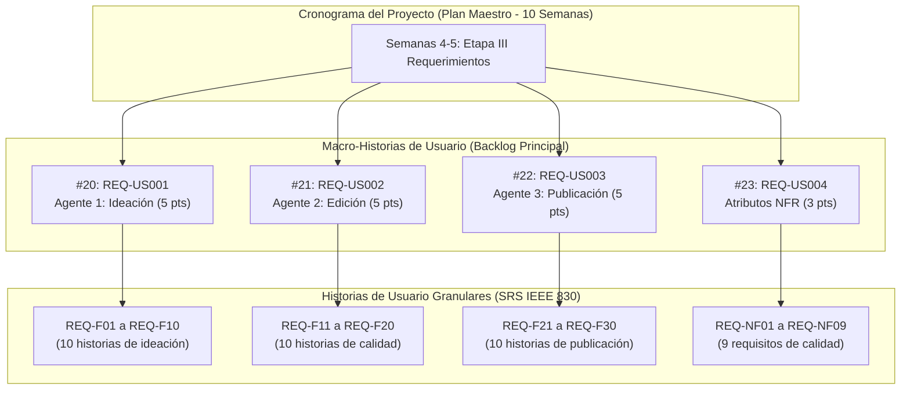

# Documento de Levantamiento y Especificación de Requerimientos de Software (SRS)

**Estándar:** IEEE Std 830-1998 (Revisión 1.0)  
**Proyecto:** Prueba de Concepto de un Sistema Multiagente (MAS) en Contenedores para la Optimización del Flujo de Contenido en ITY SAS  
**Autor:** Alvaro Felipe Lopez Russi  
**Institución:** Universidad Católica de Colombia — Facultad de Ingeniería  
**Organización Evaluada:** ITY SAS (Bogotá, Colombia)  
**Fecha de Publicación:** 15 de septiembre de 2026  
**Milestone Asociado:** `Etapa III - Requerimientos` (Semanas 4 a 5)  
**Macro-Historias del Cronograma:** `REQ-US001`, `REQ-US002`, `REQ-US003`, `REQ-US004`

---

## 1. Introducción y Propósito

### 1.1. Propósito del Documento
El presente documento constituye el contrato técnico formal de ingeniería de software entre **ITY SAS** y el equipo de investigación/desarrollo. Su propósito es definir de manera inequívoca, verificable, cuantitativa y trazable los requerimientos del sistema multiagente, garantizando que cada funcionalidad responda directamente a mitigar los cuellos de botella diagnosticados en el Objetivo Específico 1 (OE1).

### 1.2. Alcance del Producto
El software a desarrollar comprende una **arquitectura de microservicios contenerizados en Docker (14 servicios)** que automatiza la ingesta, enriquecimiento, validación creativa y preparación multicanal de contenidos digitales, manteniendo una compuerta de supervisión humana obligatoria (*Human-in-the-Loop - HITL*).

### 1.3. Articulación con los Cuellos de Botella Priorizados (ToC)
A partir del diagnóstico empírico realizado sobre $N=315$ piezas en ITY SAS, el SRS se enfoca en resolver las tres restricciones críticas endógenas:
- **Restricción $R_1$ (Bucle de Edición de Video, $IC=15/15$):** Probabilidad del 60% de rechazo interno en piezas audiovisuales. Atacado por el **Agente 2 (Control de Calidad y Edición)** mediante `REQ-F11` a `REQ-F20`.
- **Restricción $R_2$ (Ineficiencia en Ideación y Briefing, $IC=14/15$):** Brecha de 2.5 horas por concepto debido a briefs incompletos. Atacado por el **Agente 1 (Ideación y Estrategia)** mediante `REQ-F01` a `REQ-F10`.
- **Restricción $R_3$ (Adaptación Manual para Publicación, $IC=12/15$):** Pérdida de 1.8 horas por pieza reformateando copys para Instagram, TikTok, LinkedIn y X. Atacado por el **Agente 3 (Publicación Multicanal)** mediante `REQ-F21` a `REQ-F30`.

---

## 2. Metodología de Elicitación y Priorización

### 2.1. Dinámica de Taller Participativo y Planning Poker
Los requerimientos fueron consensuados y ponderados en un taller formal de dos horas celebrado en las instalaciones de ITY SAS con la participación del Líder de Operaciones, el Editor Creativo y el Investigador Principal (Anexo 11).

### 2.2. Dimensiones de Evaluación y Escala de Fibonacci
Cada requerimiento fue expresado bajo el formato estándar de **Historia de Usuario** y calificado en dos dimensiones:
- **Valor ($V$):** Impacto en la reducción de cuellos de botella y cumplimiento de objetivos (1, 2, 3, 5, 8, 13).
- **Complejidad ($C$):** Esfuerzo de implementación técnica o incertidumbre de integración (1, 2, 3, 5, 8, 13).
- **Prioridad MoSCoW:** Must Have (Crítico para PoC), Should Have (Importante no bloqueante), Could Have (Deseable) y Won't Have.

---

## 3. Catálogo Oficial de Historias de Usuario Funcionales (REQ-F01 a REQ-F30)

### 3.1. Épica Macro: Agente 1 — Ideación y Estrategia (Macro Issue `REQ-US001`)
*Objetivo Operativo: Reducir el tiempo de investigación y conceptualización de 2.5 h a menos de 5 minutos por lote.*

| ID | Nombre | Historia de Usuario | Criterio de Aceptación Cuantitativo | Prioridad | Story Points | Microservicio |
|:---:|:---|:---|:---|:---:|:---:|:---|
| **REQ-F01** | Consulta de tendencias activas | **Como** Community Manager, **quiero** consultar automáticamente las tendencias de TikTok e Instagram, **para** basar la ideación en temas actualizados y virales. | Reporte generado con antigüedad máxima de 6h y minería de top 20 audios/hashtags en $t < 5$ s. | **Must Have** | 5 pts | `tool-trends`, `tool-trending` |
| **REQ-F02** | Brief estructurado | **Como** Community Manager, **quiero** generar un borrador estructurado de brief desde formulario, **para** reducir el tiempo de redacción y evitar omisiones. | Generación de al menos 8 campos obligatorios conformes en $t < 5$ s. | **Must Have** | 5 pts | `agente_ideacion`, `tool-client` |
| **REQ-F03** | Validación semántica de brief | **Como** Líder de Proyecto, **quiero** que el sistema valide la coherencia del brief, **para** rechazar solicitudes con información contradictoria o incompleta. | Rechaza formalmente briefs con $>30\%$ de campos vacíos o inconsistencias lógicas en $t < 3$ s. | **Should Have** | 5 pts | `agente_ideacion`, `llm_gateway` |
| **REQ-F04** | Sugerencia de formato | **Como** Community Manager, **quiero** recibir una recomendación fundamentada de formato (Reel vs Post vs Carrusel), **para** optimizar el impacto según el canal. | Sugerencia justificada en 3 líneas contrastando histórico de marca en $t < 3$ s. | **Could Have** | 3 pts | `agente_ideacion` |
| **REQ-F05** | Rendimiento histórico de cuenta | **Como** Estratega de Marca, **quiero** consultar métricas históricas de rendimiento de la cuenta, **para** afinar los pilares de contenido del nuevo lote. | Resumen de métricas de engagement de los últimos 90 días en $t < 10$ s. | **Should Have** | 5 pts | `tool-rag`, `tool-client` |
| **REQ-F06** | Extracción de palabras clave | **Como** Community Manager, **quiero** extraer automáticamente las palabras clave del brief, **para** garantizar alineación semántica en la redacción. | Mapa semántico con 5 palabras clave de alto impacto entregado en $t < 5$ s. | **Should Have** | 3 pts | `agente_ideacion`, `llm_gateway` |
| **REQ-F07** | Alineación con tono de marca | **Como** Director de Marketing, **quiero** ser alertado si el concepto desvía la voz y tono de la marca, **para** proteger la identidad corporativa. | Alerta con explicación de discrepancia respecto al dossier de marca en $t < 5$ s. | **Could Have** | 3 pts | `tool-rag`, `agente_ideacion` |
| **REQ-F08** | Recuperación de referentes | **Como** Creativo Audiovisual, **quiero** recibir ejemplos visuales exitosos de la industria, **para** acelerar el guion gráfico y la preproducción. | Búsqueda semántica RAG que recupera de 3 a 5 referentes visuales en $t < 30$ s. | **Should Have** | 5 pts | `tool-competitors`, `tool-rag` |
| **REQ-F09** | Sugerencia de KPIs esperados | **Como** Líder de Cuenta, **quiero** recibir un rango estimado de alcance e interacciones, **para** fijar expectativas con los clientes corporativos. | Estimación cuantitativa fundamentada en benchmarks históricos del sector en $t < 5$ s. | **Could Have** | 2 pts | `agente_ideacion` |
| **REQ-F10** | Retroalimentación humana (HITL) | **Como** Community Manager, **quiero** editar, aprobar o descartar ideas en el backoffice, **para** mantener el criterio editorial humano. | Interfaz con modal de edición, regeneración y confirmación en tiempo real en la SPA. | **Must Have** | 5 pts | `frontend`, `orchestrator` |

---

### 3.2. Épica Macro: Agente 2 — Control de Calidad y Edición Asistida (Macro Issue `REQ-US002`)
*Objetivo Operativo: Mitigar el cuello $R_1$, reduciendo la probabilidad de rechazo de 0.60 a 0.10 y el retrabajo en 92%.*

| ID | Nombre | Historia de Usuario | Criterio de Aceptación Cuantitativo | Prioridad | Story Points | Microservicio |
|:---:|:---|:---|:---|:---:|:---:|:---|
| **REQ-F11** | Validación técnica de video | **Como** Editor Audiovisual, **quiero** verificar automáticamente relación de aspecto, duración y niveles de audio, **para** exportar solo material conforme. | Reporte técnico (9:16, audio entre $-16$ y $-12$ LUFS según ITU-R BS.1770) en $t < 30$ s. | **Must Have** | 8 pts | `tool-client`, `agente_ideacion` |
| **REQ-F12** | Límite forzoso de revisiones | **Como** Líder de Proyecto, **quiero** que el sistema bloquee preventivamente la exportación en versión v3, **para** evitar bucles infinitos de correcciones. | Bloqueo automático en v3 y escalación inmediata de alerta al Director Creativo. | **Must Have** | 5 pts | `orchestrator`, `frontend` |
| **REQ-F13** | Rough cut automático | **Como** Editor Audiovisual, **quiero** recibir una pre-edición estructurada del video en esquema JSON, **para** reducir tareas de ensamble manual. | Estructuración que reduce el tiempo de corte inicial en al menos un 40%. | **Should Have** | 8 pts | `agente_ideacion` |
| **REQ-F14** | Historial de retrabajo de editor | **Como** Director de Producción, **quiero** auditar los motivos de reproceso por editor, **para** identificar cuellos de botella en la formación técnica. | Tablero con gráfico de dispersión y causas raíz acumuladas en los últimos 90 días. | **Should Have** | 3 pts | `frontend`, `orchestrator` |
| **REQ-F15** | Subtítulos automáticos ASR | **Como** Editor Audiovisual, **quiero** generar subtítulos sincronizados automáticamente, **para** optimizar el consumo de video sin audio. | Archivo SRT generado con precisión léxica $\ge 95\%$ en $t < 2$ min para videos de 60 s. | **Must Have** | 5 pts | `tool-client`, `llm_gateway` |
| **REQ-F16** | Análisis del ritmo de edición | **Como** Editor Creativo, **quiero** recibir alertas sobre la cadencia de corte en Reels, **para** evitar piezas monótonas que pierdan retención. | Alerta visual si la frecuencia de corte es inferior a 1 corte cada 3 s. | **Could Have** | 3 pts | `agente_ideacion` |
| **REQ-F17** | Generación de proxy liviano | **Como** Director de Cuentas, **quiero** previsualizar una copia liviana a 720p en la nube, **para** revisar avances sin descargar archivos pesados. | Proxy codificado y alojado con URL firmada accesible en $t < 30$ s. | **Could Have** | 5 pts | `tool-client` |
| **REQ-F18** | Corrección de color por histograma | **Como** Colorista / Editor, **quiero** sugerencias de etalonaje y valores LUT, **para** unificar la temperatura visual de las piezas. | Recomendaciones numéricas de balance de blancos y LUTs sugeridos en $t < 5$ s. | **Should Have** | 3 pts | `agente_ideacion` |
| **REQ-F19** | Notificación por mensajería | **Como** Editor Audiovisual, **quiero** recibir alertas en Slack o WhatsApp al concluir una validación, **para** no esperar frente a la pantalla. | Despacho de webhook con resumen de aprobación en $t < 2$ s tras validación técnica. | **Should Have** | 3 pts | `orchestrator` |
| **REQ-F20** | Estimación de tiempo restante | **Como** Líder de Proyecto, **quiero** visualizar el tiempo restante estimado de procesamiento, **para** gestionar los compromisos con clientes. | Cálculo proyectado con margen de error $<20\%$ actualizado en tiempo real. | **Could Have** | 2 pts | `frontend`, `orchestrator` |

---

### 3.3. Épica Macro: Agente 3 — Publicación Multicanal y Scheduling (Macro Issue `REQ-US003`)
*Objetivo Operativo: Mitigar el cuello $R_3$, reduciendo el tiempo de formateo y publicación multicanal de 1.8 horas a menos de 3 minutos.*

| ID | Nombre | Historia de Usuario | Criterio de Aceptación Cuantitativo | Prioridad | Story Points | Microservicio |
|:---:|:---|:---|:---|:---:|:---:|:---|
| **REQ-F21** | Adaptación de relación de aspecto | **Como** Community Manager, **quiero** adaptar contenidos a proporciones 1:1, 9:16 y 16:9, **para** cumplir especificaciones de cada red social. | Recorte y adaptación inteligente a resolución $\ge 1080 \times 1080$ en $t < 10$ s. | **Must Have** | 5 pts | `agente_publicacion` |
| **REQ-F22** | Generación de copy por canal | **Como** Community Manager, **quiero** copys adaptados al tono y estilo de Instagram, TikTok, LinkedIn y X, **para** no redactar 4 variantes manuales. | Generación de 4 textos diferenciados y contextualizados en $t < 5$ s. | **Must Have** | 8 pts | `agente_publicacion`, `llm_gateway` |
| **REQ-F23** | Integración con scheduling (Postiz) | **Como** Community Manager, **quiero** despachar publicaciones hacia la API de Postiz en un clic, **para** programar la difusión sin usar interfaces externas. | Conexión con Postiz API (:4007) y confirmación con ID externo en $t < 3$ s. | **Must Have** | 8 pts | `tool-postiz`, `agente_publicacion` |
| **REQ-F24** | Previsualización en dispositivo | **Como** Community Manager, **quiero** previsualizar el post tal como se verá en móvil y escritorio, **para** validar cortes de texto y diseño. | Renderizado interactivo en la SPA en $t < 5$ s. | **Should Have** | 5 pts | `frontend` |
| **REQ-F25** | Generación inteligente de hashtags | **Como** Estratega de Social Media, **quiero** una lista de hashtags clasificados por volumen y relevancia, **para** maximizar el alcance orgánico. | Sugerencia de 15 a 30 hashtags integrados al cuerpo del post en $t < 3$ s. | **Should Have** | 3 pts | `tool-trending`, `agente_publicacion` |
| **REQ-F26** | Recomendación de mejor horario | **Como** Community Manager, **quiero** recibir el horario óptimo de publicación para cada red, **para** programar en los picos de audiencia. | Horario sugerido con nivel de confianza ($>80\%$) basado en historial de marca. | **Could Have** | 3 pts | `tool-client`, `agente_publicacion` |
| **REQ-F27** | Generación de miniatura de portada | **Como** Creador de Contenido, **quiero** una carátula sugerida con tipografía gancho para LinkedIn y Reels, **para** captar la atención de inmediato. | Composición de carátula en formato JPG/PNG generada en $t < 5$ s. | **Could Have** | 5 pts | `agente_publicacion` |
| **REQ-F28** | Validación de límites de caracteres | **Como** Community Manager, **quiero** que el sistema impida textos que superen los topes de cada red, **para** evitar rechazos de publicación. | Validación estricta en tiempo real (ej. TikTok 150 caracteres, X 280 caracteres). | **Must Have** | 3 pts | `agente_publicacion` |
| **REQ-F29** | Informe consolidado de entrega | **Como** Líder de Proyecto, **quiero** descargar la bitácora consolidada de cada campaña, **para** certificar el cumplimiento ante el cliente. | Exportación en PDF y JSON con hashes de trazabilidad en $t < 10$ s. | **Should Have** | 5 pts | `frontend`, `orchestrator` |
| **REQ-F30** | Tolerancia a fallos y reintentos | **Como** Administrador de Sistemas, **quiero** reintentos automáticos ante caídas de red, **para** no perder despachos programados. | Hasta 3 reintentos automáticos con backoff exponencial y registro en log. | **Must Have** | 5 pts | `common/events.py`, `tool-postiz` |

---

## 4. Matriz de Requisitos No Funcionales (REQ-NF01 a REQ-NF09)
*Macro Issue: `REQ-US004` (Semanas 4 a 5)*

| ID | Atributo | Requisito | Criterio de Aceptación Cuantitativo | Prioridad | Módulo / Infraestructura |
|:---:|:---|:---|:---|:---:|:---|
| **REQ-NF01** | Portabilidad | Contenedorización independiente | Cada microservicio empaquetado en Docker; imágenes base $\le 500$ MB (`python:3.11-slim`). | **Must Have** | `docker-compose.yml`, Dockerfiles |
| **REQ-NF02** | Rendimiento | Latencia entre microservicios | Percentil 95 ($P_{95}$) de latencia síncrona menor a 500 ms bajo carga nominal. | **Must Have** | Red interna `multiagent-net` |
| **REQ-NF03** | Disponibilidad | Disponibilidad de servicio | SLA del 99,5% en horario de oficina (8:00–18:00 COT) y 99,0% fuera de él. | **Should Have** | Docker healthchecks |
| **REQ-NF04** | Seguridad | Cifrado y gestión de secretos | Cifrado en reposo AES-256-GCM y gestión desacoplada de variables `.env` sin credenciales planas. | **Must Have** | `.env`, `docker-compose.yml` |
| **REQ-NF05** | Escalabilidad | Escalabilidad horizontal | Capacidad de escalar réplicas de inferencia y workers AMQP ante sobrecarga ($10\times$). | **Should Have** | RabbitMQ colas durables |
| **REQ-NF06** | Mantenibilidad | Auditoría y trazabilidad | Registro inmutable de eventos (`task_id`), retención de 90 días y búsqueda en $t < 2$ s. | **Should Have** | Redis TaskStore, `chat_history` |
| **REQ-NF07** | Fiabilidad | Modo contingencia y fallback | Conmutación automática a contingencia tras 3 fallos consecutivos usando caché Redis. | **Could Have** | `llm_gateway/resilience.py` |
| **REQ-NF08** | Eficiencia | Tiempo de arranque de servicios | Startup percentil 95 ($P_{95}$) menor a 15 segundos por contenedor. | **Should Have** | FastAPI / Uvicorn |
| **REQ-NF09** | Normativo | Cumplimiento Ley 1581 de 2012 | Cero almacenamiento de PII (nombres, correos o teléfonos) de audiencias finales. | **Must Have** | Políticas de esquema SQL |

---

## 5. Matriz de Trazabilidad: Cronograma ↔ Macro-Historias ↔ Historias Granulares

---

## 6. Registro de Cambios y Control de Versiones

| Versión | Fecha | Autor | Cambios Realizados | Aprobado Por |
|:---:|:---:|:---|:---|:---|
| **1.0** | 15/09/2026 | Alvaro Felipe Lopez Russi | Levantamiento inicial de requerimientos funcionales y no funcionales, validación MoSCoW en taller técnico con ITY SAS. | Director de Tesis / Stakeholders ITY SAS |
| **2.0** | 26/09/2026 | Alvaro Felipe Lopez Russi | Ajuste a arquitectura de 14 microservicios contenerizados y contratos OpenAPI. | Comité de Grado |
| **2.2** | 13/10/2026 | Alvaro Felipe Lopez Russi | Incorporación de estados de ciclo de vida, inmutabilidad HTTP 409 y sincronización pgvector. | Operaciones ITY SAS |
